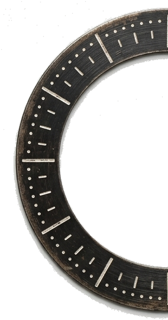
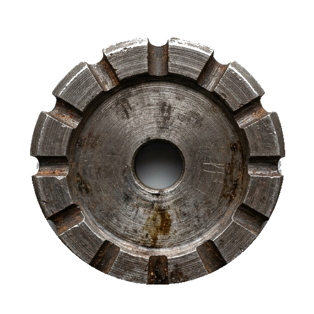
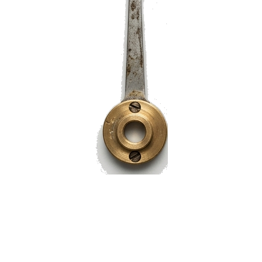

# ПАК СОВЕТСКОЙ АНАЛОГОВОЙ ФУРНИТУРЫ (СССР)
### Для аудиоплагинов (HamloComp, HamloZastava, VST/Web GUI)

В этом паке собраны аутентичные элементы советской приборной панели: грубая точёная сталь со ржавчиной, сколотый чугун, бакелит с насечками, тумблеры типа ТП1-2, карболитовые кнопки и рубиновые индикаторные лампы.

---

## 📁 Структура папки

```text
soviet_hardware_pack/
├── index.html                      # Интерактивный полигон/тестер (можно крутить, щёлкать тумблеры, нажимать кнопки)
├── README.md                       # Эта инструкция
├── knobs/                          # ОСНОВАНИЯ РУЧЕК С НАСЕЧКАМИ (512x512 PNG, чистый альфа-канал)
│   ├── knob_lathe_steel_rust.png       - Точёная сталь с фрезерованными прямоугольными насечками и ржавчиной
│   ├── knob_chipped_iron_dark.png      - Воронёный чугун с ромбической накаткой (diamond knurling) и сколами
│   ├── knob_bakelite_ribbed.png        - Карболитовый/бакелитовый диск с глубокими рёбрами под пальцы
│   └── knob_aluminum_brass_insert.png  - Дюралюминий с круговой насечкой по ободу и латунным сердечником
│
├── pointers/                       # СТРЕЛКИ / УКАЗАТЕЛИ (512x512 PNG, прозрачный фон)
│   ├── pointer_white_enamel.png        - Белая эмалированная стрелка с треугольным остриём
│   ├── pointer_red_tip_brass_collar.png - Латунная стрелка с ярко-красным советским маркером
│   ├── pointer_brass_wedge.png         - Массивная клиновидная стрелка с бронзовой гайкой
│   └── pointer_black_instrument.png    - Тонкая прецизионная приборная стрелка
│
├── scales/                         # ШКАЛЫ (512x512 PNG)
│   └── scale_arc_ticks.png             - Круговая аналоговая разметка с делениями и цифрами
│
├── switches/                       # ТУМБЛЕРЫ СССР ТП1-2 (PNG с чистым прозрачным фоном)
│   ├── toggle_switch_up.png            - В верхнем положении UP (на нижней планке штамп DOWN)
│   ├── toggle_switch_neutral.png       - В среднем положении
│   └── toggle_switch_down.png          - В нижнем положении DOWN (на верхней планке штамп UP)
│
└── buttons_and_lamps/              # КНОПКИ И ЛАМПЫ (512x512 PNG)
    ├── button_soviet_on_off_red.png    - Нажимная красная кнопка с накаткой и штампом ВКЛ / ВЫКЛ
    ├── lamp_panel_red_off.png          - Рубиновый гранёный плафон лампы (ВЫКЛЮЧЕН)
    └── lamp_panel_red_on.png           - Светящийся рубиновый индикатор с ореолом (ВКЛЮЧЕН)
```

---

## ⚙️ Правило сопряжения «Крутилка + Стрелка»

Все крутилки и стрелки имеют **разрешение 512×512** с **идеальным геометрическим центром на `(256, 256)` (то есть ровно `50% 50%`)**.
Стрелка в исходном файле указывает строго на **12 часов (0°)**.

### Пример HTML:
```html
<div class="soviet-knob-container">
  <!-- Неподвижная шкала (опционально) -->
  

  <!-- Основание крутилки (может быть статичным или вращаться вместе) -->
  

  <!-- Стрелка-указатель (вращается) -->
  
</div>
```

### Пример CSS:
```css
.soviet-knob-container {
  position: relative;
  width: 140px;
  height: 140px;
  user-select: none;
}

.knob-layer {
  position: absolute;
  top: 0;
  left: 0;
  width: 100%;
  height: 100%;
  pointer-events: none;
}

/* Ключевое правило: ось вращения строго по центру 50% 50% */
.knob-pointer, .knob-body {
  transform-origin: 50% 50%;
  will-change: transform;
}
```

### Пример JS (вращение от -140° до +140°):
```javascript
function setKnobValue(normalizedValue) { // 0.0 ... 1.0
  const angle = -140 + normalizedValue * 280;
  const pointer = document.getElementById('knob-pointer');
  const body = document.getElementById('knob-body');
  
  // Можно вращать только стрелку или стрелку вместе с телом ручки:
  pointer.style.transform = `rotate(${angle}deg)`;
  body.style.transform = `rotate(${angle * 0.7}deg)`; // лёгкий эффект текстуры металла
}
```

---

## 💡 Тумблеры и Индикаторы

- **Тумблер:** Переключайте `src` между `switches/toggle_switch_up.png` и `switches/toggle_switch_down.png`.
- **Индикатор питания:** Переключайте `src` между `buttons_and_lamps/lamp_panel_red_off.png` и `buttons_and_lamps/lamp_panel_red_on.png` (при включении можно добавить легкий CSS glow `filter: drop-shadow(0 0 10px rgba(255, 60, 40, 0.7));`).
- **Кнопка ВКЛ/ВЫКЛ:** При нажатии (mousedown / active) применяйте `transform: scale(0.96); filter: brightness(0.9);`.

---
*Сделано для HamloComp / HamloZastava и советской линейки плагинов.*
