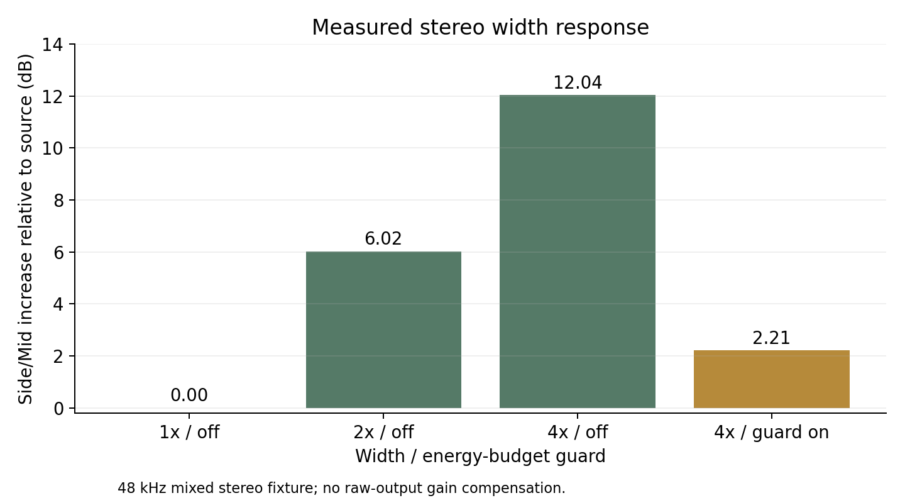
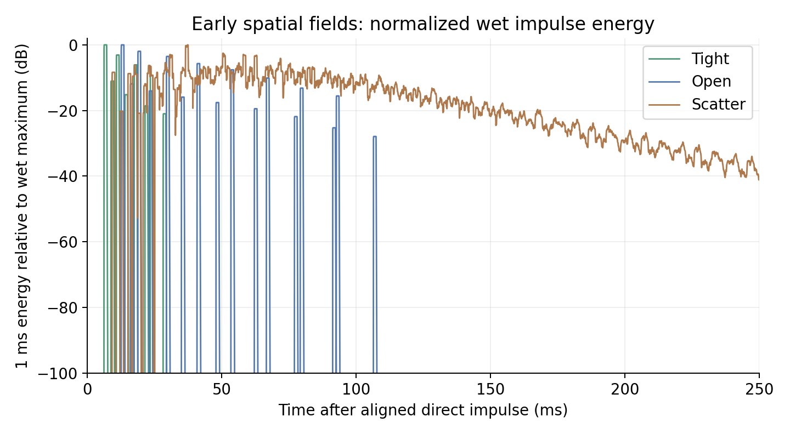

# S2: stereo and early-space prototypes

Completed 2026-11-02, following S1 commit `5ba304c`. This is an offline DSP
checkpoint. The production plug-in remains version 0.1.0/S1, with the same
validated binary. These features are not yet available in the VST3 editor.

Final result: **181/181 assertions over 58 render cases**, four provenance fault
tests, 115 native Legacy expectations and 160 byte-identical M0 renders. There
are no failed S2 numeric criteria in the final experiment. This does not certify
the remaining movement, binaural, UI, preset or release requirements.

## Implemented prototype

`SpatialPrototype` is compiled only into the standalone spatial lab/demo tools.
It provides width 0..4, three complementary spectral width bands, fourth-order
mono-bass filtering, an optional energy-budget guard and its attenuation meter.
The guard defaults off and is independent of the artistic width setting.

Mono-to-stereo choices are Phase (windowed FIR quadrature), Micro (a difference
of short Mid delays) and Diffuse (cascaded delay allpasses). Generated Side joins
source Side before spectral/global width, mono-bass and the guard. Source Mid
is retained. Space then adds the separate Tight, Open or Scatter reflection
field, with amount, size, depth, damping and predelay. These are our tap structures
and parameterization using published mathematics; references are in
[S2_METHODS.md](../../S2_METHODS.md).

Histories allocate in prepare. Continuous macros and mode weights advance per
sample. Initial settings apply immediately before the first sample; subsequent
edits use 30 ms ramps. The common reference delay is 58/64/128 samples at
44.1/48/96 kHz. This is a prototype alignment decision, not a new host PDC value.

## Measurements

Targets, stimuli, windows and disclosures are in S2_METHODS.md. Final paired
results are `before_v4.json` and `final_v4.json`; raw inputs/renders and identity
bindings are preserved locally under `out/s2/before_v4` and `out/s2/final_v4`.
Both roles use the same final driver/analyzer/method. The dry baseline has
129 passes and nine feature groups marked n/a. All original 86 baseline input/
output PCM files remain byte-identical to the first pre-implementation run.
All 58 final paired input files match.

| Goal | Final evidence |
|---|---|
| P01: exact aligned dry | Neutral and disabled/extreme settings match at all three rates |
| P02: predictable width | 2x: +6.020600 dB; 4x: +12.041200 dB Side/Mid, guard off. All three generated Sides also gain +6.020600 dB at 2x |
| P03: mono behavior | Width0 produces identical channels including each generator; tested Space-off mono-fold errors meet -130 dBFS RMS |
| P04: distinct generators | Side/Mid: Phase -3.4996, Micro -6.4532, Diffuse -5.3885 dB. Largest absolute pair Side correlation 0.2191 |
| P05: mono bass | 150 Hz control attenuates 60 Hz source/generated Side by about 31.839 dB; source-Side 1 kHz loss below 0.000002 dB |
| P06: spectral width | Muting the low band reduces 60 Hz Side about 14.321 dB, including generated Side; 8 kHz source-Side loss 0.1773 dB |
| P07: visible guard | Off intervention is unity. Both requested stationary energy budgets and attenuation readings meet the 0.5 dB tolerance |
| P08: predelay | All six measured first wet arrivals exactly match the expected sample index at 44.1/48/96 kHz, with 0/23 ms additional delay |
| P09: distinct spatial fields | Wet energy centroids Tight/Open/Scatter: 10.655/27.054/65.043 ms; largest absolute tail pair correlation 0.01780 |
| P10: finite, bounded tails | All 58 cases finite, including 30 s maximum-setting stress; all three fields meet the mono-energy and post-3 s tail limits |
| P11: deterministic real-time path | Blocks 1/64/127/512/4096 are byte-identical at the same events; zero audited C++ allocations in every process callback |
| P12: callback performance | Three 48 kHz/256 runs average 2.5423%, 2.5543%, 2.6994% of a block period on Intel i5-10300H; target <=25% |
| P13: Legacy unchanged | 115/115 native expectations; 160/160 M0 cases; original production sources/10-unit closure and validated DLL hash unchanged |

Largest measured callback fractions in the three controlled CPU runs were
5.54%, 16.20% and 7.39%. These are wall-time measurements of the offline prototype,
not total computer CPU usage or a host scheduling guarantee. The CPU fixture is
the fixed P12 case; P10 additionally exercises maximum spectral band gains.
Extremely small residual tails reported near the analyzer floor are not claims
of physical measurement precision.
P10 tail jobs use a 100 ms noise burst; the initial methods table called this an
impulse tail, while its measurement column specified tail stress. The actual
burst stimulus and energy test are unchanged in every before/after pair.
Isolated impulses are used separately for P08 timing and P09 field shape.

## Failures and method changes retained

1. The initial aligned-dry baseline (`before.json`) passed 99 checks, with nine
   unavailable feature groups. Candidate01 then passed 138 and failed initial
   Width0 equality: a ramp from neutral preserved Side during startup. Applying
   pre-playback settings immediately fixed it; Candidate02 passed 139. No limit,
   fixture or window was relaxed. Failed source and renders are retained.
2. A later provenance rerun restored a baseline file with an old timestamp.
   MSBuild reused its object while rebuilding the lab driver. The invalid mixed
   run is preserved as `final_mixed.json`. Fresh restore timestamps, identity
   dependencies in both translation units and their runtime comparison prevent
   silent acceptance. The analyzer also requires explicit `--baseline` for an
   unimplemented reference. The corrected v3 pair passed 139 checks.
3. The routing audit found an omitted combination: generated Side was added
   after width/bands/mono-bass, so those controls only governed original Side.
   Before changing DSP, coverage grew by 15 cases and 12 assertions, keeping the
   original 43 cases and all numeric limits. `routing_failed_v4.json` records
   169 passes and all 12 expected failures across the three generators.
   Generation now precedes the stereo controls. The same extended method yields
   181/181 in the final v4 candidate. The failed source is hash-checked by the
   acceptance audit. Both final experiment roles and all A/Bs were regenerated.

`guard_tests.json` records four negative tests: mismatched DSP identity,
unimplemented candidate, corrupt cached PCM and actual mixed C++ translation
units. All are rejected. Identity bindings include DSP, header, driver, analyzer,
method, manifest and raw file hashes. Demo caches additionally bind material,
extracted input, demo tool and executable; verified resume works for all groups.

## Owner-material A/Bs

40 float-WAV demonstrations: ten scenes each for vocal_lead1, keys, drumbus1 and
synth. Compare `dry`, `width2`, `phase`, `micro`, `diffuse`, `tight`, `open`,
`scatter`, `phase_open`, `diffuse_scatter` in `E:/HamloShirota/out/s2/listen`.
The dry file has the same reference delay as its processed counterparts.

Select the highest-energy five-second region at 48 kHz, prepare to -18 dBFS RMS
subject to a -6 dBFS sample-peak cap, and append 2.5 s for the field to finish.
Each material group shares one output gain across all ten scenes. All four groups
needed 0 dB additional gain; worst prepared 8x reconstruction peak estimate is
**-1.5477 dBTP**, below the -1 dBTP criterion. Raw peaks and preparation gains
are retained in `demos.json`. The original material is read-only. No owner
headphone listening result or perceptual front/back acceptance is claimed.

## Limits and next stage

- No timed paths, binaural renderer, HRTF dataset, QUICK/full editor, new host
  parameters, genre presets, installer or V2 release yet. AKG K712 is the owner's
  listening reference, not a personalized HRTF or headphone correction.
- Size/predelay automation moves delay reads and can produce pitch modulation.
  Mono-bass coefficient changes are immediate. Integration requires explicit
  transition/click policies and tests for these controls.
- Guard is an approximate stationary Mid/Side energy budget. It does not ensure
  a correlation floor in every short window or after the separate Space field.
- Mono-fold conservation applies to Space-off stereo processing. Added spatial
  wet energy has its own measured bounds. Width0 applies to the stereo section;
  an enabled spatial field can still create stereo reflections.
- Shipping latency/routing, mono-to-stereo bus support, old-state migration with
  new parameters and host automation await integration. S1's original bypass/
  mix block dependency remains confined to Legacy.

Production VST3 SHA256 remains
`ff712038bf196a3f75077ca2ed5545e43c334ba0c3ca20a77e77669a10ffb3a1`.
S1 pluginval5..10 and Steinberg537/537 results apply to this unchanged binary;
they were not rerun for the offline prototypes. Version remains0.1.0.

Reproduction commands and the S3 handoff are in `docs/NEXT_STAGE.md`.
`acceptance.json` binds final evidence, tool binaries and demonstration hashes.
