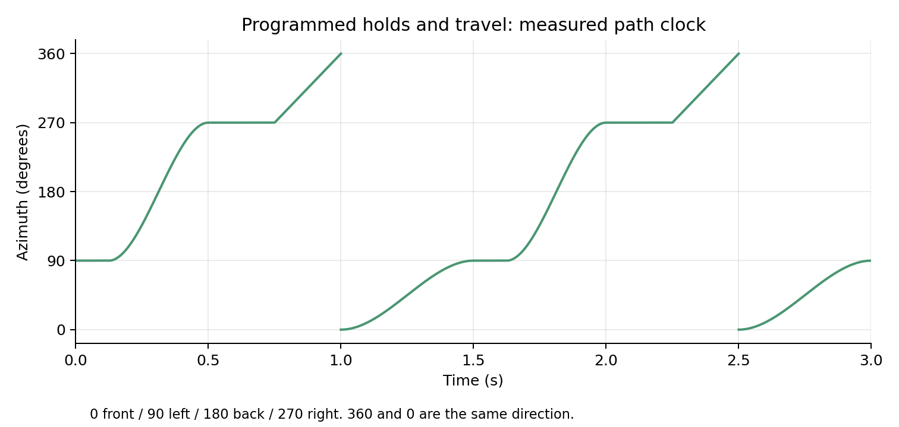
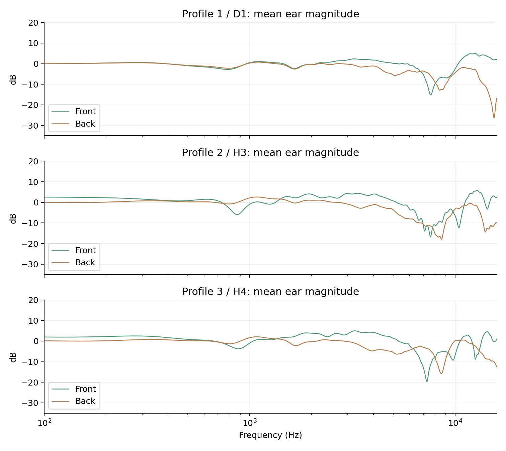

# S3: timed paths and horizontal binaural rendering

Completed2026-11-02 after S2 commit2b7ff77. **211/211 assertions,67 render cases,
five provenance rejection tests and68owner-material auditions.** This is an
offline prototype checkpoint. Production VST3 remains0.1.0/S1; no new plug-in,
interface, preset library or installer is released by this stage.

## Behavior and data

Own `MotionClock` implements up to16nodes, each with hold then travel, milliseconds
or quarter-note beats, linear/smoothstep curves, shortest/clockwise/counterclockwise
arcs, looping/nonlooping, reset and sample-positioned tempo changes. Directed
travel to the same azimuth makes a full turn. Fractional phase carries across
segments, avoiding repeated rounding of durations. All-zero paths safely hold.

Azimuth0front,+90left,180back,270right; positive angles move counterclockwise
viewed from above. Stereo uses a constant-power pan matrix and independent
channel balance. Spread preserves separate L/R emitters at center+/-spread/2;
Point explicitly uses Mid. Neutral Stereo center0/spread180 is exact aligned dry.
Point center preserves the power of a duplicated mono input; channel balance
attenuates the opposite output without boosting the chosen side.

Binaural uses three horizontal SADIE II profiles, with our own interpolation,
convolution, transitions and path code. No commercial renderer is copied.

| Listening label | File prefix | Upstream subject |
|---|---|---|
| Profile1 | profile0 | D1 |
| Profile2 | profile1 | H3 |
| Profile3 | profile2 | H4 |

The pinned source is [SADIE II v2-1](https://zenodo.org/records/10886409).
Its exact Apache2.0 license and attribution are retained in `Assets/Hrtf`.
The source SOFA filters were already low-frequency extended, diffuse-field
equalized and windowed upstream. We select every5degrees on the horizontal
plane, keep all native256/256/512taps at44.1/48/96kHz, apply one common gain per
subject and pack float32. Data.Delay is zero; there is no tail truncation,
resampling, minimum-phase conversion, room response or headphone correction.
Where the database repeats a direction, select its first regular-grid entry.
Archive/SOFA hashes, indices, gains and embedded copyright are in manifest.json.
Copyright2018 University of York; original authors Cal Armstrong, Lewis Thresh,
Gavin Kearney. See NOTICE.md and LICENSE-SADIE-II.txt for full provenance.

Native prepared bank size1,769,516bytes. The C++ prepare path verifies SHA256
before parsing; the lab checks matching compiled identities in both translation
units before creating an output directory. No data file is read in process().

## Evidence

Targets and complete method disclosures: [S3_METHODS.md](../../S3_METHODS.md).
Final before/after use the same final driver, analyzer, methods and bank.
Baseline `before_final.json`:155passes,4unimplemented groups n/a. Candidate
`final.json`:211passes,0failures,0n/a. Preserve raw outputs/inputs/traces under
out/s3/before_final and out/s3/final, plus source/executable snapshots.
All original60baseline cases' audio/traces remain byte-identical after the
coverage extension; all67final paired input files match.

| Goal | Result |
|---|---|
| M01 aligned identity | Neutral/disabled mono/stereo at all three rates exactly match delayed input |
| M02 path accuracy | Twelve trace cases match the independent analytic cumulative-time oracle; maximum angular error1.011e-9degrees, boundary labels within1sample |
| M03 real-time determinism | Identical event audio across blocks1/64/127/512/4096; zero audited process/setter allocations throughout |
| M04 routing | Point pan power within0.01dB; side separation>=100dB; balance and antiphase Point cancellation correct; Spread retains antiphase stereo. All six isolated binaural emitter convolutions pass-90dB relative RMS error |
| M05 convolution/ear order | Seventeen point/filter cases pass-90dB, including intermediate2.5degrees and44.1/96k. Measured left sources lead the right ear by35..39samples; right sources reverse the ordering. High-band ILD sign matches direction |
| M06 native filter fidelity | Minimum retained energy0.9999999459; worst magnitude difference0.000022947dB over defined100Hz..16kHz band after undoing profile gain |
| M07 transitions | Exact20ms enable/disable ramp versus frozen wet/dry:-172.56dB relative RMS error. Profile/position event residual0.20535 versus bound0.24768. Worst adjacent angular boundary step0.001790dB versus0.5dB limit |
| M08 stress | Five minutes /14,400,000frames, rapid settings and NaN/Inf control targets, zero paths: finite, zero allocations, peak0.448713 versus prepared-kernel L1bound3.158691 |
| M09 mean performance | Three48k/256runs:12.7373%,13.1601%,11.5869%of a block period on i5-10300H; each passes25%mean target. See outliers below |
| M10 compatibility/provenance | Fresh115/115native Legacy expectations and160/160byte-identical M0cases. S2 sources/evidence and S1 production DLL unchanged. All five fault tests reject invalid data/runs |
| M11 auditions | Four input groups x17scenes=68WAVs, all<=-1dBTP(8x estimate); verified source-pinned resume |

Exact/near-exact impulse comparisons sometimes reach the analyzer's-300dB floor;
that is a numerical floor, not a physical precision claim. Ear-order/filter
measurements do not establish individually perceived front/back location.

## Performance limits

Mean callback cost passes the recorded M09target. However the largest measured
wall-time callbacks were2.2734x,8.5823x and0.9816x a block period, approximately
12.12/45.77/5.24ms. The standalone offline process is not a host deadline test.
These outliers remain disclosed; their cause has not been established. Investigate
thread scheduling versus processing work, and measure combined S2/S3 processing
in the actual VST/host before release. Do not infer deadline safety from mean
cost or silently omit outliers. No performance criterion was relaxed.

## Experiment history and protection

Before the first laboratory run, H10's source grid failed the exporter's5degree
measurement requirement; selected H4 instead of inventing missing measurements.
The first audio pair passed141/4n-a and190/190. A coverage audit added six
isolated left/right emitter impulses and one enable/disable tone; old60jobs and
all thresholds remained. Repeated both roles with the extended tool, and
regenerated every audition using the final DSP/method/data identity. DSP source
itself did not change between the first and extended candidate.

No failed S3audio case or relaxed limit is concealed. The native fault probe
intentionally links a stale object and is excluded from normal builds. One
probe-source preparation command initially failed shell quoting and consequently
its CMake build failed for a missing file; corrected source creation and rebuilt.
It did not change DSP/methods or produce an accepted audio result.

`guard_tests.json` proves rejection of corrupt bank data, mixed translation units,
stale data/method identity, an unimplemented candidate and modified cached PCM.
Raw audio/traces, manifest, stress and benchmark records bind to source hashes.
Demo caches additionally bind original/extracted material, tool and executable.
Interrupted demo attempts remain separate; only completed verified groups resume.

## Listening files and remaining work

Local WAVs: `E:/HamloShirota/out/s3/listen`. For each vocal_lead1,keys,drumbus1,synth:
dry; each profile at0/90/180/270degrees; each profile moving around the head;
and spread_orbit, which retains two emitters. Files labeled profile0/1/2 map to
Profile1/2/3 above. Orbit runs counterclockwise from front over4seconds.

Highest-energy5second source excerpt at48k, prepared to-18dBFS RMS subject to a
-6dBFS sample-peak cap, followed by0.25s tail. One common gain per material group
keeps comparisons consistent: vocal-1.7320dB, keys0dB, drumbus-2.4359dB, synth0dB.
Worst prepared peak-1.00999954dBTP; raw outputs/gains remain available. Binaural
Spread uses1/sqrt(2)per emitter, Point uses Mid; correlated stereo emitters can
sum coherently. No hidden raw-output level compensation is applied.

Owner listening on AKG K712 is pending. The three measured profiles are audition
options, not a personalized calibration or a promise of externalized/backward
perception. Rendering is horizontal only, with no vertical or head tracking.

Clock commands are sample-exact; speaker/FIR targets update every16samples and
interpolate over the next16. Manual/profile/source/renderer/enable controls use
20ms ramps. Acoustic behavior includes that interpolation and the HRIR group
delay. Dry reference delay128/128/256samples is for this prototype only.

Next integrate S2/S3 with precise STEREO/SPACE/MOTION and QUICK, resolve combined
PDC/transitions and state migration, preserve original12parameter/7program/state
contract in Legacy, add200genre programs, test/validate/inspect UI, owner FL
audition and package. S2 size/predelay automation and mono-bass coefficient
transitions still require integration policies. No installer or version bump yet.
Production SHA256 remains
`ff712038bf196a3f75077ca2ed5545e43c334ba0c3ca20a77e77669a10ffb3a1`.
S1 validator results apply to that unchanged binary; no new host validator claim.
