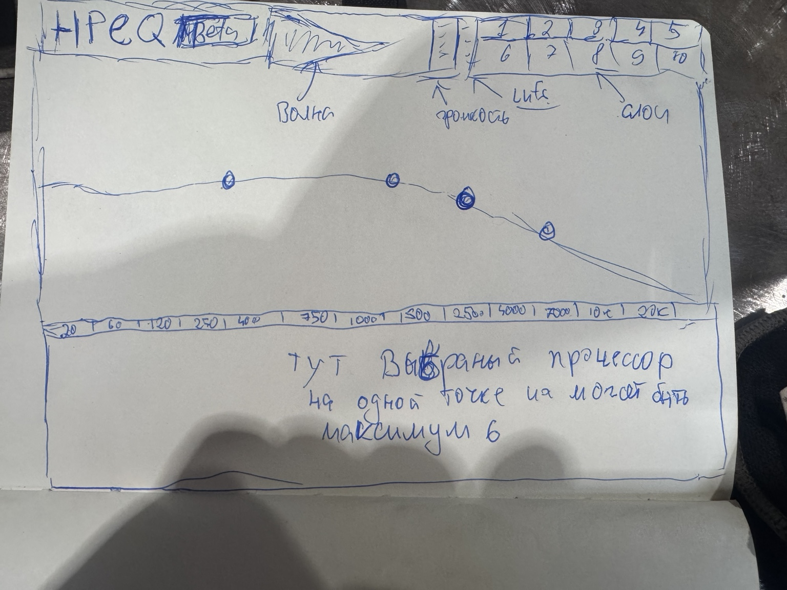
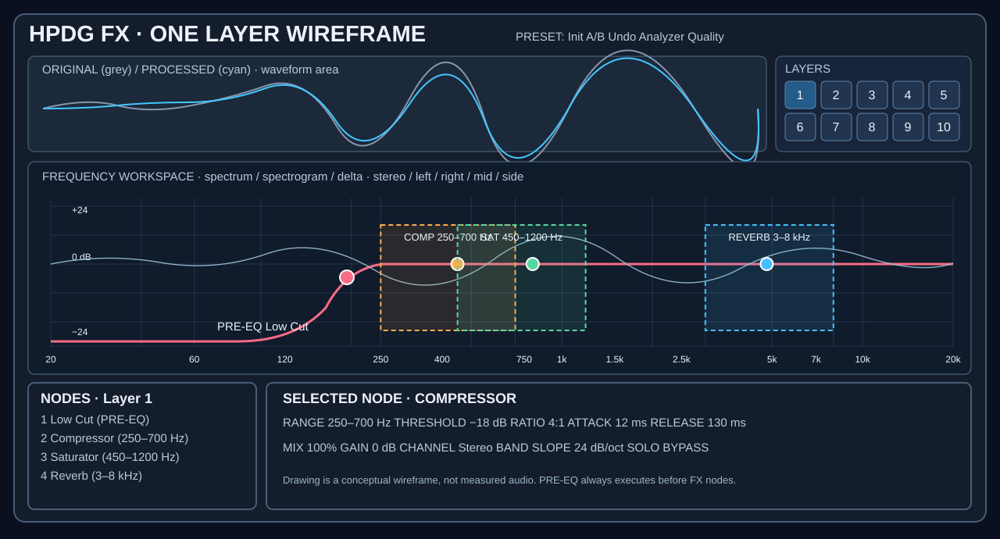
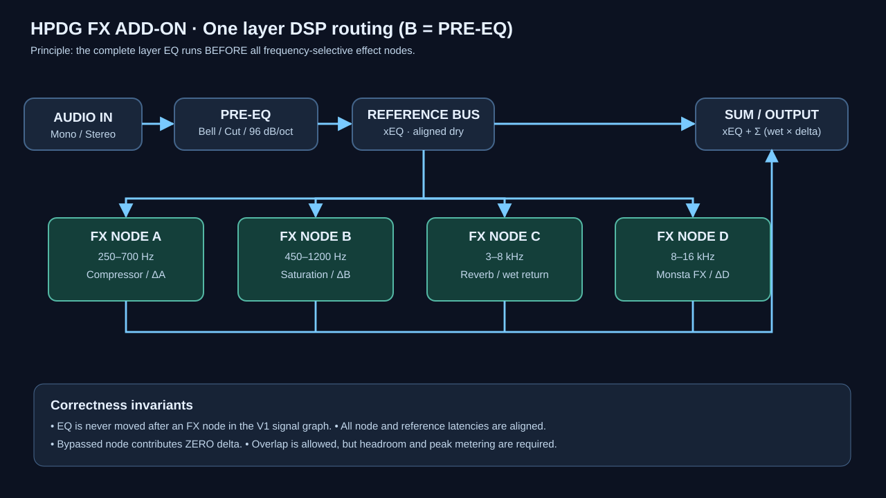

# HPDG FX ADD-ON — научно-техническое исследование и архитектура

**Статус:** проектирование / технические гипотезы, не реализация. **Дата:** 2026-10-21. **Рабочее имя:** `HPDG FX Add-on` / `HPEQ` (название НЕ утверждено). **Основной репозиторий:** https://github.com/Hamec01/HPDG . **Область:** отдельный VST3 **audio effect**, а НЕ MIDI-генератор и НЕ включение скрытого Sound Module в существующем HPDG.

> **Зафиксированное решение заказчика B:** **каждый Layer сначала выполняет PRE-EQ над своим входным аудио, затем подаёт полученный сигнал на все FX Nodes.** Никакой пользовательской перестановки Pre-EQ после FX в V1. Все графические точки EQ, включая Low Cut, Shelf, Bell, Notch, работают в PRE-EQ, даже если визуально находятся на одном спектральном поле с FX-точками. Отдельный FX Node может иметь фильтр для выделения своего диапазона; это не замена PRE-EQ.







## 0. Короткий научный вывод

Плагин осуществим на JUCE/C++ при условии, что разработка **не** начинается с интерфейса или безоговорочного переноса DSP из HPDG. Центральная техническая задача — одновременно обеспечить: **(1)** корректную обработку произвольных и перекрывающихся частотных регионов, **(2)** предсказуемое сложение сухого/обработанного сигналов с учётом фаз и задержек, **(3)** безопасную работу без аллокаций в аудиопотоке, **(4)** возможность 10 Layers, **(5)** качественные крутые EQ-фильтры, включая 96 dB/oct, **(6)** достоверную визуализацию до/после. Реальные измерения важнее красивой кривой на экране.

**Новая ценность не в самом наличии мультибенда:** Pro-MB, Pro-Q 4 и Multipass уже решают отдельные части этой задачи. Продуктовая ставка — единое спектральное поле с графическими EQ/FX-точками, произвольными пересекающимися регионами, до 10 слоями, честным осциллографом Input/Output и контролируемой Delta-композицией.

## 1. Подтверждённое исследование существующего HPDG

Исследован **живой `main`** GitHub на дату документа. Архив `Source.zip` из материалов проекта является **старой мартовской копией**; использовать его как актуальное состояние нельзя.

| Компонент | Файл `main` | Наблюдение | Решение для аддона |
|---|---|---|---|
| Звуковые состояния | `Source/Core/SoundLayerState.h` | `EqState`: 7 полос, 3 формы; Compressor, Reverb, Transient, Stereo, Monsta | Извлечь **структуру идей**, не копировать глобальное состояние проекта |
| Общая DSP-цепь | `Source/Plugin/PluginProcessor.cpp` → `applySoundLayerFx()` | EQ → Compressor по `order` → Monsta → Transient → Reverb → Stereo; уже существует обработка аудиобуфера | Новый `ProcessGraph` с фиксированным PRE-EQ, отдельными частотными регионами |
| FX runtime | `Source/Plugin/PluginProcessor.h` → `SoundFxRuntimeState` | Жизненный цикл эффектов привязан к HPDG | Отдельный lifecycle `prepare/reset/process/tail/latency` |
| Компрессор | `Source/Audio/DrumCompressorBlock.{h,cpp}` | JUCE Compressor, Glue/Punch, saturator, Dry/Wet | Кандидат на extraction после RT-аудита |
| Monsta | `Source/Audio/MonstaFxBlock.{h,cpp}` | Ритмические slice/repeat/reverse/crush/gate, транспорт | Потребуется независимый `TransportContext` и проверка работы без DAW transport |
| UI Sound Module | `Source/UI/SoundModuleComponent.{h,cpp}` | Шесть секций, controls, spectrum | Использовать функциональную модель, но создать новый UI, оптимизированный под частотные регионы |
| Текущий VST3 UI | `Source/Plugin/PluginProcessor.cpp` → `Vst3EditorContent` | `soundModule.setVisible(false)` и `soundModule.setBounds({})` | **Не включать** Sound Module в исходном VST3 |
| CMake | `CMakeLists.txt` | `juce_add_plugin(HPDG ... IS_SYNTH TRUE, NEEDS_MIDI_OUTPUT TRUE)` | Добавить **второй** отдельный `juce_add_plugin` с `IS_SYNTH FALSE`, входными аудиобусами |

Прямые ссылки:
- https://github.com/Hamec01/HPDG/blob/main/Source/Core/SoundLayerState.h
- https://github.com/Hamec01/HPDG/blob/main/Source/Plugin/PluginProcessor.cpp
- https://github.com/Hamec01/HPDG/blob/main/Source/Plugin/PluginProcessor.h
- https://github.com/Hamec01/HPDG/blob/main/Source/Audio/DrumCompressorBlock.cpp
- https://github.com/Hamec01/HPDG/blob/main/Source/Audio/MonstaFxBlock.cpp
- https://github.com/Hamec01/HPDG/blob/main/Source/UI/SoundModuleComponent.h
- https://github.com/Hamec01/HPDG/blob/main/CMakeLists.txt

### Выявленные технические риски в текущем исходнике

1. В текущем `applySoundLayerFx()` при обработке EQ формируются коэффициенты через `makeHighPass/makeLowPass/makePeakFilter`, а затем обновляется состояние фильтра **на пути обработки звука**. В новой архитектуре коэффициенты конструируются **вне** real-time callback; в обработчик передаётся подготовленное состояние и сглаженные параметры.
2. `DrumCompressorBlock::process()` вызывает `ensureScratchCapacity()`, где `AudioBuffer::setSize()` может выделять память. `MonstaFxBlock` имеет аналогичные `ensure*Capacity()`. При создании аддона это нужно устранить, обеспечив ёмкость во время `prepareToPlay` и контролируемое поведение при неожиданном размере блока.
3. Текущая реализация HPDG умеет брать `projectMutex` через `try_lock`, что иногда даёт тишину вместо подвисания. Для отдельного профессионального FX-плагина **ни блокирующий lock, ни выпадение аудио из-за UI** не являются приемлемой архитектурой. Использовать immutable снимки параметров / очередь команд без ожидания и выделения памяти.
4. Существующий HPDG не является обычным insert-FX: в `CMakeLists.txt` стоит `IS_SYNTH TRUE`; для нового VST3 требуется отдельная входная/выходная маршрутизация.
5. Скрытый Sound Module = проблема UI-доступности исходного VST3; это **не доказывает**, что DSP совсем не выполняется: в HPDG FX используется при определённых сценариях preview/render. Не путать два проекта.

Статус: **подтверждено чтением кода**, но **не подтверждено самостоятельным локальным билдом/аудиотестами** в ходе составления данного документа.

## 2. Сравнение с промышленными решениями

| Продукт | Подтверждённые возможности | Что следует изучить | Чего НЕ стоит заявлять как уникальное |
|---|---|---|---|
| FabFilter Pro-Q 4 | EQ до 96 dB/oct / Brickwall для срезов, динамический и spectral EQ, Mid/Side | Interaction graph, stereo per band, display, фильтры | 96 dB/oct, графические точки и динамическая коррекция — уже существуют |
| FabFilter Pro-MB | Свободные полосы, Minimum / Linear / Dynamic Phase, динамика | Сведение диапазонов, латентность, работа с узкими полосами | Свободный выбор диапазонов и мультиибэнд-компрессор уже существуют |
| Waves F6 | Динамические EQ-полосы, Mid/Side, сайдчейн | Разделение detection и processing | Мультиибэнд/динамический EQ не нов |
| Kilohearts Multipass | Мультичастотный хост эффектов, PRE/POST FX и модуляции | Маршрутизация FX, UI для сложных цепей | «Много разных FX на разных диапазонах» само по себе не новшество |

Важная оговорка: алгоритм FabFilter **Dynamic Phase** проприетарный; не обещать его точного повторения и не использовать название как утверждение собственной идентичной технологии. Построить собственный алгоритм и измерить его свойства, либо честно оставить Minimum / Linear Phase.

## 3. Функциональная модель (V1)

- **Отдельный VST3 insert effect** для одной моно/стереодорожки или шины из нескольких дорожек DAW; не требовать запуска HPDG.
- Верхняя панель: осциллограмма **реальных** входных и выходных PCM, совмещение по задержке; 10 кнопок Layer; метры.
- Центральная панель: логарифмическая частотная ось 20 Hz … `min(20k, Nyquist*margin)`, дБ, Input/Output FFT; EQ-точки, FX-точки, заштрихованные выделенные FX-регионы с левым/правым краем.
- Нижняя панель: настройки **только выбранного** EQ/FX-процессора; Gain, Mix, Channel Mode, Bypass, A/B, Undo.
- Существуют `EqNode`, `FxNode`, `Layer`. Никакой путаницы: EQ Nodes находятся **только в PRE-EQ**; FX Nodes — **только после PRE-EQ**.
- Поддержка десяти слоёв в структуре модели с самого начала; активный для UI один. Введение реальной обработки множества слоёв — после успешного прототипа одного.
- Каждый FX-регион имеет точные границы low/high (например, 250–700 Hz), регулируемую ширину/склоны, тип процессора, gain/mix, channel routing и режим Wet Output `Free`/`Restricted` (опция только для эффектов с частотным расширением).
- Частоты EQ: Bell, Low Shelf, High Shelf, Low Cut, High Cut, Notch, Band Pass, Tilt, All Pass — **по этапам**; для крутых срезов 6/12/18/24/36/48/72/96 dB/oct и отдельно алгоритмически определённый Brickwall (не обещать идеальную вертикальную границу).
- FX: Parametric EQ (PRE), Compressor, Limiter, Reverb, Delay, Transient, Saturator, Monsta FX, Stereo, Gate/Expander. **Не объявлять все 10 готовыми, пока не написаны тесты.**
- Channel Mode: Stereo, Left, Right, Mid, Side, Linked Stereo, Dual Mono; некоторые режимы неприменимы к моно, UI обязан это пояснять.
- Для V1 **один FX-процессор на FX Node**; дополнительные последовательные эффекты внутри точки — следующая фаза. Иначе быстро растёт сложность маршрутизации.
- Максимальное число EQ и FX точек должно быть ограничено **ресурсным бюджетом**, а не надуманным правилом «только 6 точек». Стартовая безопасная конфигурация: 24 EQ + 8 FX на Layer, `10` слоёв; допускается уточнение лимитов измерениями.

## 4. Предлагаемая математическая модель одного слоя

Обозначения: `x[n]` — вход; `E{}` — **полный PRE-EQ**; `B_i{}` — частотный селектор i-го FX Node; `P_i{}` — преобразование выделенной полосы; `D_k{}` — компенсация задержки k samples; `m_i` — коэффициент Mix или FX-send, нормировка 0..1; `y` — выход.

**Шаг 1. Pre-EQ:**

```math
x_E[n] = E\{x[n]\}.
```

**Шаг 2. Независимые FX Regions (параллельно после Pre-EQ):**

```math
b_i[n] = B_i\{x_E[n]\}.
```

**Шаг 3. Дельта обработанного региона для эффектов замены (Compressor, Transient, Saturator, Monsta, Stereo):**

```math
\Delta_i[n] = D_{L_i \rightarrow L}\{P_i(b_i)[n]\} - D_{B_i \rightarrow L}\{b_i[n]\}.
```

Здесь оба слагаемых **приведены к одной временной оси**: один и тот же target latency `L`; иначе возникает гребенчатая фильтрация.

**Для эффектов посыла (Reverb/Delay)** определяем **wet-only** выход `W_i(b_i)` и используем:

```math
\Delta_i[n] = D_{L_i \rightarrow L}\{W_i(b_i)[n]\}.
```

**Шаг 4. Сведение:**

```math
y[n] = D_L\{x_E[n]\} + \sum_{i=1}^{N} m_i\,\Delta_i[n].
```

**Смысл:** когда все FX Nodes выключены, сумма их дельт равна нулю и выход остаётся `x_E` (Pre-EQ может при этом быть активным). Если отключить ещё и Pre-EQ, выход становится задержанной копией оригинала, а в режиме zero-latency — непосредственно оригиналом. Не требуется постоянное суммирование десятков сухих копий.

**Физические ограничения:** перекрывающиеся FX Nodes могут создавать большой уровень; формула не гарантирует безопасных пиков или отсутствие фазовой окраски. Нужны индикаторы, headroom, явный Output Trim и тестирование. Не включать невидимый мастер-лимитер «ради спасения» — он меняет звук.

### Операционная семантика режима B

- EQ Low Cut **всегда** обрабатывает весь вход данного слоя **до** того, как FX-точка выберет из него свою частоту.
- Если Low Cut поставлен на 200 Hz, FX-компрессор 100–250 Hz получает уже ослабленный нижний спектр; он **не может восстановить вырезанный фундаментальный сигнал** простым выбором полосы.
- Меню «ORDER» в раннем UI — **только внутренний порядок FX после PRE-EQ** (в V1 единственный FX на точку). Не добавлять опцию «EQ after FX», не согласовав изменение решения B.
- При `Mix = 0` FX-точка должна передавать **нулевую дельту**; при `FX bypass` — тоже. На входе/выходе EQ Bypass не изменяет других настроек.
- FX-селектор с `low=250, high=700 Hz` — **band-selection**, не Bell-gain. На графике обязательно отображать границы.

### Channel routing

Stereo по умолчанию. Для Mid/Side принят один из согласованных вариантов нормировки, например `M=(L+R)/2`, `S=(L−R)/2`, затем `L=M+S`, `R=M−S`. В контракте обработчика обязательно указывать, какие каналы он принимает и куда возвращает результат. Отдельно тестировать mono compatibility, Left/Right isolation, phantom side и изменение стереоширины без фазовой аварии. Внешний сайдчейн после V1 должен быть отделён от обработанной аудиополосы.

## 5. Два исследования для частотного ядра (нельзя заранее объявлять победителя)

### Гипотеза H1 — «совмещённые delta bands» для перекрывающихся FX

Селекторы `B_i` применяются к `x_E` независимо; слои возвращают только свою обработанную разницу. Нет обязательного общего split/recombine N непересекающихся полос. Проверить на белом/розовом шуме, sweep, одиночном импульсе, стереосигнале и музыкальных фрагментах. Плюс — изолированные процессы и простая математическая гарантия unity в bypass; минус — фазовые/корреляционные эффекты при одновременной активной обработке.

### Гипотеза H2 — «дополняющее multiband-разделение» для строго непересекающихся полос

Использовать фильтры с проверяемым свойством реконструкции (например, Linkwitz–Riley 24 dB/oct как отправная точка, но не автоматически сумма фазово идентична задержанному dry). Для двух- и многополосного случая строить топологию и проверять **комплексный** спектр `H_sum(f)`, не только график модуля. Важно: JUCE сообщает, что его LinkwitzRileyFilter даёт **all-pass equivalent с плоским модулем**, а не обязательно time-domain identity. Поэтому **нулевой null-test без фазовой компенсации не является универсальным доказательством ошибки**.

### Эксперимент сравнения H1/H2

1. Создать offline DSP harness без GUI, одна и та же последовательность сигналов с фиксированными seed.
2. Сравнить CPU, память, latency, magnitude ripple, excess group delay, aliasing, null/error **после корректного alignment**.
3. Проверить частотные переходы во время воспроизведения, а не только стационарное состояние.
4. Только затем принять режим по умолчанию, сохранить raw-CSV/JSON измерения и осциллограммы.

**Важное решение:** default для **перекрывающихся FX Nodes** в V1 — H1. H2 — исследовательский режим только для специальных неперекрывающихся конфигураций и после тестов. Не смешивать режимы неявно.

## 6. Крутые фильтры, 96 dB/oct и Brickwall

### 6.1. Что значит 96 dB/oct

Для асимптотической крутизны порядка `N` обычно `6N dB/oct` (точнее `20 log10(2) × N ≈ 6.02N`). Следовательно **96 dB/oct ≈ фильтр 16-го порядка**, практически 8 biquad-каскадов для IIR. Но реальная цифровая АЧХ около cutoff и Nyquist отличается от асимптоты из-за преобразования частот и конструкции.

Графический индикатор **не может** просто рисовать линейную линию −96 dB на октаву: вычислять фактическую АЧХ реальных коэффициентов.

### 6.2. Low/High Cut спецификация

- Конфигурации: `6,12,18,24,36,48,72,96 dB/oct` (для нечетных порядков 6/18/36 потребуются соответствующие реализации 1st-order + biquad или целевой прототип).
- При высоких порядках: секции SOS (second-order sections), отдельная проверка коэффициентов, double при проектировании фильтра, float/double тесты.
- При очень низком cutoff / частотах около Nyquist — ограничить диапазон с пояснением, не создавать неустойчивые коэффициенты.
- Перестройка при перемещении точки: **smoothing или crossfade подготовленных коэффициентов**, без выделения памяти в callback; для резких изменения высоких порядков параметрическое сглаживание необязательно достаточно — предпочтительна проверенная transition стратегия.
- Реальный анализ амплитуды, фазовой задержки, ringing и импульсного отклика.

### 6.3. Brickwall — отдельная ветка R&D

Обязательные параметры: cutoff, transition width, stopband attenuation, latency/quality. На конечной длине фильтра **невозможен бесконечно крутой** идеальный переход. Заужение переходной полосы (особенно в низких частотах) резко увеличивает длительность FIR и задержку. Не делать Brickwall фиктивным псевдонимом 96 dB/oct.

### 6.4. Linear Phase

Для линейно-фазовой FIR обработки: latency (примерно `(M−1)/2` для симметричного FIR длиной M) должна сообщаться DAW через `setLatencySamples` / VST3 latency. Возможный pre-ringing обязан быть показан и измерен. Нельзя обещать одновременно zero-latency, истинную линейную фазу и бесконечную крутизну.

**Минимальные алгоритмические испытания:** статика на 44.1 / 48 / 96 / 192 kHz, cutoff 30 / 80 / 200 / 1000 / 6000 Hz (где допустимо), амплитуда и фаза, импульс, ступень, sweep, block-invariance, stress automation. Публиковать результат на каждую конфигурацию; красивая картинка — не валидация.

## 7. FX модули: контракты и характерные риски

| FX | Как обрабатывает частотный селектор | Главные параметры | Непременный тест |
|---|---|---|---|
| EQ | **Только PRE-EQ**, многополосный | `freq/gain/Q/shape/slope/channel` | реальная АЧХ и стабильность |
| Compressor | Region replace-delta | threshold, ratio, knee, attack, release, detector, makeup, mix | step response, gain-reduction, transient preservation |
| Limiter | Region replace-delta; опциональный global limit — отдельно | ceiling, release, lookahead, true-peak quality | overshoot на oversampled true peak; PDC |
| Reverb | Region wet-only send-return | pre-delay, decay, early/late, damping, stereo width, wet | tails на stop/bypass; стабильность |
| Delay | Region wet-only send-return | time, BPM sync, feedback, diffusion/filter, wet | feedback stability, tail, transport tempo |
| Transient | Region replace-delta | attack, sustain, sensitivity, output | onsets, отсутствие щелчков |
| Saturator | Region replace-delta | drive, algorithm, bias, pre/post band-limit, 2x/4x/8x | aliasing, level match, DC |
| Monsta FX | Region replace-delta | repeat, microloop, reverse, crush, gate, tempo sync, seed | reproducibility, latency, seamless crossfade |
| Stereo | Region replace-delta | pan, width, M/S, low mono protection | L/R, mono null, correlation |
| Gate/Expander | Region replace-delta | threshold, ratio/range, attack, hold, release | no chatter, deterministic dynamics |

**Особо важно:** «Limiter только в частоте» не равен пиковому лимитеру полного аудиовыхода; после суммирования FX других полос общий сигнал может всё ещё клиппировать. В UI разделить `Band Limiter` и опциональный `Output Safety Limiter`.

### Тяжёлые DSP-ветви

- Saturator и Monsta (crush) создают гармоники/алиасинг; `juce::dsp::Oversampling` 2x/4x/8x со скорректированной задержкой, quality-driven и resource-aware.
- Реверберация и Delay могут длиться после завершения input; плагины должны возвращать осмысленную tail length и обеспечивать отсутствие «обрыва хвоста» при bypass/переходах по режимам.
- Частотное деление ПЕРЕД nonlinear FX и постфильтрация ПОСЛЕ не эквивалентны: `Free` (новые гармоники могут лежать вне исходного диапазона) и `Restricted` (фильтр выходного wet) — отдельные явно показанные режимы.
- Monsta FX должен адаптироваться к произвольному stereo stream, а не к встроенной генерации нот; поддержать fallback tempo при отсутствии данных transport. Для real-time повтора нет бесконечной предварительной истории: история сигнала хранится в заранее выделенном ring buffer, минимальная задержка/границы исполнения определены.

## 8. 10 Layers: два математически определённых режима

### Parallel Layers

Пусть `L_j{x}` — полностью обработанная версия исходного сигнала через собственный `PRE-EQ_j → FX Nodes_j`. При одинаковом выравнивании по задержке `L`, `w_j∈[0,1]`:

```math
y[n]=D_L\{x[n]\}+\sum_{j=1}^{10}w_j\Big(D_{L_j\rightarrow L}\{L_j(x)[n]\}-D_L\{x[n]\}\Big).
```

Это **дельта-слои**: десять пустых или выключенных слоёв не умножают dry-сигнал в 10 раз. `Parallel` не означает, что 10 активных эффектов не могут привести к перегрузке: изменённые составляющие суммируются. Пиковый meter/headroom обязателен.

### Serial Layers

```math
x_0=x;\quad x_{j+1}=(1-w_j)\,D\{x_j\}+w_j\,L_j(x_j);\quad y=x_{10}.
```

Практическая реализация должна учитывать **equal latency обеих ветвей**. В Serial PRE-EQ каждого слоя всегда остаётся перед FX **этого слоя**, хотя слой 2 естественно получает результат слоя 1. **Hybrid routing** — после отдельного архитектурного RFC и тестов; не внедрять в V1.

### Layer Controls

`Enable / Solo / Mute / Bypass / Mix / Gain / Pan / Stereo Width / Channel Mode / Rename / Duplicate / Copy-Paste / A-B / Colour`. Внутри проекта все 10 слоёв существуют стабильно, даже если неактивны; выделяется и отображается лишь один. Solo действует как диагностическая маршрутизация, не меняет сохранённые мьюты.

## 9. Научно корректная визуализация

### Верхнее окно: True Waveform

Снимки **реального** PCM до и после сигнальной цепочки, синхронизированные по общей задержке. Не рисовать «предполагаемую» волну по EQ response. Режимы `Overlay`, `Processed`, `Difference`, `Envelope`; Freeze Capture; горизонтальная шкала ms/s; калибровка вертикальной амплитуды. Функция **Difference**: `d[n]=y_aligned[n]-x[n]` (при исходной нормировке для сравнения необязателен auto-match, но обязательно показывать выбранный режим). Следить за хвостами и сохранением временного выравнивания.

### Нижнее окно: Spectrum Workspace

- FFT input/output; window и FFT size отображать, честный temporal/spectral resolution tradeoff.
- Частота — логарифмическая ось: `f(u)=f_min (f_max/f_min)^u`, `u ∈ [0,1]`.
- Яркая **теоретическая и/или измеренная частотная характеристика только ЛИНЕЙНОГО PRE-EQ**; НЕ выдавать Gain Reduction, Saturation или Reverb за статическую EQ-кривую.
- Выделенные FX regions показывать полупрозрачными областями с границами; dots обозначают центры/действующие процессоры.
- `Difference Spectrum`: `20log10((|Y(f)|+eps)/(|X(f)|+eps))`; подавлять малодостоверные бины около тишины, показывать smoothing/неопределённость, различать гармоническое усиление и достоверное подавление. Для динамики результат усреднять по заданному окну и не трактовать как статическую transfer function.
- Spectrum Solo и Delta Listen должны реально выдавать диагностический audio output; при A/B их loudness надо выравнивать по опции, но не незаметно менять основное звучание.

### Качество визуального интерфейса

Сохраняем исходную компоновку с рукописного эскиза (верхняя waveform + переключатель 1–10, большая середина, нижняя секция выбранного эффекта). Технический векторный wireframe — **схема структуры**, не требование точно копировать цвета, брендинг или размеры. Рендер `assets/ui_mockup_reference.png` — концептуальный пример, возможны неточности подписей и значений; **не использовать картинку как источник истины DSP или как единственный UI-spec**.

## 10. Real-time contract и host-интеграция

**В `processBlock()` запрещено:** malloc/new/delete, `std::vector::resize`, `AudioBuffer::setSize`, создание IIR coefficients с аллокацией, mutex/try_lock ради UI, filesystem, logging, UI components, blocking waits, тяжёлая FFT UI-визуализация. Все scratch buffers и DSP histories выделяются в `prepareToPlay`/non-RT graph-building; при изменении пресета готовые конфигурации пересылаются RT-safe способом, старые уничтожаются за пределами audio thread. **Никаких зависаний/молчания** из-за UI.

- Полноценный `Stereo In → Stereo Out`, `Mono In → Mono Out` (если поддерживается); fallback корректный mono-to-stereo только если предусмотрен и протестирован. Подключение к группе дорожек DAW выполняется **на стороне DAW bus**; не заявлять multi-track intake без реальных VST3 audio buses.
- Stable parameter IDs, automation gestures, сохраняемые VST3 state и совпадение звучания после restore.
- `setLatencySamples(actualLatency)` с безопасной сменой режимов, Delay Compensated dry/wet, quality switching без щелчков; host may reconfigure/restart.
- `getTailLengthSeconds()` соответствует Reverb/Delay и меняется корректно; tail lifecycle при bypass/stop определяется UX.
- JUCE `SmoothedValue` либо проверенный собственный dezippering, especially gains/frequency/crossovers.
- 44.1, 48, 96, 192 kHz × block 1/16/64/256/1024/2048 × mono/stereo × varying blocks, silence, denormals.
- CMake: отдельный target `juce_add_plugin(...)`, `IS_SYNTH FALSE`, `NEEDS_MIDI_INPUT FALSE` до запланированных MIDI триггеров, `NEEDS_MIDI_OUTPUT FALSE`, уникальные manufacturer/plugin codes и bundle id; не подменять исходный HPDG .vst3.
- Нельзя заранее добавлять 10 × 24 × 20 host parameters без стратегии. Выбрать подход: stable indexed slots для automatable параметров + macro IDs, отдельная сериализация динамической коллекции UI-точек. Правильно документировать ограничения DAW Automation в V1.

## 11. Тестовые гипотезы и критерии фальсификации

| ID | Утверждение | Опыт | Успех / оговорка |
|---|---|---|---|
| T01 | FX bypass не изменяет audio | синус+multitone+шум, сравнение выровненных буферов | normalized error ≤ −100 dB относительно rms reference, для побитового pass-through — точное равенство |
| T02 | Перекрытие FX не дублирует dry | 2–8 nodes `Mix=0` / `Bypass` | Output = PRE-EQ result при общей компенсации задержки; без роста уровня |
| T03 | 96 dB/oct соответствует реальной АЧХ | logarithmic sweep, передаточная функция фильтра | измеренная асимптотическая крутизна в валидном участке близка к выбранной с заранее обоснованной допуском ±6 dB/oct, исключая cutoff и шумовой пол |
| T04 | Нет нестабильности при параметризации | 100k псевдослучайных изменений в допустимых ranges | no NaN/Inf, bounded signal, no exceptions, no allocation inside audio |
| T05 | Stereo/MS корректно преобразуется | импульс L/R, M-only, S-only, mono | канал не утекает, error измерен, ширина не ломает mono случайно |
| T06 | Compressor реально уменьшает динамику | calibrated step/tone bursts | ratio/threshold/attack/release сравнимы с аналитической моделью ± tolerances после определения detector semantics |
| T07 | Reverb/Delay отдают tails | импульс, silence afterwards | хвост физически продолжается; нет внезапного обрыва при обычном stop/bypass |
| T08 | Saturator снижает aliasing с OS | sine 9–16k Hz, 44.1/48k, 1x vs 4x | измерить и показать снижение alias-energy; числовая цель утверждается ПОСЛЕ контрольных рендеров |
| T09 | UI показывает реальные данные | impulse transient, compressor, reverb, FFT, waveform | изменение графика соответствует offline reference buffer, после компенсации delay |
| T10 | Разные block size не изменяют рендер | один и тот же input по 32, 127, 256, 1024 samples | численное отличие ≤ заданной погрешности, не за счёт сломанных phase accumulators |
| T11 | Reload/reopen не ломает host | repeat open/close 100–1000, pluginval, DAW | no crash, deadlock, hang, leaked resources, state loss |
| T12 | 10 слоёв допустимы | synthetic peak workload + real multitrack | бюджет CPU/p99 и максимальной памяти измерен на опорной машине, оптимизация до включения по умолчанию |

**Важно о порогах:** −100 dB T01 — стартовая инженерная цель, а не заранее полученный результат. Часть моделей со встроенным allpass/linear-phase может не null-test до компенсации фазы и latency; в таком случае фиксировать expected transfer и сравнивать с ним. В T03 асимптотическую крутизну цифрового фильтра тестировать в заданном частотном участке, где она применима: отсутствие валидного участка означает, что проверка не пройдена, а не что результат нужно придумать.

### Статистический набор сигналов

- Синус с разными частотами/уровнями; двутоновые IMD-тесты; sweep; белый и розовый шум; единичный импульс; DC; silence; денормализованные числа.
- Изолированные kick/snare/hats; full drum loops; bass; vocals; mixed/master stereo, референсы только с разрешением на использование и без включения чужого защищённого аудио в репозиторий.
- Входы с `fs=44.1/48/96/192 kHz`, разные block size; генерация deterministic seeds; производить WAV / JSON metrics и сравнение с предыдущей версии.
- Проверять `Mono sum`, `L/R leakage`, `stereo correlation`, sample peak, oversampled true peak, ΔLoudness.
- Избегать логической подмены: «слышится круто» без blind A/B и level match не означает лучший DSP.

## 12. Эксперименты по эффективности

Профили `1 layer / 1 FX`, `1 layer / 5 FX`, `10 layers / 1 FX`, `10 layers / 5 FX` при `44.1/48/96/192k`, OS off/2x/4x, optional linear phase. Замерять **p50, p95, p99** callback duration на профилированной машине; `time budget = blockSize / sampleRate`. Для режима «обычный микс» целевой p99 ≤ 20% бюджета блока на эталонной тестовой машине **после фиксации модели/CPU**, для полной тяжёлой нагрузки — отдельный performance tier и честные ограничения. Это **целевые значения**, не заявленные факты.

Сохранить приборный контекст `CPU, OS, buffer, host/driver, compiler flags, plugin commit SHA`; иначе статистика несопоставима.

## 13. Источники (проверенные 2026-10-21)

* [FabFilter Pro-Q 4: Band Controls — вплоть до 96 dB/oct, Brickwall](https://prod.fabfilter.com/help/pro-q/using/bandcontrols)
* [FabFilter Pro-Q 4: Dynamic EQ](https://www.fabfilter.com/support/help-detail?alias=pro-q&url=using%2Fdynamic-eq)
* [FabFilter Pro-Q 4: Spectral Dynamics](https://prod.fabfilter.com/help/pro-q/using/spectral-dynamics)
* [FabFilter Pro-Q 4: Stereo Options](https://prod.fabfilter.com/help/pro-q/using/stereo)
* [FabFilter Pro-MB: Processing Mode](https://www.fabfilter.com/help/pro-mb/using/processingmode)
* [Kilohearts Multipass: Signal Path](https://kilohearts.com/docs/multipass)
* [Steinberg VST3: API, threading, audio processing](https://steinbergmedia.github.io/vst3_dev_portal/pages/Technical%2BDocumentation/API%2BDocumentation/Index.html)
* [Steinberg VST3: Data Exchange / GUI isolation](https://steinbergmedia.github.io/vst3_dev_portal/pages/Technical%2BDocumentation/Data%2BExchange/Index.html)
* [Steinberg VST3: Processing FAQ / bypass / latency](https://steinbergmedia.github.io/vst3_dev_portal/pages/FAQ/Processing.html)
* [JUCE: AudioProcessor latency / tails](https://docs.juce.com/master/classjuce_1_1AudioProcessor.html)
* [JUCE: Linkwitz-Riley filters](https://docs.juce.com/develop/classjuce_1_1dsp_1_1LinkwitzRileyFilter.html)
* [JUCE: Oversampling](https://docs.juce.com/master/classjuce_1_1dsp_1_1Oversampling.html)
* [JUCE: DryWetMixer and latency compensation](https://docs.juce.com/master/classjuce_1_1dsp_1_1DryWetMixer.html)
* [JUCE: SmoothedValue / zipper noise](https://docs.juce.com/master/classjuce_1_1SmoothedValue.html)
* [Tracktion pluginval: validation and stress tests](https://github.com/Tracktion/pluginval)

**Научный статус:** это архитектурное исследование с проверяемыми гипотезами и официальными источниками, а не рецензируемая экспериментальная публикация. Численные результаты DSP-тестов нельзя считать известными до реализации и запуска стенда. Полезность на слух необходимо отдельно проверять level-matched, blind A/B и независимыми эталонными рендерами.
