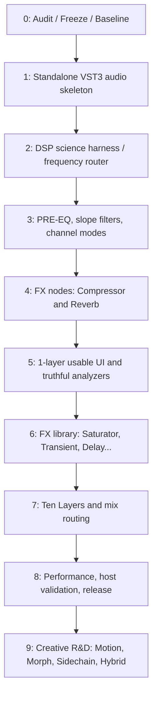

# HPDG FX ADD-ON — дорожная карта отдельного VST3

**Статус:** план, ни одна фаза не отмечена `DONE`, пока агент не приложит фактические проверки. **Репозиторий:** https://github.com/Hamec01/HPDG. **Основа UI:** [`assets/hand_sketch_reference.jpeg`](assets/hand_sketch_reference.jpeg) и [`assets/one_layer_wireframe.svg`](assets/one_layer_wireframe.svg). **Документ исследования:** [01_RESEARCH_ARCHITECTURE.md](01_RESEARCH_ARCHITECTURE.md).

## Зафиксированные продуктовые решения

1. Это самостоятельный VST3 **audio insert effect**, которым можно обрабатывать отдельную дорожку, bus группы или master. Исходный HPDG должен продолжать работать без изменений поведения.
2. В каждом Layer действует порядок **B: Input → PRE-EQ → frequency-selective FX Nodes → layer mix → output**. PRE-EQ всегда перед FX.
3. Интерфейс: верхний исходный/обработанный Waveform + кнопки 1–10, центральный frequency editor, нижний inspector только активного процессора.
4. Модель 10 Layers; на первых этапах физически работает один. FX-сегменты могут перекрываться. Простые EQ-тoчки — обычные фильтры, FX Nodes — диапазонные обработчики.
5. В спектре присутствует кривая **реального Pre-EQ**, а также отдельно спектр сигналов. Не рисовать статической линией компрессию, reverb или saturation.
6. Протокол разработки: **измерение → базовая реализация → повторное измерение на тех же данных → отчёт → next gate**.

## Структура репозитория (предлагаемая, НЕ существующая)

```text
HPDG/
├── CMakeLists.txt                # новый target отдельно от HPDG
├── Source/                      # исходный HPDG; регрессии запрещены
├── Addons/
│   └── HpdgFx/                  # временное техническое имя каталога
│       ├── CMakeLists.txt
│       ├── Plugin/
│       │   ├── FxPluginProcessor.h/.cpp
│       │   ├── FxPluginEditor.h/.cpp
│       │   └── FxParameterContract.h
│       ├── Core/
│       │   ├── FxProjectState.h
│       │   ├── FxLayerState.h
│       │   ├── FxNodeState.h
│       │   ├── FxRoutingGraph.h/.cpp
│       │   ├── FxGraphSnapshot.h
│       │   ├── FxStateSerialization.h/.cpp
│       │   └── TransportContext.h
│       ├── DSP/
│       │   ├── PreEqProcessor.h/.cpp
│       │   ├── FrequencyRegionSelector.h/.cpp
│       │   ├── FxNodeProcessor.h/.cpp
│       │   ├── DeltaMixer.h/.cpp
│       │   ├── LatencyCoordinator.h/.cpp
│       │   ├── CompressorProcessor.h/.cpp
│       │   ├── ReverbProcessor.h/.cpp
│       │   ├── SaturatorProcessor.h/.cpp
│       │   └── ...
│       ├── Analysis/
│       │   ├── AudioCaptureQueue.h/.cpp
│       │   ├── SpectrumAnalyzer.h/.cpp
│       │   └── WaveformAnalyzer.h/.cpp
│       ├── UI/
│       │   ├── FxMainEditor.h/.cpp
│       │   ├── WaveformPanel.h/.cpp
│       │   ├── SpectrumWorkspace.h/.cpp
│       │   ├── LayerSwitcher.h/.cpp
│       │   └── NodeInspector.h/.cpp
│       └── Tests/
│           ├── TestSignalFactory.h/.cpp
│           ├── FrequencyRouterTests.cpp
│           ├── PreEqTests.cpp
│           ├── DeltaMixerTests.cpp
│           ├── HostContractTests.cpp
│           └── ReferenceRenderTests.cpp
├── Tests/                        # существующие тесты HPDG
└── docs/fx-addon/               # актуальные документы и отчёты
    ├── 01_RESEARCH_ARCHITECTURE.md
    ├── 02_PROJECT_ROADMAP.md
    ├── 03_AGENT_TASK.md
    ├── 04_ACCEPTANCE_MATRIX.md
    └── reports/
```

`shared audio/DSP` следует выносить в независимую библиотеку лишь после проверки совместимости старой и новой сигнальных цепей. Не создавать параллельную неконтролируемую копию и не проводить массовый рефакторинг HPDG.

## Зависимости и очередность



## Milestone 0 — Аудит и измерительная машина (обязательный старт)

**Задача:** зафиксировать основу, прежде чем трогать коэффициенты и переносить код.

**Работы:** зафиксировать `git rev-parse HEAD`, текущую ветку, результаты `cmake --build`, `ctest`, артефакты `HPDG_VST3`/`HPDG_Standalone` (где доступны), список зависимостей; подробно пройти `SoundLayerState`, `SoundFxRuntimeState`, `applySoundLayerFx`, классы FX, передачу параметров и RT-опасные места. Подготовить сигнал-генератор, WAV/JSON отчёт, spectrum/phase/group delay/aliasing/CPU измерения. Подготовить контролируемые 44.1/48/96/192k test cases.

**Критерий DONE:** `docs/fx-addon/reports/M0_BASELINE.md` + `manifest.json`, reproducible command line для тестов, подтверждённое неувеличение регрессий HPDG. Если build нельзя запустить, честно `BLOCKED`, а не `PASS`.

## Milestone 1 — Собственный insert-FX VST3

**Задача:** отдельный plugin ID, `IS_SYNTH FALSE`, mono/stereo input/output, никакой обязательной зависимости от HPDG runtime, редактор заглушка с текущими метрами.

**Работы:** создать target, корректные bus layouts, `prepareToPlay / releaseResources / processBlock / getStateInformation / setStateInformation`, bypass, корректное заполнение buffer, RT-safe lifecycle и базовые `gain/enable`, сохранить его как отдельную сущность в DAW. В UI пока простейшие контролы.

**DONE:** Audio in/out работает; полностью выключенный плагин — unity; pluginval минимум 5 (при доступном инструменте); re-open 100 раз; исходный HPDG собирается. Логи и пути к реальным .vst3 в M1.

## Milestone 2 — DSP-прототип одного частотного FX Node (важнейшая фаза)

**Задача:** доказать работу произвольного диапазона 250–700 Hz без искажения dry, когда node отключён.

**Работы:** region filter, compressor region, delta mixer, latency alignment, node mix/bypass/solo, overlapping regions тестировать двумя обработчиками. Сравнить H1 и H2 из исследования для 2/3/5 band сценариев, явно обозначить рациональный выбор.

**DONE:** реальные T01/T02/T04/T10 и графики отклика. Нет allocation в audio processing. При изменении диапазона не возникают клики выше выбранного измеримого порога и не вылезает NaN; результаты опубликованы.

**STOP-GATE:** если нельзя обеспечить корректную dry reconstruction / delta mix, **не приступать к красивому интерфейсу и десяти Layers**. Вернуться к архитектуре выбора частот.

## Milestone 3 — PRE-EQ и точная фильтрация

**Задача:** получить полностью корректное решение B и точные графические EQ-фильтры.

**Работы:** минимум Bell, Low Shelf, High Shelf, Low Cut, High Cut, Notch; затем Band Pass, Tilt, All Pass. Для Cut проверить 6–96 dB/oct; Brickwall только отдельным подэтапом по честно заданной transition width и latency. Реальные biquad/SOS coefficients и реальные frequency-response charts. Mid/Side/Left/Right/Mono и частотный cap относительно Nyquist. Strict ordering `PRE-EQ before FX Nodes`.

**DONE:** измерения T03/T05; комплексные АЧХ, impulse/phase для slopes; копии Preset до/после load по звучанию совпадают.

## Milestone 4 — Компрессор + Reverb на FX Nodes

**Задача:** первый действительно музыкальный рабочий прототип. Компрессор 250–700 Hz и реверб 3–8 kHz могут работать одновременно, в том числе с перекрывающимися регионами.

**Работы:** адаптация существующего `DrumCompressorBlock`, создание region-aware compressor; reverb wet-only send, tails; важны separate input/output filtering, Mix, Gain, output headroom.

**DONE:** референсный PCM рендер, тесты dynamics T06 и tails T07, A/B по одному и тому же входу, слуховые тесты хотя бы на kick/snare/bass/full mix; PDC и реверберационный хвост в DAW.

## Milestone 5 — Один слой с настоящим UI и мониторингом

**Задача:** воссоздать модель рисунка, но в профессиональном юзабилити. На экране будет один активный Layer из 10 кнопок (остальные видны, без полного DSP до M7).

**Работы:** top waveform real input/processed, delta, spectrum/capture/FFT, графический editor с freq range handles, EQ shape и nodes, нижний selected-processor inspector. Freeze, Node Solo/Bypass, Undo, A/B, resize, DPI scale. Кривая EQ не подменяет live spectrum.

**DONE:** T09, отсутствие падения FPS/зависаний при активном анализаторе; UI не блокирует DSP; каждое отображаемое значение привязано к реальному state; raw video/screenshots + screenshots тестирования.

## Milestone 6 — Полная базовая библиотека эффектов

**Задача:** Saturator, Transient, Delay, Limiter, Monsta FX, Stereo, Gate/Expander в region-mode, прошедшие отдельные quality tests.

**Порядок:** Saturator (+ oversampling, DC blocker) → Transient → Delay → Monsta → Stereo → Gate → Limiter. Порядок можно уточнить после аудита без нарушения acceptance gates. Не переносить непроверенный Monsta автоматически; состояние транспорта/seed не должно зависеть от генератора паттернов.

**DONE:** для каждого эффекта собственные signal fixtures, objective measurements, reference audio и performance stats; все эффекты доступны в Node Inspector.

## Milestone 7 — 10 Layers

**Задача:** только после успешного однослойного движка внедрить реальную обработку 10 слоёв.

**Работы:** Parallel Delta Layers, Serial Layers, управление Layer Mix/Gain/Width/Mono/M/S/Solo/Mute, A/B snapshot, copy/duplicate, silent layers skip DSP, правильная latency compensation across layers. **Hybrid** не делать без отдельного архитектурного согласования.

**DONE:** при выключенных 10 Layers исходное аудио без +20 dB; нет клиппинга из-за случайного сухого дубля; спецификация headroom и порядка определена; M7 stress/full 10-layer state restore.

## Milestone 8 — Профессиональная валидация и beta

**Задача:** подготовить продукт, который выдерживает реальную DAW, а не только работает в standalone.

**Работы:** pluginval 5/10, VST3 validation, FL Studio/REAPER/другие доступные хосты, тест многократного добавления/удаления плагина, re-open проекта, freeze/render, no transport, tempo changes, 1000 operations, sample rates, buffers, ASan/UBSan/TSan в совместимых режимах. Release package, подпись при наличии соответствующей инфраструктуры.

**DONE:** матрица `04_ACCEPTANCE_MATRIX.md` с evidence links, перечисление известных ограничений, versioned preset compatibility, non-regression существующего HPDG.

## Milestone 9 — R&D после beta (не блокировать релиз)

- Spectral Sidechain, внешние Audio Bus и детекторы;
- Frequency Motion / transport-synced LFO;
- Layer Morph и time-smoothing/crossfade для различающихся topology;
- Dynamic EQ / Spectral Dynamics (настоящий detector, не нарисованная линия);
- Hybrid routing, multieffect chains внутри одного node;
- Brickwall FIR profile если не успели в M3;
- Mid/Side независимый wet-output routing;
- открепление мокапа от HPDG стилистики, альтернативные скины.

## Риски, приоритеты и минимизации

| Риск | Вероятность/ущерб | Приоритет | Меры |
|---|---|---|---|
| Фазовая окраска/comb-filter от пересечений | высокая/высокий | P0 | delta topology, delay alignment, complex response tests |
| Автоматизация 96 dB/oct щёлкает | высокая/высокий | P0 | topology-safe transitions, staged coefficients, signal test |
| Десять слоёв перегружают CPU | высокая/высокий | P0 | lazy DSP, p99 profiling, resource budget |
| Модуль HPDG выделяет память в audio thread | подтверждённый риск | P0 | самостоятельные подготовленные buffers, RT sanitization |
| Неправильные host automation/IDs | средняя/высокий | P0 | fixed IDs, versioned serialization, host tests |
| Измеритель показывает «нарисованную» волну | средняя/средний | P1 | post-processing capture buffers + FFT validation |
| Реверб хвост обрывается | средняя/средний | P1 | tail lifecycle, stop/bypass tests |
| UI слишком перегружен | высокая/средний | P1 | активный node-only inspector, layers navigation |
| Расширение текущего HPDG ломает DAW | высокая/высокий | P0 | отдельная сборочная цель и regression matrix |

## Ритм работы агента

**Один milestone = отдельный PR / reviewable group of commits** с тестами, измерениями, документацией и списком изменённых файлов. Выполнять подфазы последовательно. После каждого milestone предоставлять:

```text
Milestone:
Git SHA / Branch:
Files changed:
Commands executed:
Baseline metrics:
New metrics:
Pass/Fail/Blocked by test ID:
Audio test artifacts (WAV/JSON):
CPU p50/p95/p99:
Open issues / known limitations:
HPDG regression checks:
Next recommended milestone:
```

Нельзя помечать как `PASS` проверки, которые в данном окружении фактически не запускались. **Сначала M0 и M1, затем gate M2.**
