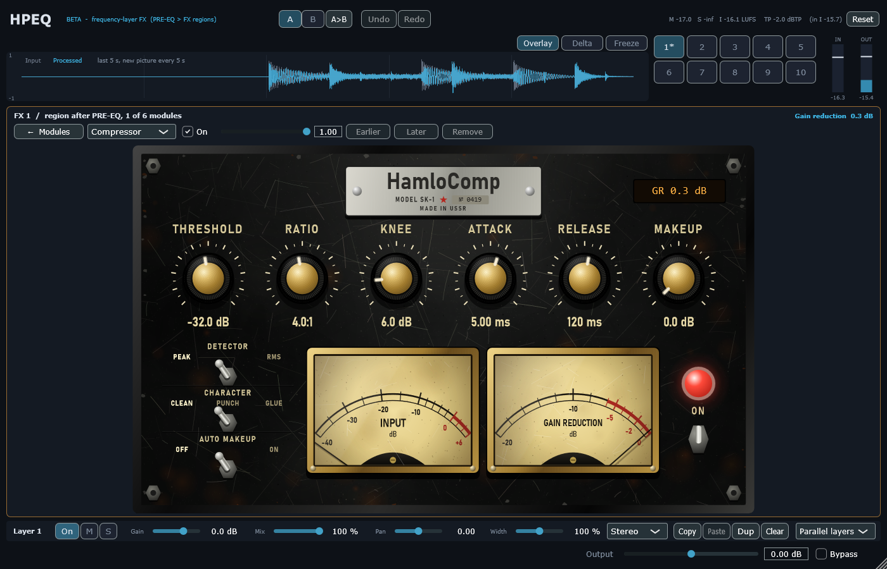

# Module pass 1 — Compressor, and a calmer waveform strip

## 1. Scope / Date / Base / Platform

| | |
|---|---|
| Scope | Owner: rework the modules one by one, starting with the compressor; waveform strip smaller, not live |
| Owner input | Add: GR indicator, auto makeup, Peak/RMS detector, character Clean/Punch/Glue, knobs and needle meters "like an old Soviet analogue compressor". Current sound: "too weak / not noticeable". Waveform: smaller, a new picture every 5 s, less zoomed in |
| Date | 2026-10-22 |
| Base | `ab0600f` (D6) on `feature/hpeq-m0-m1` |
| Platform | Windows 11 x64, i5-10300H, MSVC 19.50.35730, JUCE 8.0.12 |

## 2. What changed

**Compressor DSP** (laws in `Source/DSP/Processors.h`; with every option off the output is the previous
law bit-for-bit, so existing projects sound the same):
- **Detector Peak / RMS** — RMS = one-pole mean square, 10 ms.
- **Auto makeup** — a 2 s one-pole of the gain reduction is added back; steady compression keeps the
  long-term level.
- **Character** — Clean (the law as before); **Punch**: saturation relative to the threshold, before the
  gain, growing with the gain reduction (no reduction = exact identity); **Glue**: program-dependent
  release (short peaks recover in 0.25 × release, long compression in 2 × release).
- New meters for the UI: detector level and auto-makeup gain per block.

**Why it sounded weak** (measured, §4): the default threshold (−18 dB) sat above typical band levels
(the owner's input was about −25 dBFS) and the 10 ms attack let drum hits through, with no makeup.
A compressor added from the UI now starts at **threshold −30 dB, ratio 4:1, attack 1 ms, release 80 ms,
Punch, auto makeup on** (`defaultModule`). Projects that already have a compressor keep their values.

**Compressor page = the owner's HamloComp design** (`hamlocomp.zip`, style "v2 Black Steel"; prototype
and chosen reference kept in `docs/fx-addon/assets/hamlocomp/`). `Source/UI/HamloCompPanel.*` draws it in
the design's own coordinates (1180 × 700, scaled to fit) from `style.css` / `app.js`: worn black steel with
rust, chips, scratches and pitting (same procedure and seed as `drawWear`), hexagon bolts, the nameplate
"HamloComp · MODEL SK-1 · № 0419 · MADE IN USSR", amber GR display, six brass knobs with knurled skirts and
engraved 21-tick scales, chrome toggle switches (Detector, Character, Auto Makeup), brass-bezel needle
meters with aged dial paper, red zone, needle shadow, tremor and scratched glass (design ballistics), red
ON lamp with toggle (= module on). Knobs: vertical drag (Shift = fine), wheel, double-click = default,
click on a value to type it. The page fills the editor body; "← Modules" returns.

Differences from the prototype, on purpose: the font is Windows' Bahnschrift instead of Oswald (no font
download); the Character switch is Clean / Punch / Glue (the tested DSP above) instead of the prototype's
Web-Audio Clean / Warm / Tube; the prototype's Source / Play chips are not needed in a plugin. An earlier
interim style of this pass (grey plate, bakelite knobs) was replaced by this design.

**Waveform strip:** about 30 % lower; shows the last 5 s and takes a new picture every 5 s (or at once on
Overlay/Delta or resize); one-second grid lines.



## 3. Commands and exit codes

```bash
cmake --build --preset release                     # 0, no warnings
build/Release/HPEQ_Tests.exe                       # 0 — 1074 passed, 0 failed
build/Debug/HPEQ_Tests.exe                         # 0 — 1074 passed, 0 failed (CRT hook: malloc + new, 0 audio-thread allocations)
build/Release/HPEQ_Lab.exe ui --out …/compressor_pass/screenshots   # 0
```

## 4. Numbers (thresholds fixed before the runs)

| Test | Result |
|---|---|
| Options off = previous law (and T06 against the independent model, unchanged) | **bit-exact**; T06 −135.3 dB |
| Input meter: −20 dBFS sine reads −20.0 (Peak) / −23.0 (RMS) ±0.1 | −20.00 / −22.98 |
| RMS detector: steady sine compressed by the law at its RMS level ±0.2 dB | 15.76 dB vs law 15.74 |
| Auto makeup: level after 10 s of steady compression within 0.5 dB | −0.08 dB (GR 14.1, makeup 14.0) |
| Punch: identity without reduction; 3rd harmonic > Clean + 20 dB at 18 dB GR | identity; −37.2 vs −62.9 dB |
| Glue: GR 150 ms after a 30 ms burst lower than Clean; after 3 s higher | 0.07 vs 4.00 dB; 6.60 vs 3.97 dB |
| HamloComp page wiring (real editor): fills the body; knob / switch / ON edit the project; rebuilt page shows them; grid restores the layout | pass |
| Old vs new default on drums, region 60–250 Hz, crest factor inside the band (after 0.5 s): new cuts ≥ 2 dB more | input 17.30, old 17.25 (−0.05), **new 14.16 (−3.14)** |

Survey for the default attack (Punch, auto makeup on, same measurement): 0.5 ms → band crest 13.97,
1 ms → 14.16, 2 ms → 14.97, 5 ms → 16.24 dB.

## 5. Disclosed changes made after first runs

1. **Punch design changed** after the first run: saturating after the gain (on the already quiet signal)
   raised the 3rd harmonic by only 8 dB; now it saturates relative to the threshold before the gain
   (+25.7 dB). The criterion (> +20 dB) was not changed.
2. **Weakness criterion changed twice:** (a) whole-signal crest is not a measure of a band compressor
   (it rose 14.61 → 15.50 dB because the compressed band dominates the mix RMS) → measured inside the
   band; (b) the first hit falls in the region's birth glide (edges glide in from 1 Hz, D4) and was not
   compressed, so the band peak never changed → measured after 0.5 s. The ≥ 2 dB threshold was fixed
   before and kept. The default attack (5 ms → 1 ms) was then chosen from the survey above.
3. In a 3 s test file the band RMS is still 3.8 dB lower with auto makeup on: the 2 s makeup is still
   rising there (it settles on steady material, §4).

4. A test of the panel wiring first read the project through a reference into a temporary copy
   (`plugin->getProject().layers…`) and saw zeros; the test was fixed (the same class of bug as D6's
   dangling pointer, this time in the test).

## 6. Not verified

Listening and mouse use in FL Studio (owner). Other modules keep the generic page until their designs
arrive.
