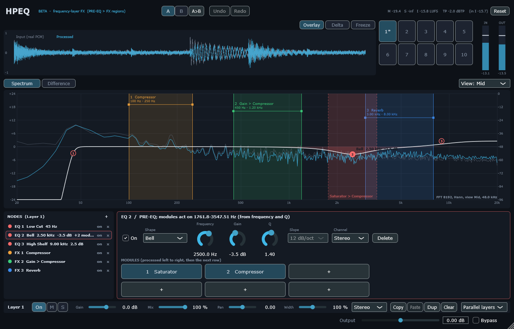
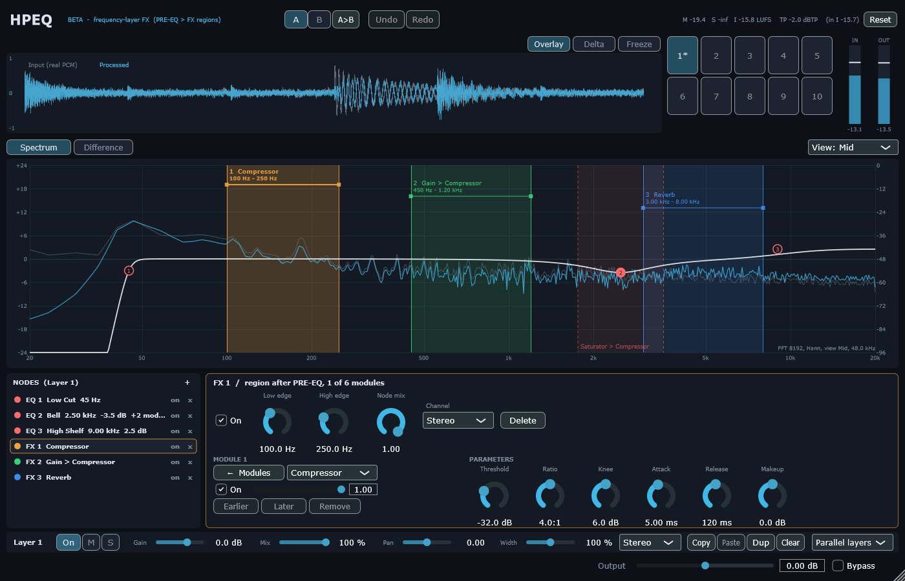

# D6 — Modules on EQ points, module-grid inspector (owner feedback F1–F3)

## 1. Scope / Date / Base / Platform

| | |
|---|---|
| Scope | Owner feedback from the FL Studio test of M5 (BACKLOG F1–F3), decision D6 |
| Date | 2026-10-22 |
| Base | `8b0e4c8` (M8 + pluginval) on `feature/hpeq-m0-m1`; code and report in the D6 commit |
| Owner answers | 6 modules per point / region (grid 3 × 2); a point's module band from its frequency and Q |
| Platform | Windows 11 x64, i5-10300H, MSVC 19.50.35730, JUCE 8.0.12 |

## 2. What changed

- **F1 — modules on an EQ point.** Right-click a point → "Add module on this point", or the "+" tiles
  in its inspector. The point's EQ stays in PRE-EQ (decision B); its modules run on the band
  `f·(√(1 + 1/(4Q²)) ∓ 1/(2Q))` (centre f, f / bandwidth = Q), on the point's channel component. In the
  workspace the band is shown dashed with the module names; the point is filled; the node list says
  "+N modules".
- **F2 / F3 — module grid.** The inspector of a region or a point shows its modules as a 3 × 2 grid in
  processing order (left to right, then the next row); empty tiles are "+" (adds at the end). A tile
  opens the module page in the same panel: back arrow "← Modules", type, On, Mix, Earlier / Later,
  Remove, parameters. No scrolling needed.
- **Stable engine slots.** Regions and points with modules share the layer's 8 engine nodes; each keeps
  its slot (saved in the state). Deleting a region no longer moves the others' processing state (it
  did before D6). With all 8 used, the UI refuses new bands ("All 8 module bands of this layer are in
  use"); sanitize drops modules that cannot fit.

| Path | Why |
|---|---|
| `Source/Core/FxProjectState.*` | `EqNodeState::chain`, `engineSlot` (points and regions), `pointModuleBandHz`, `assignEngineSlots`, `freeEngineSlots`; state read/write |
| `Source/DSP/LayerSnapshot.cpp` | Engine nodes from stable slots; points with modules become nodes on their band |
| `Source/UI/NodeInspector.*` | Module grid and module page for regions and points |
| `Source/UI/SpectrumWorkspace.cpp`, `NodeList.h`, `Theme.h`, `Plugin/FxPluginEditor.h` | Point bands, menu, list text; selection opens the grid |
| `Tests/Unit/D6Tests.cpp`, `M8Tests.cpp`, `Tests/Fixtures/` | New tests; canonical state fixture updated (old ones must still load) |
| `Tests/Tools/LabT11.cpp`, `LabUi.cpp` | Random projects with point modules; screenshots |





## 3. Commands and exit codes

```bash
cmake --build --preset release                     # 0, no warnings
build/Release/HPEQ_Tests.exe                       # 0 — 1054 passed, 0 failed
build/Debug/HPEQ_Tests.exe                         # 0 — 1054 passed, 0 failed (CRT hook: malloc + new, 0 audio-thread allocations)
HPEQ_Lab t11 + HPEQ_HostSmoke --t11 (random projects now include point modules)   # 0 — 20/20
HPEQ_Lab ui --out docs/fx-addon/reports/d6/screenshots                              # 0
```

## 4. Numbers (thresholds fixed before the runs)

| Test | Result |
|---|---|
| Point band: geometric centre = f and f / bandwidth = Q (1e−12 relative), 3 cases | pass (1 kHz, Q 0.707: 517.6–1932.0 Hz) |
| A compressor on a point vs an FX region with the same band | **bit-exact**; differs from the bell alone (> −60 dB null) |
| Point off → its modules off; point channel → module channel | pass |
| Stable slots: delete region 1 of 3 → others keep slots 1, 2; a new region takes 0; in the engine slot 1 keeps running, slot 0 stops | pass |
| 8 regions + a point with modules: 0 free slots; sanitize drops the point's modules | pass |
| State round trip with point modules and slots | equivalent |
| Inspector (real editor): grid with 2 modules → 4 "+" tiles; tile → module page with back arrow, no "+"; page shows the module's type and On | pass |
| T11 through the VST3 binary, random projects with point modules | 237/237 states, 237/237 latencies, 57/57 bit-exact renders, 57/57 re-open |
| Preset compatibility: states written by M7 and by M8 (before engine slots) load; canonical state re-saves identically | pass |

## 5. Findings

1. **Dangling pointer in the first module page:** the inspector read the chain through a pointer into
   a temporary copy of the project (`selectedChain(processor.getProject())`), so the page showed empty
   values (seen in the first screenshot, reproduced by a new test). Fixed by keeping the project alive;
   the test checks that the page shows the module's type and On state.
2. The state format grew additively (`engineSlot`, `FxSlot` children of `EqNode`), schema still 1.
   Older builds would ignore point modules.

## 6. Not verified

Mouse use of the grid, menus and module pages in a DAW (owner check). Drag-reordering of tiles is not
implemented (Earlier / Later buttons instead).
