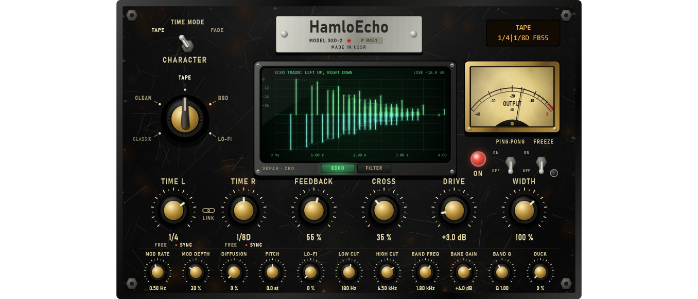

# Module pass 3 — Delay: HamloEcho

## 1. Scope / Date / Base / Platform

| | |
|---|---|
| Scope | Owner: "delay по типу Timeless; дизайн опираясь на HamloComp" |
| Design note | [DELAY_DESIGN.md](../DELAY_DESIGN.md) (function parity with FabFilter Timeless, engine, page, thresholds) |
| Date | 2026-10-23 |
| Base | `0ec2ca2` (reverb pass) on `feature/hpeq-m0-m1` |
| Platform | Windows 11 x64, i5-10300H, MSVC 19.50.35730, JUCE 8.0.12 |

## 2. What changed

**Engine** (`Source/DSP/HamloEcho.*`, written for HPEQ, D3). The Delay module now has a **Character**:
Classic (the M6 delay, unchanged) or one of four HamloEcho characters — **Clean, Tape, BBD, Lo-Fi**.

- **Time L / Time R**, each free (1 ms – 4 s) or synced to the host tempo (1/32 … 1/1, dotted, triplets),
  **Link** (right follows left).
- **TIME MODE**: **TAPE** — a time change glides and bends the pitch like a tape speed change; **FADE** —
  two heads cross-fade in 40 ms, the pitch stays.
- **Feedback** (up to 98 %), **Cross** (0 = two delays … 1 = full ping-pong), **PING-PONG** input (mono
  into the left line).
- Loop filters: **Low cut** and **High cut** (12 dB/oct, **resonance** set on the CRT), **Band** (bell:
  freq, gain, Q).
- **Diffusion** (four allpasses in the loop: echoes melt towards a reverb), **Pitch** −12 … +12 semitones
  per repeat (two-voice grain shifter; each new grain starts where it best matches the playing one, so
  the cross-fades stay in phase), **Mod rate / depth** (wow; Tape adds flutter), **Drive**, **Lo-Fi**
  (sample-and-hold rate and bits).
- Characters: **Clean** — only a safety clip `4 tanh(x/4)` (transparent at normal levels); **Tape** —
  asymmetric saturation, wow + flutter, gentle loss of highs per repeat; **BBD** — dark bandwidth, round
  clipping, deeper wobble; **Lo-Fi** — reduced rate and bits.
- **Width**, **Ducking** under the dry input, **Freeze** (the loop holds losslessly, the input is closed).
- Classic ↔ HamloEcho changes fade 10 ms; wet-only send, spill-over, pool, PDC 0, block-size
  independence and no audio-thread allocation as before. Host tail = time + time·ln(10⁻³)/ln(loop gain)
  + 0.1 s, the loop gain including band boost and resonance; 30 s or more while frozen.

**Compatibility.** A project saved before this pass has no `character` key and stays **Classic,
bit-exact** (test below). A delay added from the UI starts as **Tape, 1/4 synced, feedback 35 %**.
`FxSlotParams::values` grew from 24 to 32 floats; time ranges to 4 s and feedback to 98 % apply to the
new characters (Classic keeps clamping to its M6 ranges).

**Function parity** — table in [DELAY_DESIGN.md §1](../DELAY_DESIGN.md). Not copied on purpose:
Timeless's free modulation matrix (XLFOs, envelope generators, MIDI triggers) and its free filter slots.

**Page = HamloEcho** (`Source/UI/HamloEchoPanel.*`), the same Black Steel series as HamloComp and
HamloVerb. The CRT drawing (bezel, tube, glass, buttons, phosphor strokes) moved from the reverb page into
`BlackSteel.*`; the reverb page renders pixel-identical after the move (all five Lab screenshots compared).
Nameplate **HamloEcho · MODEL ЭХО-2 · № 0421**; amber LCD (character, FADE, times, feedback, freeze,
ducking); **CHARACTER** five-position selector with the bakelite chicken-head; **TIME MODE** lever;
**OUTPUT** needle meter; red **ON** lamp; **PING·PONG** and **FREEZE** levers (blue freeze lamp). Large
knobs: Time L, Time R (FREE / SYNC under each, a **LINK** chain between them), Feedback, Cross, Drive,
Width; small: Mod rate, Mod depth, Diffusion, Pitch, Lo-Fi, Low cut, High cut, Band freq, Band gain,
Band Q, Duck. In Classic the controls that do nothing for the M6 delay are dimmed; a linked Time R shows
the left time, dimmed.

CRT views:
- **ECHO** — the echo train: left echoes up, right echoes down, heights from the feedback, cross /
  ping-pong and the loop's mean gain (300 Hz – 3 kHz), dashed decay guides, the pitch of the first
  repeats (+7, +14 …), a play head at real time burnt into the phosphor.
- **FILTER** — the loop response after 1, 2, 3, 4 repeats (bright → fading); handles **LOW** (drag:
  frequency and resonance), **BAND** (frequency and gain; mouse wheel: Q), **HIGH** (frequency and
  resonance).



## 3. Commands and exit codes

```bash
cmake --build --preset release                     # 0, no warnings
build/Release/HPEQ_Tests.exe                       # 0 — 1187 passed, 0 failed
build/Debug/HPEQ_Tests.exe                         # 0 — 1187 passed, 0 failed (CRT hook: malloc + new, 0 audio-thread allocations)
build/Release/HPEQ_Lab.exe ui --out …              # 0
build/Release/HPEQ_Lab.exe bench --out …/delay_pass/bench.json --reps 3 --blocks 2000   # 0
```

## 4. Numbers (thresholds fixed before the runs)

| Test | Threshold | Result |
|---|---|---|
| Classic (no `character` key) = the M6 delay; stereo, mono, ping-pong | bit-exact | **bit-exact** ×4; an old project's slot reads character 0 |
| Echo positions L / R free 300 / 450 ms; synced 1/4, 1/8 D at 120 BPM; link | ±1 sample | 14400 / 21600; 24000 / 18000; link equal |
| Feedback 0.5, consecutive echoes (Clean, filters open) | −6.02 ± 0.5 dB | −6.029, −6.029, −6.027 dB |
| Cross 1: the second echo on the other side | ≥ 30 dB | 72.4 dB (first echo 260 dB one-sided) |
| First echo vs analytic low cut 400 Hz (res 0.5) × band 2 kHz +6 dB × high cut 6 kHz (res 0.3), 100 Hz – 10 kHz | ±0.5 dB | equal to 0.01 dB at all 11 points |
| Band +6 dB at 1 kHz, sine | ±0.5 dB | +6.000 dB |
| Clean at −20 dBFS, THD + N | < −80 dB | −84.3 dB |
| Tape, drive 18 dB, −6 dBFS | ≥ 30 dB above Clean | −11.0 dB (+73 dB) |
| Pitch +12 / −12 on a 500 Hz echo | 1000 / 250 Hz ±2 % | 1000.2 / 249.8 Hz |
| Modulation: 1 kHz echo outside ±5 Hz | depth 0 < −80 dB; depth 1 ≥ −30 dB | −81.1; −1.5 dB |
| Time change 300 → 400 ms on a 1 kHz echo | FADE ±1 %; TAPE > 2 % | FADE 1000.1 Hz; TAPE 513.5 Hz |
| Diffusion 0 → 1, crest factor of the first echo | ≥ 10 dB lower | 36.9 → 24.5 dB (−12.4) |
| Lo-Fi 1 (Clean), −12 dBFS 1 kHz, THD + N | > −40 dB | −7.3 dB |
| 6th echo of a noise burst, spectral centroid | BBD ≤ 0.7 × Clean | Clean 12 191, Tape 3 402, BBD 916 Hz |
| Freeze 2 → 11 s (with wobble and drive set) | ±1 dB | Clean 28.72 → 28.71; Tape 26.56 → 26.54 dB |
| Ducking 100 % under −6 dBFS; 0.5 s after the input stops | ≥ 12 dB; ±1.5 dB | 30.0; 0.32 dB |
| Classic → Tape mid-stream | ≤ 1.5 × steady peak | 0.377 vs 0.369 |
| Tail formula; frozen | exact; ≥ 30 s | pass |
| Block sizes 1 / 64 / 127 / 512, everything on (Tape, FADE, cross, sync R, drive, wobble, diffusion, pitch, lo-fi, resonances, band, duck) | bit-identical; 0 allocations | bit-identical; 0 |
| 20 000 random mutations of every setting in the engine | finite, < 1000; 0 allocations | pass; 0 |
| HamloEcho page wiring (real editor), old delay shows Classic | pass | pass |

**CPU** (Release, block 512 at 48 kHz, budget 10 667 µs, `bench.json`, warm, median of 3 runs; includes
the node's band split, `tree_1node_gain` = 27.6 µs):

| Config | p50 µs | p99 µs | p99 % of the block |
|---|---|---|---|
| Classic delay, 1 node | 38.0 | 61.4 | 0.58 % |
| **HamloEcho Tape (UI default), 1 node** | **104.3** | **147.7** | **1.38 %** |
| HamloEcho Tape, pitch +7 | 145.7 | 232.4 | 2.18 % |
| HamloEcho Tape, 8 nodes | 794.4 | 1 174.3 | 11.0 % |

**Memory:** each delay of the pool (8 per project) now also holds 2 × 4 s lines and the pitch rings,
about 1.6 MB at 48 kHz: the pool grows from ~6 MB to ~19 MB at 48 kHz (~77 MB at 192 kHz), allocated in
`prepare()` as before.

**UI frame** (analysis update + full repaint 1400 × 900, Lab): p50 8.1 ms, p95 9.4 ms (budget 33 ms).

Screenshots: [ECHO](delay_pass/screenshots/hpeq_hamloecho_echo.png),
[FILTER](delay_pass/screenshots/hpeq_hamloecho_filter.png),
[BBD, FADE, ping-pong, pitch +7, diffusion](delay_pass/screenshots/hpeq_hamloecho_bbd_pitch.png),
[an old project: Classic](delay_pass/screenshots/hpeq_hamloecho_classic.png).

## 5. Disclosed changes made after first runs

1. **Pitch shifter — design changed** after the first run: a plain two-grain shifter (fixed half-grain
   offset) read a 500 Hz tone back at 1020 / 240 Hz for +12 / −12 (threshold ±2 %): at that frequency the
   two grains meet in anti-phase, the carrier cancels and the side bands win. The grains now start at
   the delay (up to 8 ms later) where the recent past best matches the playing grain: 1000.2 / 249.8 Hz.
   The criterion was not changed.
2. **THD measurement fixed**: the first run used a 2¹⁵-point window, whose Blackman–Harris main lobe
   (±5.9 Hz) is wider than the ±5 Hz guard, so the 1 kHz tone's own skirt read as −67 dB "distortion".
   With 2¹⁶ points (±2.9 Hz): −84.3 dB. The threshold (< −80 dB) was not changed.
3. **Fuzz found an out-of-ring read**: a pitch change from down to up in the middle of a grain could
   move a voice's delay below zero; reads are now clamped to the ring.
4. **CPU**: the first grain-alignment search (14 k interpolated reads in one sample) gave p99 466 µs
   with 37 spikes per run for pitch +7; a coarse-then-fine search with whole-sample reads: p99 232 µs,
   no spikes; the pitch result is unchanged within 0.2 Hz.
5. Display / text: the LCD said "TAPE TAPE" for the Tape character in TAPE time mode (now only FADE is
   added); pitch labels could overlap the CRT title.

## 6. Not verified

Listening and mouse use in FL Studio (owner): the characters, TAPE vs FADE when turning the time, the
CRT handles, the pitch shifter on real material. No side-by-side with Timeless (not on this machine);
parity is by the function list and the measurements above.
