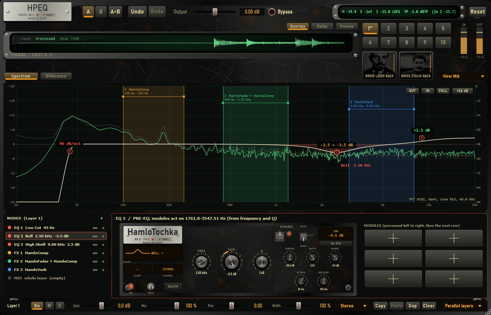
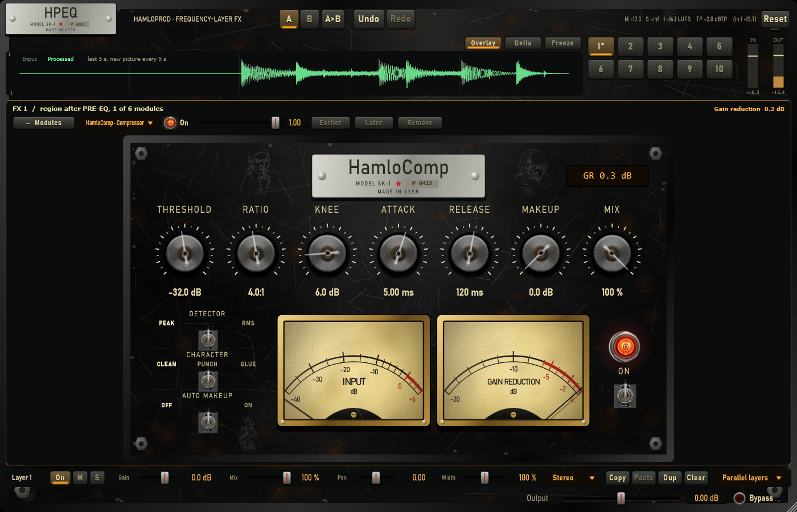
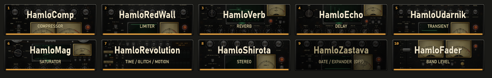

# EQ pass — point SOLO and DYNAMIC, HamloTochka page, zoom, the whole window in Black Steel, two fixes

## 1. Scope / Date / Base

| | |
|---|---|
| Scope | Owner, 2026-10-25 (screenshots of HPEQ and FabFilter Pro-Q): EQ points get SOLO (listen) and a compressor-like DYNAMIC gain, their own page in our style, the shape menu with pictures, zoom in / out, the whole plugin in the Soviet style; fixes: the DAW hangs when HPEQ closes; adding a module to the MIX chain of a fresh window jumps to "Nothing selected" |
| Date | 2026-10-25 |
| Base | `a47fa34` on `feature/hpeq-m0-m1` |

## 2. What changed

**Fix — DAW hang on close.** JUCE 8 renders Windows windows with Direct2D; when FL Studio closes / unloads a
plug-in, tearing down that DLL's D3D11 device has been seen to wait forever in the GPU driver (the other
agent hit the same with the module VST3s and switched those to software rendering). HPEQ now does the same:
`HPEQ_JUCE_DEFAULT_RENDERING_ENGINE=0` and software images at build time, and the editor switches its peer
to the GDI renderer when it appears (`FxPluginEditor::selectSoftwareRenderer`). UI frame cost with the
software renderer: p50 14.7 ms, p95 23.0 ms at 1400 × 900 (30 Hz budget 33.3 ms).

**Fix — MIX selection.** The editor's "layer shown" started at −1, so the first project change (adding a
module to MIX) counted as a layer change and dropped the selection. It is now set in the constructor.

**EQ point SOLO** (headphones button on the point page): after all bands the layer's PRE-EQ output goes
through a filter on the point — band pass at its frequency and Q (Bell, Notch, Band Pass, All Pass, Tilt),
low pass for Low Shelf / Low Cut, high pass for High Shelf / High Cut — with a 10 ms crossfade. One point
at a time. Saved with the project (`solo`).

**EQ point DYNAMIC** (gain shapes): a detector on the point's own region (band pass at the point for Bell,
low / high pass at f for the shelves, broadband for Tilt; channels linked by the larger level, or the
point's Left / Right / Mid / Side signal), attack / release, THRESHOLD, RATIO, 6 dB soft knee, and RANGE:
the gain moves by up to |range| — down for a negative range (de-ess, tame a resonance, duck a band),
up for a positive one. The offset rides on the PRE-EQ's control clock like the gain itself (no zipper).
A point with 0 dB static gain but a range runs. Saved as `dyn*` properties only when used.

**HamloTochka** — the EQ point page (Black Steel, 1100 × 340, in the bottom panel so the spectrum stays in
view, the point's six module places on the right): nameplate (EQ number), SHAPE window with the shape's
picture (a click opens all nine as pictures), SLOPE, CHANNEL, ON lamp, SOLO, DELETE; FREQ / GAIN / Q;
DYNAMIC lever and lamp, THRESH / RATIO / RANGE / ATTACK / RELEASE, an LCD with the gain the dynamics add
now, and on the GAIN knob an amber ring: dim = the range, bright = now. The spectrum's right-click
"Change shape" menu shows the same pictures.

**Zoom**: IN / OUT / FULL buttons and the EQ range button (±3 / 6 / 12 / 24 / 36 dB) on the spectrum;
Ctrl + wheel zooms the frequency around the mouse (at least one octave), Alt + wheel the dB range, Alt-drag
or the middle button moves the view. Grid labels follow the zoom.

**The whole window in Black Steel**: a shared `SteelLookAndFeel` (also the default for menus while an HPEQ
window is open): steel keys with a lamp stripe for the lit ones, amber LCD combo boxes, dark steel menus,
brass knobs, steel fader caps, lamps for toggles; the theme colours are steel / stencil cream / amber, the
analyser and waveform traces green phosphor; the editor background is the worn steel plate with the HPEQ
nameplate and scratched pictures.

## 3. Numbers (thresholds fixed before the runs)

| Test | Threshold | Result |
|---|---|---|
| DYNAMIC bell 1 kHz, range −12, thr −30, ratio 4: loud tone (−6 dBFS) / quiet (−50) | −12 ± 1 / ±0.1 dB | −12.00 / 0.000 dB |
| DYNAMIC range +6 (ratio 20): loud tone | +6 ± 1 dB | +6.00 dB |
| DYNAMIC: a loud 80 Hz does not trigger a 1 kHz point (Q 2) | ±0.5 dB at 1 kHz | 0.000 dB |
| SOLO bell 1 kHz Q 2: 1 kHz / 100 Hz / 8 kHz | ±1 dB (of the point's +0.5) / ≤ −20 / ≤ −20 | +0.50 / −26.0 / −24.8 dB |
| SOLO low shelf 300 Hz: 100 Hz / 8 kHz | ±2 dB / ≤ −20 dB | +0.50 / −58.7 dB |
| Solo off, dynamic off | bit-exact to the plain point | bit-exact |
| State: solo and dynamic round-trip; plain points save no new properties | exact | exact |
| Zoom: the frequency under the mouse stays; ≥ 1 octave; x ↔ Hz; dB range; FULL | 0.5 px; 1 oct; 1e-3 Hz; exact | pass |
| MIX selection survives the first edit (fails without the fix — checked) | selected | selected |
| Point page: DYNAMIC, SOLO (only one point), shape chooser edit the project | pass | pass |
| SteelLookAndFeel is the window's and the default while open, released after | pass | pass |

`HPEQ_Tests` 1651 / 1651, `HPEQ_ModuleTests` 73 / 73 (Release).

## 4. Disclosed changes made after first runs

1. **D6 test** counted "+" buttons; the zoom-in button was "+" too. The zoom buttons are now IN / OUT.
2. **HamloRevolution CPU test** (8 instances) read 102.8 % once while a build ran on the machine; it now
   takes the best of three runs (threshold unchanged).
3. **Zoom x ↔ Hz** tolerance 1e-6 Hz → 1e-3 Hz: the x coordinate is a float pixel.
4. **MIX test** first edited the project behind the inspector's back (no rebuild), so the tile it looked for
   could not appear either way; it now checks the selection through a test hook, and fails without the fix.
5. Screenshot check: double-encoded "·", "±", "ЭК-1", "№" (written by a script as characters), the
   nameplate overflowing the header, and the DYNAMIC lever drawn invisible (`steel::lamp` leaves a gradient
   fill) were fixed before the run above.

## 5. Not verified / limits

- The hang fix in FL Studio (the owner): the cause matches the one found for the module VST3s; it cannot be
  reproduced in the test harness.
- External sidechain for DYNAMIC (FabFilter offers it): the detector listens to the point's own band of the
  layer; HPEQ has no sidechain input bus yet.
- Listening and mouse use in FL Studio.
- The software renderer costs more CPU than Direct2D for the 30 Hz spectrum (measured above: within budget).

---

## 6. Owner's review, round 1 (same pass)

- **Modules as pictures with names** (`UI/ModuleTile.*`, owner's second look: "a miniature of the page, the
  name written on it, the picture a little darker"): every module tile shows that module's real Black
  Steel page rendered small (once per type, cached while an HPEQ window is open), darkened, with the name
  in large stencil letters over it, the function under it, the number in the corner and an amber stripe
  when it runs (a module that is off is darker and says OFF); empty places are an engraved "+". The
  add-module menus show the same miniatures. (A first version with hand-drawn pictures was replaced.)
- **What a point does, on the spectrum**: every point carries a small LCD tag with its boost / cut
  (`+2.5 dB`, `-3.5 dB`; cuts their slope, NOTCH, BAND); a DYNAMIC point shows `set → now` and an amber
  arrow from the set gain to the gain of the moment, and the curve as it is now (amber) over the set curve.
- **Header**: OUTPUT and BYPASS moved up after Redo; the loudness readout (M / S / I LUFS, TP, input I) is a
  narrow green CRT in a gunmetal bezel (red when the true peak is over 0 dBTP); the waveform strip is a CRT
  in the same bezel ("SIGNAL · LAST 5 S"), as the module pages' scopes, and real time again (a new
  picture at every editor tick instead of every 5 s; FREEZE holds it).

---

## 7. De-esser on the point (owner, 2026-10-26: "put the de-esser on the point itself")

Instead of a separate module, the EQ point's DYNAMIC got a second detector and a one-press setting:

- **DETECT BAND / VOICE** (`dynDetect`, saved only when VOICE). VOICE compares the point's region with the
  voice body (band pass 1 kHz, Q 0.6: 300 Hz – 3 kHz), same attack / release: the detector level is
  region − voice − 20 dB, so the THRESH scale reads as before (−28 dB = the region 8 dB under the voice);
  below −60 dBFS in the region nothing triggers. It reacts to how far an "s" stands out over the voice, not
  to how loud the singer is.
- **DE-ESS** (button on the point page): bell 7 kHz, Q 0.8 (sibilance spreads over ~4.5–11 kHz), static gain
  0, DYNAMIC on, VOICE, THRESH −28 dB, RATIO 4, RANGE −9 dB, ATTACK 0.5 ms, RELEASE 40 ms. Every value stays
  editable; SOLO on the point listens to the region.
- Not on the point: look-ahead (the PRE-EQ has no latency; the 0.5 ms attack catches the "s") and a wide
  (whole-signal) mode — the reduction is the point's band, as a split de-esser.

| Test (synthetic voice: a vowel 180 Hz with formants 700 / 1200 / 2600 Hz; an "s" = noise around 7 kHz; the vowel +6 dB) | Threshold | Result |
|---|---|---|
| "s" | ≥ 4 dB down | −5.52 dB |
| vowel / vowel 6 dB louder | ±0.5 dB | 0.000 / 0.000 dB |
| DETECT round-trips; the DE-ESS button sets the point | pass | pass |

Disclosed: the first DE-ESS setting (bell 6.5 kHz, Q 1.5) took the "s" down only 3.69 dB — too narrow for
sibilance; widened to 7 kHz, Q 0.8 (the threshold unchanged).
