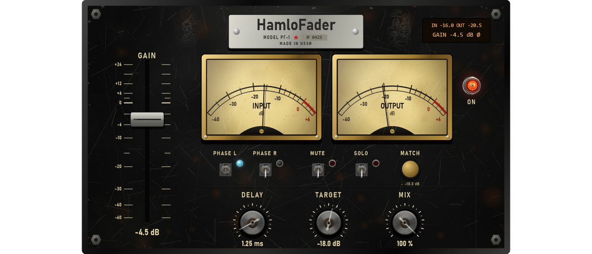

# Module pass 9 — Gain: HamloFader, and the owner's module names

## 1. Scope / Date / Base

| | |
|---|---|
| Scope | Owner: the Gain module as a band utility (gain, polarity, solo / mute, delay, match, VU — "второй вариант"), an English name; in the plugin the modules carry our own names (HamloShirota …) so users are not confused |
| Date | 2026-10-25 |
| Base | `d03fde6` on `feature/hpeq-m0-m1` |

## 2. What changed

**Module names in HPEQ** (`Source/UI/Theme.h`): `fxName()` is now the owner's name — HamloComp,
HamloRedWall, HamloVerb, HamloEcho, HamloUdarnik, HamloMag, HamloShirota, HamloZastava, HamloFader
(Monsta FX keeps its name). Menus, the module type list, the grid tiles and tooltips show the full name
with the function, e.g. **"HamloShirota · Stereo"** (`fxFullName()`); labels on the spectrum and the
status line show the short name. Project files are unchanged (they store the type, not the name).

**HamloFader = the Gain module** (`GainProcessor`, `HamloFaderPanel`):
- **Gain** −60 … +24 dB on the band (the vertical fader), **MUTE** (linear 10 ms to exact silence),
  **PHASE L / PHASE R** (polarity per channel, 10 ms ramp through 0), **DELAY** 0–20 ms (moves the band in
  time; deliberately not compensated), module **MIX**.
- **SOLO**: while any Gain module in a layer has SOLO on, the layer plays only those bands — each band
  aligned to the layer latency plus its processing — with a 10 ms cross-fade (`LayerEngine`). Solo off
  renders bit-exactly as before.
- **MATCH** + **TARGET**: one click sets the gain to TARGET − the band's 3 s input level.
- Meters: band input RMS (300 ms and 3 s) and output RMS → INPUT / OUTPUT needles, LCD.
- Projects saved before: a Gain module with only `gainDb` renders bit for bit as the old y = g·x.

**Page** (Black Steel, 1180 × 700): long vertical fader with an engraved dB scale (0 dB at three quarters
of the travel), INPUT / OUTPUT needle meters, PHASE L / PHASE R / MUTE / SOLO levers with lamps, MATCH
brass push button (shows the target), DELAY / TARGET / MIX knobs, LCD (IN / OUT, gain, SOLO, Ø), ON lamp.

## 3. Numbers (thresholds fixed before the runs)

| Test | Threshold | Result |
|---|---|---|
| Old law (gainDb only: 0, −6, +7.5 dB) | bit-exact y = g·x | bit-exact |
| Gain 0 → −12 dB, settled after 200 ms | ±0.01 dB | −11.9990 dB |
| Mute after 100 ms; unmute | < −120 dBFS; unity | silent (exact 0); error 0 |
| Polarity L / both after the ramp | exact | exact (< 10⁻⁶) |
| Delay 5 ms | 240 ± 1 samples | 240 |
| Meters: −20 dBFS noise; +6 dB gain | ±0.5 dB | −20.07 (3 s); out − in = +6.00 |
| MATCH: target −18, band −24 | +6 dB | +6 (panel: −30 → +12) |
| SOLO on 2–8 kHz: below 1 kHz | ≥ 30 dB down | 39.7 dB down |
| SOLO: band centre (3.6–4.4 kHz) vs normal | ±1 dB | −0.9 dB (the band as the crossovers cut it) |
| SOLO off | bit-exact to the plain render | bit-exact |
| Block sizes 1 / 64 / 127 / 512 (gain, phase, delay); allocations | identical; 0 | identical; 0 |
| Names; page wiring (fader, levers, MIX, ON, values back) | pass | pass |

`HPEQ_Tests` 1507 / 1507, `HPEQ_ModuleTests` 73 / 73 (Release).

## 4. Disclosed changes made after first runs

1. **Mute** first glided with the 20 ms gain smoother: −50.7 dBFS 100 ms after muting (threshold
   −120). Now a separate linear 10 ms ramp to exactly 0.
2. **Gain glide test** measured at 150 ms, inconsistent with the documented 20 ms smoother (0.01 dB needs
   ~160 ms); now at 200 ms. The law was not changed.
3. **Solo band check**: the windows 2.5–7 kHz and 3.2–5 kHz read the crossover skirts (−1.5 / −1.0 dB);
   solo plays the band exactly as the crossovers cut it, so the comparison is at the band centre.
4. **The "·" in the full names** was written double-encoded ("·") at first; the names test caught it.

## 5. Not verified

Listening and mouse use in FL Studio (owner); the standalone module VST3s do not include HamloFader
(they are another agent's work).
