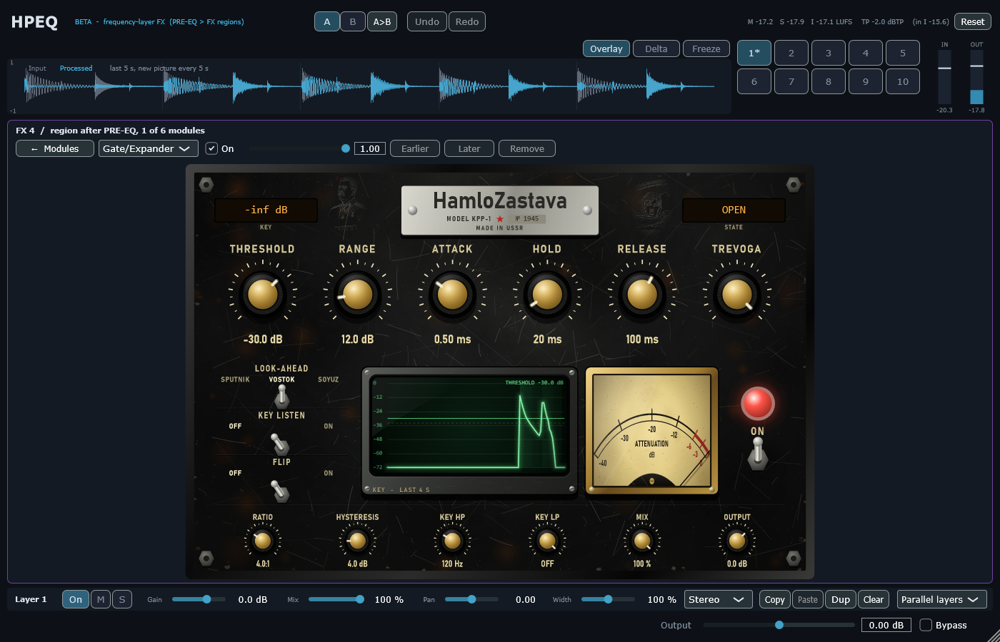

# Module pass 7 — HamloZastava gate / expander

## 1. Scope / Date / Base / Platform

| | |
|---|---|
| Scope | Owner: gate pass after the briefing, "design the same as before, one style"; key from another band left for later |
| Design | [`GATE_DESIGN.md`](../GATE_DESIGN.md) |
| Date | 2026-10-23 |
| Base | `72cd1e3` (scratched pictures) on `feature/hpeq-m0-m1` |
| Platform | Windows 11 x64, i5-10300H, MSVC 19.50.35730, JUCE 8.0.12 |

## 2. What changed

**HamloZastava** (laws in `Source/DSP/HamloZastava.h`; with every new key absent the M6 gate runs,
bit-exact — older projects sound the same):
- **ZASTAVA** (gate, the M6 law), **PATRUL** (continuous downward expander, no open/shut state),
  **TREVOGA** (duck: a key above the threshold pushes the signal down by RANGE).
- **LOOK-AHEAD** SPUTNIK 0 / VOSTOK 2 / SOYUZ 5 ms: the gate opens L earlier and shuts on time (the applied
  attenuation is the minimum — for TREVOGA the maximum — over the next L samples); latency reported.
- **KEY HP / KEY LP** (2nd-order Butterworth on the detector only), **KEY LISTEN**, **FLIP** (what the gate
  removes; gate + flip = input), **MIX** (the slot's mix), **OUTPUT**.
- A gate added from the UI starts with the M6 settings and VOSTOK.

**Page (Black Steel, same style as the other pages):** nameplate "HamloZastava · MODEL KPP-1 · № 1945",
amber LCDs KEY and STATE (OPEN / SHUT −n dB / FLIP), big knobs THRESHOLD, RANGE, ATTACK, HOLD, RELEASE and the
mode knob titled with the mode, a strip of small knobs RATIO, HYSTERESIS, KEY HP, KEY LP, MIX, OUTPUT, levers
LOOK-AHEAD / KEY LISTEN / FLIP, green CRT (key level of the last 4 s, threshold line, the shut level dashed,
shut stretches shaded), ATTENUATION needle meter, ON lamp and toggle, two scratched pictures. The levers on
HamloUdarnik and HamloZastava were shortened so they no longer cover the middle option's name.




## 3. Commands and exit codes

```bash
cmake --build --preset release                     # 0, no warnings
build/Release/HPEQ_Tests.exe                       # 0 — 1411 passed, 0 failed
build/Debug/HPEQ_Tests.exe                         # 0 — 1411 passed, 0 failed (CRT hook: malloc + new, 0 audio-thread allocations)
HPEQ_Lab bench --reps 2 --blocks 1000              # reports/gate_pass/bench.json
HPEQ_Lab t11 + HPEQ_HostSmoke --t11 (random projects now with HamloZastava options)   # 0
HPEQ_Lab ui                                        # screenshots
HPEQ_MEM_FS=48000 HPEQ_Lab m7                      # memory
```

## 4. Numbers (criteria from the design note, fixed before the runs; all passed on the first run)

| # | Test | Result |
|---|---|---|
| G1 | Keys absent = M6 (latency 0); RANGE 0 in 3 modes × 3 look-aheads = input delayed by L | pass, bit-exact (9/9) |
| G2 | Latency reported = measured (0 / 96 / 240); blocks 1 / 64 / 512 identical; 0 allocations | pass |
| G3 | ZASTAVA range 40, attack 0.5 ms, hits from silence: worst gain on the first sample ≥ −0.92 dB | SPUTNIK −26.53 dB (reported), **VOSTOK −0.49, SOYUZ −0.00 dB** |
| G4 | Bass 60 Hz −6 dBFS + 14 hats −20 dBFS, threshold −30, KEY HP 2 kHz | **14 openings = 14 hats**; without the filter 1 opening (the bass keeps it open, passes at 0.00 dB) |
| G5 | 50 Hz sine ±1 dB around the threshold, 6 s: ≤ 1 opening per second | 2 openings in 6 s, every mode |
| G6 | TREVOGA range 12: −12 ± 0.5 dB during hits, 0 ± 0.1 dB after | **−12.00 dB**, after **−0.035 dB** |
| G7 | FLIP: gate + flip = input delayed by L | worst 6.0e−8 |
| G8 | PATRUL ratio 2: tone 10 dB under the threshold lowered by 10 ± 0.5 dB | **−10.019 dB** |
| G9 | KEY LISTEN = independent HP 500 Hz + LP 4 kHz delayed by L | worst 7.4e−9 |
| G10 | OUTPUT ±6 dB = output × 10^(O/20) | pass |
| G11 | Page in the real editor (older gate shows the M6 defaults; knobs, MIX, levers edit the project; latency reaches the engine); T11 through the VST3 binary | pass; **237/237** states and latencies, **57/57** bit-exact renders and re-opens |

CPU (block 512 at 48 kHz, p50 / p99 µs, p99 % of the block; includes the crossover tree for a band): M6 gate
32.2 / 57.6 (0.5 %), ZASTAVA VOSTOK + key HP 53.7 / 141.1 (1.3 %), TREVOGA SOYUZ on the MIX chain 40.6 / 98.7
(0.9 %), PATRUL on 8 nodes 434.3 / 736.5 (6.9 %).

Memory of a prepared engine at 48 kHz: 108.27 MB (module pass 6) → **111.87 MB** (+3.6 MB for 540 gate slots).

## 5. Not verified

Listening and mouse use in FL Studio (owner). Key from another band (bass gated by the kick band): not in
this pass.
