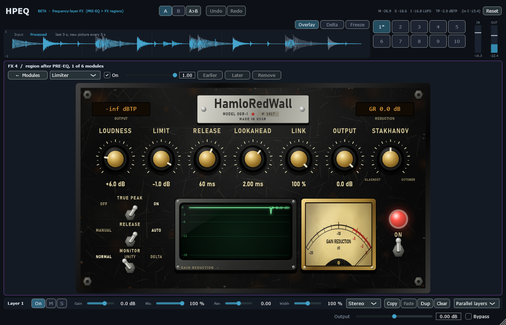
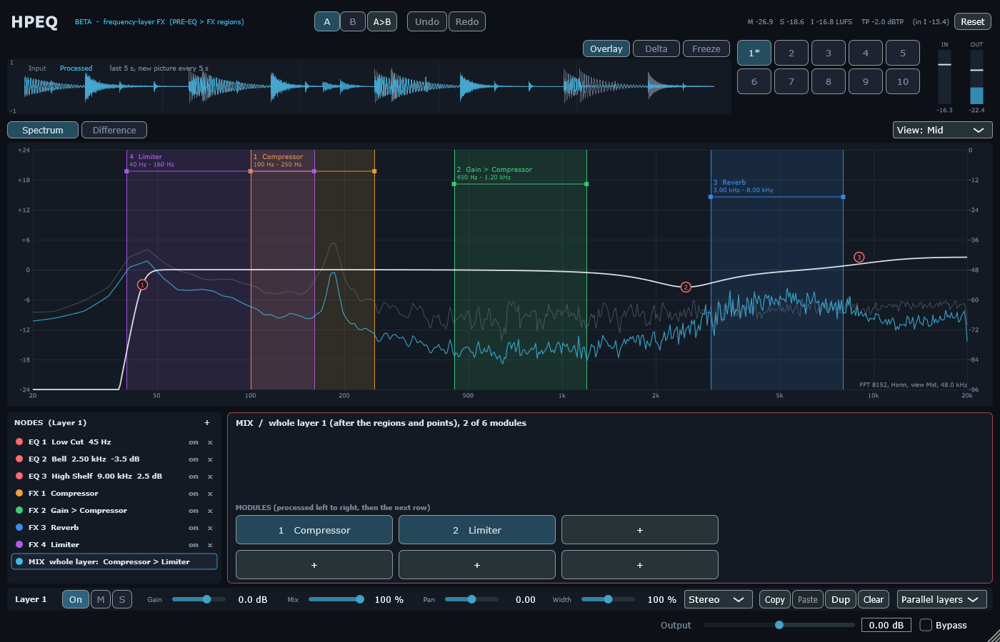

# Module pass 5 — HamloRedWall limiter, and modules on the whole layer (D7)

## 1. Scope / Date / Base / Platform

| | |
|---|---|
| Scope | Owner: limiter pass ("HamloRedWall", Black Steel, Soviet style names in English); every module must also work on the whole mix of a layer; the "+" menu offered only 2 FX |
| Design | [`LIMITER_DESIGN.md`](../LIMITER_DESIGN.md), DECISIONS D7 |
| Date | 2026-10-23 |
| Base | `f04dfc3` (module pass 4) on `feature/hpeq-m0-m1` |
| Platform | Windows 11 x64, i5-10300H, MSVC 19.50.35730, JUCE 8.0.12 |

## 2. What changed

**Modules on the whole layer (D7).** Each layer has a MIX chain (0–6 modules) after its regions and
points and before the layer controls, on its own engine node; its latency adds to the layer's. The node
list shows "MIX  whole layer: …" (click = its module grid); the "+" menu now has full submenus — EQ point
(every shape), FX region (every module), module on the whole layer (every module) — and the workspace's
right-click menu has "Add module on the whole layer". State: `MixChain` (additive).

**HamloRedWall** (laws in `Source/DSP/HamloRedWall.h`; with every option at its default the M6 limiter
runs, bit-exact):
- THRESHOLD (push, L2 style), CEILING (sample peak guaranteed), RELEASE + AUTO (program-dependent),
  LOOKAHEAD, LINK 0–100 %, MONITOR NORMAL / UNITY / DELTA.
- TRUE PEAK: the detector also sees 4× interpolated inter-sample peaks; the audio waits 8 more samples so
  the guarantee covers them (latency + 8, reported to the host).
- Styles: **GLASNOST** (openness: transparent, the M6 law), **STAKHANOV** (over-fulfils the plan:
  effective look-ahead L/4 — less ducking before a hit — and half the release, same total latency),
  **OCTOBER** (the revolution: soft clip at 1.25 × ceiling before the limiter — louder, with harmonics).
- A limiter added from the UI starts with true peak and auto release on, ceiling −1 dB, release 60 ms.

**Page (Black Steel):** nameplate "HamloRedWall · MODEL OGR-1 · № 1917", amber LCDs (output peak in dB or
dBTP, gain reduction), brass knobs **LOUDNESS** (the push, shown as +dB), **LIMIT** (the ceiling), RELEASE,
LOOKAHEAD, LINK, **OUTPUT**, and the style knob titled with the chosen style (GLASNOST / STAKHANOV /
OCTOBER; owner: no red labels, the style name on top), levers TRUE PEAK / RELEASE MANUAL–AUTO / MONITOR, green CRT with the gain-reduction history
of the last 4 s, GAIN REDUCTION needle meter, ON lamp and toggle.





**OUTPUT** (owner, after the first page: "a knob for the volume"): `out = y · 10^(O/20)`, O ∈ [−24, 0] dB,
applied last. Since |y| ≤ c, the output peak is ≤ LIMIT + OUTPUT and every level measure moves by exactly
O; O > 0 is not offered (it would break the ceiling guarantee; louder = LOUDNESS).

## 3. Commands and exit codes

```bash
cmake --build --preset release                     # 0, no warnings
build/Release/HPEQ_Tests.exe                       # 0 — 1276 passed, 0 failed
build/Debug/HPEQ_Tests.exe                         # 0 — 1276 passed, 0 failed (CRT hook: malloc + new, 0 audio-thread allocations)
HPEQ_Lab bench --reps 2 --blocks 1000              # reports/limiter_pass/bench.json
HPEQ_Lab t11 + HPEQ_HostSmoke --t11 (random projects now with MIX chains)   # 0 — 20/20
HPEQ_Lab ui                                        # screenshots
```

## 4. Numbers (criteria from the design note, fixed before the runs)

| # | Test | Result |
|---|---|---|
| 1 | Options at defaults = M6 (path, latency 96; true peak adds 8) | pass |
| 2 | Output sample peak ≤ ceiling: 3 styles × 3 links × 3 thresholds × true peak × auto (108 settings), drums +18 dB | worst **0.00000 dB** over |
| 3 | True peak: inter-sample peaks (independent 8× interpolator) ≤ ceiling + 0.3 dB with TP; > 0.5 dB without | without **+3.01 dB**, with **0.00 dB** |
| 4 | Threshold −6 dB on drums: ≥ +3 LU at the same ceiling | **+4.74 LU** (−15.71 → −10.98 LUFS), peak −1.00 dBFS |
| 5 | Auto release on a bass line: GR modulation ≥ 20 % lower than fixed | 1.746 → **1.214 dB (−30 %)** (see §5) |
| 6 | STAKHANOV: samples ducked > 0.5 dB before a transient ≤ 30 % of GLASNOST | **54 vs 214 (25 %)** |
| 7 | OCTOBER: ≥ +1 LU over GLASNOST; more 3rd harmonic | **+1.59 LU**; −14.5 vs −175 dB |
| 8 | LINK 0: right channel untouched by a left burst; LINK 1 ducks it | exact; up to 10.5 dB |
| 9 | MONITOR: UNITY level change ±0.5 dB; DELTA = delayed input − output | 0.000 dB; < 1e−5 |
| 10 | Latency reported = measured (TP on/off, styles); blocks 1 / 64 / 512 identical; 0 allocations | pass |
| 11 | MIX chain: compressor on the MIX chain = the compressor on the input (≤ −120 dB); layer latency = nodes + mix; state round trip; "+" menu lists 9 shapes + 10 + 10 modules | **−141.3 dB**; 104 + 104; pass; pass |
| 13 | OUTPUT −0.5 / −6 / −18 dB: peak ≤ LIMIT + OUTPUT; output = 0 dB output × 10^(O/20) (≤ 1e−6); loudness shift = O ± 0.01 LU | peak over **0.00000 dB**; worst error 4.2e−8; shifts −0.500 / −6.000 / −18.000 LU |
| 12 | Page in the real editor: fills the body; knobs / levers edit the project; an older limiter shows the M6 defaults | pass |
| — | T11 through the VST3 binary (random projects with MIX chains) | 237/237 states and latencies, 57/57 bit-exact renders and re-opens |

CPU (block 512 at 48 kHz, p50 / p99 µs, p99 % of the block; includes the crossover tree for a band):
M6 limiter 49 / 111 (1.0 %), GLASNOST + auto 61 / 162 (1.5 %), + true peak 83 / 169 (1.6 %),
OCTOBER + TP + link 50 % 102 / 217 (2.0 %), true-peak limiter on the MIX chain 86 / 182 (1.7 %).

## 5. Disclosed changes after the first run

1. **AUTO release** first used a 1 s hold and up to 3 × the release: −8 % modulation (criterion −20 %). A
   diagnostic in the test showed the metric follows the release length (fixed 40 / 120 / 400 ms: 1.75 /
   1.52 / 0.97 dB), so the law was not slowing down enough. Now: 0.3 s hold and up to 6 × the release:
   −30 %. The criterion was not changed.
2. **Screenshot helper** of the page first filled the GR history with an invented curve; it now appends the
   real reading (no made-up data in screenshots).

## 6. Not verified

Listening and mouse use in FL Studio (owner).
