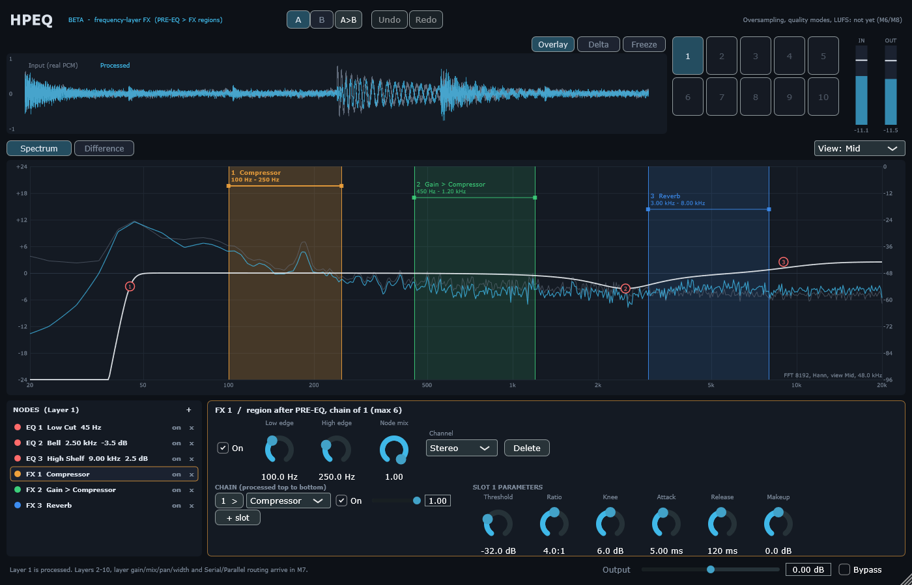

# M5 — One-layer UI with truthful analysers

## 1. Milestone / Date / SHA / Branch / Platform

| | |
|---|---|
| Milestone | M5 — usable one-layer UI and monitoring |
| Date | 2026-10-21 |
| Base | `d751812` (analysis groundwork) on `feature/hpeq-m0-m1`; code and report in the M5 commit |
| Platform | Windows 11 x64, i5-10300H, MSVC 19.50.35730, JUCE 8.0.12 |

## 2. Changed files

| Path | Why |
|---|---|
| `Source/Analysis/AudioCapture.h` | Lock-free SPSC capture of real input/output PCM (frames dropped if the UI is late, never audio) |
| `Source/Analysis/SpectrumAnalyzer.*` | FFT 8192, Hann, dBFS-calibrated, power averaging, masked difference |
| `Source/Analysis/ResponseCurve.h` | Drawn PRE-EQ curve = product of `dsp::bandResponse()` of the used designs |
| `Source/Plugin/FxPluginProcessor.*` | Capture push, `editProject` (UndoManager), A/B, change broadcast |
| `Source/Plugin/FxPluginEditor.*` | New editor composed after the sketch / mock-up |
| `Source/UI/Theme.h`, `AnalysisModel.*`, `WaveformPanel.h`, `SpectrumWorkspace.*`, `NodeList.h`, `NodeInspector.*` | The UI |
| `Tests/Unit/UiAnalysisTests.cpp` | T09, METER, capture under load, undo/redo/A-B, editor life cycle |
| `Tests/Tools/LabUi.cpp` | `HPEQ_Lab ui`: renders the real editor to PNG after real audio, measures frame cost |

## 3. What the UI does (real) and what it shows as not available



**Real:**
- Header: A/B (B starts as a copy of A), copy A→B, Undo/Redo (every edit, drags grouped per gesture).
- Top strip: waveform of the **real** input (grey) and processed output (cyan), min/max per pixel,
  sample-aligned; Delta (output − input); Freeze; IN/OUT peak/RMS meters; layer buttons 1–10 in two rows.
- Workspace: log 20 Hz–20 kHz; measured input/output spectra (FFT size, window, view and rate printed
  on the plot); Difference mode; the exact PRE-EQ curve; FX regions between their real edges with their
  chain names; EQ points. View Mid / Left / Right / Side.
- Gestures: double-click adds a Bell; right-click menus add any EQ shape or an FX region (Compressor,
  Reverb, Gain), change shape, enable/disable, delete; drag an EQ point (frequency, gain), wheel = Q
  (cuts: slope); drag region edges or the region; Shift = fine.
- Node list (processing order: PRE-EQ first) with enable/delete; inspector for the ONE selected item:
  EQ (shape, frequency, gain, Q, slope, channel) or FX region (edges, node mix, channel incl. Linked/
  Dual Mono, chain of up to 6 slots with type/on/mix, parameters of the selected slot), live gain
  reduction, reverb-pool starvation warning. All values typeable.

**Shown disabled / labelled with their milestone:** layers 2–10 and layer controls (M7), FX types
without DSP in the type lists (M6), oversampling/quality/LUFS (M6/M8). Brickwall is not offered (M3).

**Not verified:** mouse gestures have no automated test and were not tried by hand by the agent; only
the edit paths they call (`editProject`, undo, inspector rebuilds) are tested. Not checked in a DAW.

## 4. Commands and exit codes

```bash
cmake --build build --config Release                         # 0, no warnings
build/Release/HPEQ_Tests.exe     # 0 — 770 passed, 0 failed
build/Debug/HPEQ_Tests.exe       # see §7
build/Release/HPEQ_Lab.exe ui --out docs/fx-addon/reports/m5/screenshots   # 0
build/Release/HPEQ_HostSmoke.exe --plugin …/HPEQ.vst3 --other …/HPDG.vst3     # 0 — 16/16
```

## 5. Numbers

| Test (threshold fixed before the run) | Result |
|---|---|
| T09: captured input/output vs the real PCM through the plugin (EQ + output gain) | **bit-exact**, every sample; 0 allocations in `processBlock` |
| Capture with no reader for 3 s (queue 1.37 s) | 78 465 analyser frames dropped; audio **bit-identical** to a processor without the overflow |
| Analyser calibration: on-bin sine −6 dBFS | −6.00 dB (±0.05); worst off-bin −7.42 dB (Hann scalloping, ≤ 1.43) |
| Displayed spectrum vs FFT of the captured PCM | **identical** arrays |
| Drawn PRE-EQ curve vs measured engine response (Low Cut 48, Bell +6, High Shelf −4) | worst **0.0001 dB** (≤ 0.05) |
| Difference spectrum, Bell +6 dB at 1 kHz on pink noise | 6.01 dB at 1 kHz (6 ± 0.5), 0.08 dB at 100 Hz; quiet bins masked |
| METER: −12 dBFS sine, output −6 dB | in peak −12.00, RMS −15.01; out peak −18.00, RMS −21.01 (±0.01) |
| Undo/redo of a gain edit + an added node; A/B | exact restore (value trees equivalent); B starts as A; both kept |
| Editor: 50 create/paint/destroy cycles at 1000×700 and 2600×1700 with EQ and 6-slot FX selections, audio running; selected node deleted from outside | no crash, inspector falls back to "nothing selected" |
| UI frame (analysis update + full repaint 1400×900, message thread) | p50 6.4 ms, p95 8.0 ms, max 13.0 ms (30 Hz budget 33.3 ms) |

Screenshots (rendered from the real editor after real audio): `m5/screenshots/hpeq_m5_compressor_selected.png`,
`hpeq_m5_eq_selected.png`, `hpeq_m5_difference.png`. The Difference view shows the measured effect of
the whole chain: the EQ curve, −1…−2 dB from the two compressors in their bands, and the reverb's
added energy at 3–8 kHz.

## 6. Artifacts

`reports/m5/screenshots/*.png`, `reports/m5/host_smoke.json`, `reports/m5_logs/`.

## 7. Acceptance matrix

| ID | Status | Evidence |
|---|---|---|
| T09 | **PASS** | §5 (capture, analyser, curve, difference) |
| METER | **PASS** (sample peak + RMS; true peak is M8) | §5 |
| STATE (UI) | **PASS** (undo/redo, A/B); A/B is not saved with the plugin state (documented) | §5 |
| Gate 5 | **PASS** — T09, screenshots from real data, UI work on the message thread only (lock-free capture, the audio thread never waits), frame cost measured | |
| DAW / gestures by hand | **BLOCKED** (agent) | owner check in FL Studio suggested |

Debug run with the allocation hook: `reports/m5_logs/unit_debug.log` (summary added on completion).

## 8. Existing HPDG

Untouched; HPDG.vst3 still scans next to HPEQ (16/16).

## 9. Limitations / risks / findings

1. Finding while writing T09: the first version of the difference test read past the end of its buffer
   (last block 512 samples into a 1.2 s signal), which produced NaN and crashed the test process. Test
   fixed (`jmin`); no product code involved.
2. The analyser view of an M/S or L/R-mode EQ band draws the band as if it acted on the drawn channel;
   the plot names the view, but per-mode curves are a later refinement.
3. Host automation of nodes is not exposed (01 §10: stable parameter slots are a separate design task).
4. A/B and undo history are session-only.

## 10. Next

**M6** — the remaining processors one by one with their own tests (Saturator with oversampling and
alias test T08, Transient, Delay, Monsta FX, Stereo, Gate/Expander, Limiter), then M7 layers.
