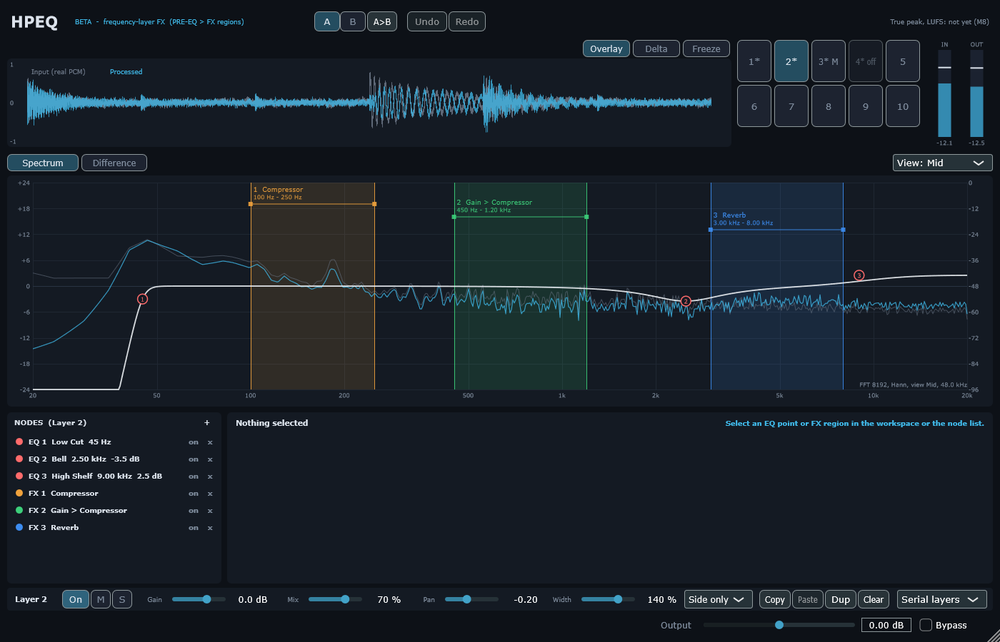

# M7 — Ten layers, Parallel / Serial routing

## 1. Milestone / Date / SHA / Branch / Platform

| | |
|---|---|
| Milestone | M7 — 10 layers, Parallel (delta) and Serial routing, layer controls |
| Date | 2026-10-22 |
| Base | `78f7b17` (M6) on `feature/hpeq-m0-m1`; code and report in the M7 commit |
| Platform | Windows 11 x64, i5-10300H, MSVC 19.50.35730, JUCE 8.0.12 |

## 2. Changed files

| Path | Why |
|---|---|
| `Source/DSP/ProjectEngine.*` | Ten `LayerEngine`s, routing, weights, controls, channel components, cross-layer latency, lazy layers |
| `Source/DSP/LayerEngine.*` | Optional shared pools; `update()` (snapshot + tree before the block); `needsProcessing()` |
| `Source/DSP/FxNodeProcessor.h` | Pools shared per project: Reverb 16, Delay 8, Monsta 8 (DECISIONS D5) |
| `Source/Core/FxProjectState.*` | `selectedLayer()`, `copyLayerInto()` (fresh node ids), `layerHasContent()` |
| `Source/Plugin/FxPluginProcessor.*` | `ProjectEngine`; latency = Parallel max / Serial sum; tails per routing; `selectLayer`, copy/paste layer |
| `Source/Plugin/FxPluginEditor.*`, `Source/UI/LayerControls.*` | Ten working layer buttons with state marks; Layer Controls row; routing selector |
| `Source/UI/NodeInspector.cpp`, `NodeList.h`, `SpectrumWorkspace.cpp` | Show and edit the selected layer instead of layer 1 |
| `Tests/Unit/M7Tests.cpp` | 12 test groups |
| `Tests/Unit/DynamicsReverbTests.cpp`, `M6Tests.cpp` | Pool tests rewritten for the shared pool sizes |
| `Tests/Tools/LabM7.cpp`, `LabUi.cpp` | T12 CPU / memory; layer screenshot |
| `docs/fx-addon/DECISIONS.md` | D5 — layer semantics |

## 3. What was built

- **Parallel (delta):** `y = D_L(x) + Σ w_j (D_{L−L_j}(L_j{x}) − D_L(x))`, `L = max L_j`.
- **Serial:** `x_{j+1} = D_{L_j}(x_j) + w_j (L_j{x_j} − D_{L_j}(x_j))`, `L = Σ L_j`; PRE-EQ stays first inside
  every layer (decision B).
- `L_j{·}` = layer engine (PRE-EQ → FX nodes) on the chosen component (Stereo / Left / Right / Mid /
  Side), then gain → width → pan. `w_j = mix · heard` (Mute/Solo), ramped 20 ms.
- Bypassed layers are not processed after their fade; empty layers are never processed.
- UI: all ten layer buttons select the shown layer and show `*` content, `off`, `M`, `S`. The row under
  the inspector: On / M / S, Gain, Mix, Pan, Width, channel, Copy / Paste / Dup / Clear, Parallel / Serial.



## 4. Commands and exit codes

```bash
cmake --build --preset release                     # 0, no warnings
build/Release/HPEQ_Tests.exe                       # 0 — 953 passed, 0 failed
build/Debug/HPEQ_Tests.exe                         # 0 — 953 passed, 0 failed (CRT hook: malloc + new)
build/Release/HPEQ_Lab.exe m7 --out docs/fx-addon/reports/m7                      # 0
build/Release/HPEQ_Lab.exe ui --out docs/fx-addon/reports/m7/screenshots          # 0
build/Release/HPEQ_HostSmoke.exe --plugin …/HPEQ.vst3 --other …/HPDG.vst3 --out docs/fx-addon/reports/m7/host_smoke.json   # 0 — 16/16
```

## 5. Numbers

| Test (threshold fixed before the run) | Result |
|---|---|
| Gate 7: 10 empty layers; 10 bypassed layers with EQ + compressor + gain (Parallel, Serial) | **bit-exact** input |
| No dry duplication: 10 enabled Parallel layers with a 0 dB bell (±0.01 dB, null ≤ −100 dB) | 0.0000 dB, null −400 dB (a dry sum would be +20 dB) |
| Parallel vs independent model of the formula (3 layers: EQ+comp, saturator node, EQ + gain −6 / pan 0.3 / width 1.5 / mix 0.5) (≤ −120 dB) | **−152.1 dB** |
| Serial vs independent model (same layers, in order) (≤ −120 dB) | **−145.0 dB** |
| Serial order: saturate → −12 dB vs −12 dB → saturate differ (> −20 dB) | −1.9 dB (different) |
| Cross-layer latency: Parallel (2 ms + 1 ms limiters) = 96; Serial = 96 + 48 = 144; output = zero-latency project delayed (≤ −120 dB after 1 s) | 96 / −400 dB; 144 / −156.7 dB |
| Mute, layer Mix 0, Solo (Parallel, Serial): equal to the project without / with only that layer | **bit-exact** |
| Mute keeps the layer running: after un-mute + 20 ms, output = never muted | **bit-exact** |
| Lazy layers: 3 of 10 processed; after bypassing one, 2 | 3 → 2 |
| Side layer: mid-only input unchanged (≤ −120 dB); side tone +6 dB bell (±0.1) | pass; 6.000 dB |
| Left layer: right channel | **bit-exact** |
| T10, 4 layers (comp + sat 2x, reverb + width, Mid-mode limiter + delay, transient + Monsta), Parallel and Serial, blocks 1/64/127/512 | **bit-exact**, **0 allocations** |
| Stress: 10 layers × 8 nodes × 6 slots (every type), 2000 random layer-control changes, Parallel and Serial | finite, 0 allocations, 112 starved pooled slots reported; peak +12.3 dBFS (Parallel), −0.2 dBFS (Serial) |
| STATE: full 10-layer project (names, mutes, bypass, Side mode, Serial, selected layer 4) value-tree round trip; plugin restored from its state renders identically | equivalent; **bit-exact**; same latency |
| Layer copy / paste / duplicate | fresh unique ids; paste undoable; selecting a layer adds no undo step |

### T12 — CPU (block 512, stereo, pink noise −12 dBFS, p99 of the callback; budget = 512 / fs)

Each layer: one EQ bell + N FX nodes with one compressor each, Parallel.

| fs | 1 × 1 | 1 × 5 | 5 × 1 | 5 × 5 | 10 × 1 | 10 × 5 |
|---|---|---|---|---|---|---|
| 44.1 k | 1.2 % | 2.6 % | 4.2 % | 15.3 % | 7.8 % | 25.1 % |
| 48 k | 0.7 % | 3.1 % | 5.3 % | 16.0 % | 7.4 % | 26.3 % |
| 96 k | 1.8 % | 6.5 % | 7.9 % | 26.8 % | 15.8 % | 56.7 % |
| 192 k | 3.8 % | 11.7 % | 19.6 % | 58.0 % | 29.0 % | **110.5 %** |

(p50/p95/p99/max in µs per row: `m7/m7_lab.json`.) Other profiles at 48 kHz:

| Profile | p50 µs | p99 µs | p99 of budget |
|---|---|---|---|
| 10 × 5 compressor, Serial | 2249 | 2865 | 26.9 % |
| 10 × 5 × [comp, sat 2x, transient, limiter 1 ms], Parallel | 9163 | 15569 | **146 %** |
| same, Serial | 9011 | 10235 | 96 % |
| same, all layers bypassed | 4.2 | 4.3 | 0.04 % |
| same, all layers muted | 9109 | 10669 | 100 % |
| empty project | 4.4 | 4.5 | 0.04 % |

Memory of a prepared engine (working set): **62 MB at 48 kHz, 123 MB at 192 kHz**; process peak 181 MB.

## 6. Artifacts

`reports/m7/m7_lab.json`, `reports/m7/screenshots/hpeq_m7_layers.png`, `reports/m7/host_smoke.json`,
`reports/m7_logs/` (unit Release/Debug, lab).

## 7. Acceptance matrix

| ID | Status | Evidence |
|---|---|---|
| Gate 7: 10 bypassed = unity | **PASS** (bit-exact, both routings) | §5 |
| No dry duplication / Parallel / Serial formulas | **PASS** | §5 |
| PDC across layers | **PASS** offline; DAW BLOCKED | §5 |
| MIX-0 (layer) | **PASS** (bit-exact) | §5 |
| STATE (10 layers) | **PASS** | §5 |
| T12 | **MEASURED**: typical mixes (≤ 10 × 1, ≤ 5 × 5 at 44.1/48 k) meet the 01 §7 target p99 ≤ 20 %; 10 × 5 at 48 k (26 %), 96/192 k heavy profiles and the 10 × 5 heavy chain do **not** | §5 |
| DAW host stress | **BLOCKED** (agent) | owner check in FL Studio |

Release: **953/953** (`reports/m7_logs/unit_release.log`). Debug with the CRT allocation hook: **953/953, 0 audio-thread allocations** incl. the 10-layer stress with random enable/mute/mode changes (`reports/m7_logs/unit_debug.log`).

## 8. Existing HPDG

Untouched; HPDG.vst3 still scans next to HPEQ (16/16).

## 9. Limitations / risks / findings

1. **CPU.** About 45 µs per FX node with one compressor per 512-sample block (crossover tree + node);
   oversampling dominates heavy chains (M6). 10 layers × 5 heavy nodes do not run in real time on this
   machine. Muted layers cost full CPU by design (seamless un-mute); bypassed layers cost nothing.
   Optimisation (tree cost per node, cheaper oversampling, optional "mute = stop") is proposed for M8
   with the same lab before/after.
2. **Memory.** 62 MB per instance at 48 kHz, mostly per-slot buffers (every one of the 480 slots owns a
   limiter look-ahead buffer, two oversamplers and an alignment line). A per-type pool or allocation
   on the message thread when a slot type changes would cut this; not done in M7.
3. Layer bypass cuts tails after the 20 ms fade (node bypass keeps them) — D5.
4. Routing change (Parallel ↔ Serial) restarts the alignment lines: an audible jump at the switch; the
   latency changes with it anyway.
5. Layer-control ramps start at host block boundaries: parameter *changes* are not block-size
   invariant (static settings are, T10).
6. First version found by the tests: ramps started from default values instead of the published
   state (formula tests at −30 dB, T10 failures). Fixed: the first block after reset lands on the
   published state.
7. First version found by the tests: the plugin published its project before `prepare()`, when the
   layer engines did not exist yet, so nothing was processed (M2/M5 plugin tests failed). Engines are
   now created in the constructor.
8. Parallel can exceed 0 dBFS (stress: +12.3 dBFS): there is no hidden limiter (03 stage 7); the meters
   show it.
9. **Found by the Debug run (CRT hook):** re-enabling a layer or switching its channel mode called
   `CrossoverTree::reset()`, which assigned a temporary `NodeEdges {}`; its empty `std::vector` allocates
   an iterator-debugging proxy in MSVC Debug builds (16 allocations per reset; none in Release, which is
   why the Release probe did not see it). The reset now clears the fields in place: 0.
10. No DAW check, no mouse test of the new controls by the agent.

## 10. Next

**M8** — validation and release: pluginval (not installed; download needs the owner's OK), T11 host
reopen / mutate / restore, true peak / LUFS meters, CPU tiers from §9.1. Then the owner's UI rework
(BACKLOG F1–F3).
