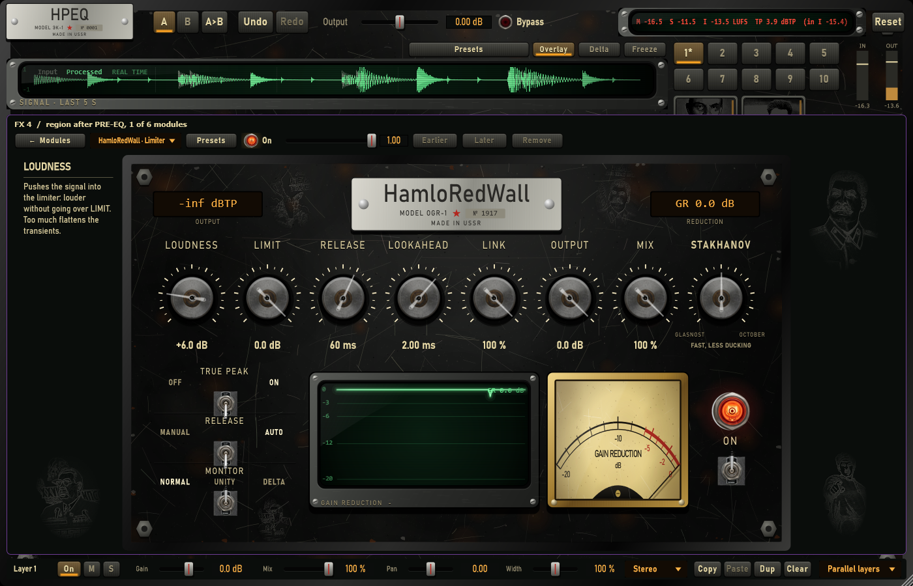
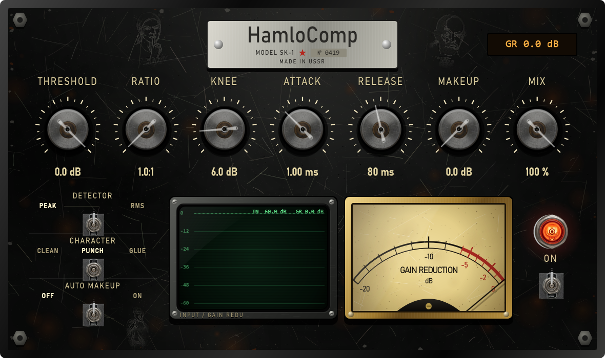
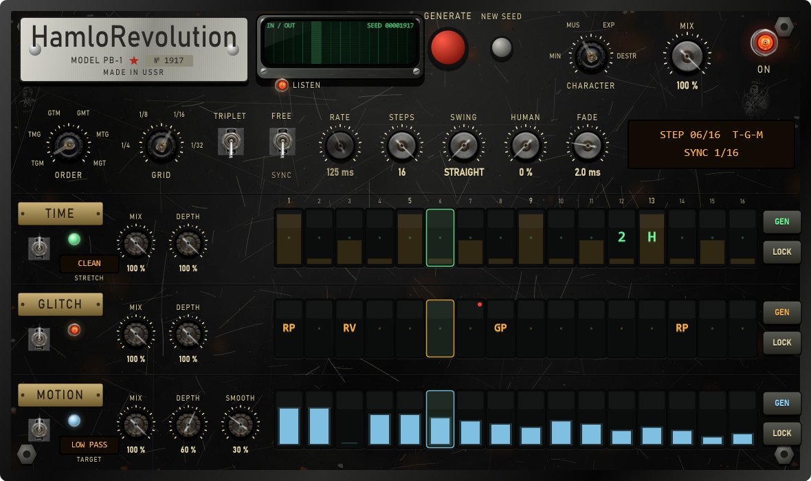

# Owner round 2026-10-26 — neutral defaults, compressor history, knob help, HamloRevolution lanes

## What the owner asked

1. The compressor should show the envelope like the other modules.
2. The saturator starts in AUTO, which turns the output down; with no preset chosen every module should start
   "at zero", everywhere.
3. Choosing a knob on any module: write at the side what it does and what it is for (there is room on the left).
4. Not every module (and not HPEQ itself) shows the scratched Soviet pictures.
5. HamloRevolution: generate TIME / GLITCH / MOTION separately, LOCK a single lane; a wave screen where the
   SEED was, to see how everything changes.

## What changed

**Neutral defaults** (`defaultModule`, FxProjectState.cpp): a module added from the UI does not change the
sound until a knob is turned —

| Module | Starts with |
|---|---|
| Compressor | THRESHOLD 0 dB, RATIO 1:1, AUTO MAKEUP off |
| Limiter | LOUDNESS 0, LIMIT 0 dB |
| Saturator | DRIVE 0 dB, AUTO off, WOW / HISS / HUM / CRACKLE 0 (TAPE, 2x as before) |
| Reverb, Delay | MIX 0 (nothing added until MIX is raised) |
| Gate | THRESHOLD OFF (-90 dB, the knob's end; the gate core now treats it as "never closes") |
| Stereo | STEREOIZE 0, SPACE 0 |
| HamloRevolution | an empty pattern (GENERATE or GEN fills it) |
| Transient, Gain | already neutral |

Double-click resets on the pages follow the same values. The factory module presets were calibrated
against the earlier defaults, so they are now built on `presetBaseModule` (those earlier defaults) and keep
their sound exactly.

**Compressor:** the INPUT needle became a green CRT with the input level (dim) and the gain reduction
(bright, from the top) of the last 4 s and the threshold dashed; the GAIN REDUCTION needle stays.

**Knob help:** every module page tells the inspector which control is under the mouse (`HelpTarget`); the
inspector writes its name and what it does (`ModuleHelp.cpp`, a text for every knob and switch of the 11
pages) in the free margin left of the page. Before a control is chosen it says "Point at a knob or a
switch".

**Scratched pictures:** the free margins left and right of every module page now carry 2–3 large pictures
(that is where HPEQ's own window showed none); the HamloRevolution and HamloTochka pictures were drawn
squashed or faint and are now in proportion at full strength.

**HamloRevolution:** each lane has **GEN** (a new pattern for this lane only, a new seed; the other lanes are
held) and **LOCK** (every step of the lane locked: GENERATE keeps it; LOCK lit shows LOCKED). The SEED
counter is now a **wave screen**: the input (dim) and output (bright) peaks of the pattern cycle per 1/8 step,
the step grid and the play head, the seed written small in its corner (the engine keeps the 128 peaks).

## Tests (`Tests/Unit/OwnerRoundTests.cpp`)

- A new module of every type but the saturator, on the whole layer, after its 20 ms fade-in: the output is
  the input (delayed by its latency) — difference -3000 dB (exact) for all nine.
- Presets keep their base (compressor -30 dB, saturator 6 dB drive, reverb mix 100 %, a generated pattern).
- Every knob and switch of every page has a help text; a page answers the key under a point.
- Lane GEN changes only that lane; LOCK keeps a lane through GENERATE; GEN on a locked lane does nothing.
- The wave screen gets input and output peaks from the engine.
- Tests that checked the old defaults now check the new ones (compressor, saturator, MIX knobs), and the ones
  that used the old default as a sound reference use `presetBaseModule` (compressor crest, HamloRevolution
  render).

## Not verified

Listening and mouse use in FL Studio (owner).

## Runs

- Release: **2551 passed, 0 failed**.
- Debug: 2548 passed, **3 failed — the CPU deadline checks** of HamloRevolution (1 and 8 instances) and the tubes
  (LENIN / STALIN). They measure speed in the unoptimised Debug build; the tubes' check fails there too and this
  round did not touch the tubes. In Release they pass (HamloRevolution 8 instances p99 52 % of the deadline).
- The first full Release run failed the 8-instance HamloRevolution CPU check (p99 122 %): the wave screen looked
  up the step on every sample. It now looks it up only at step edges (52 %).
