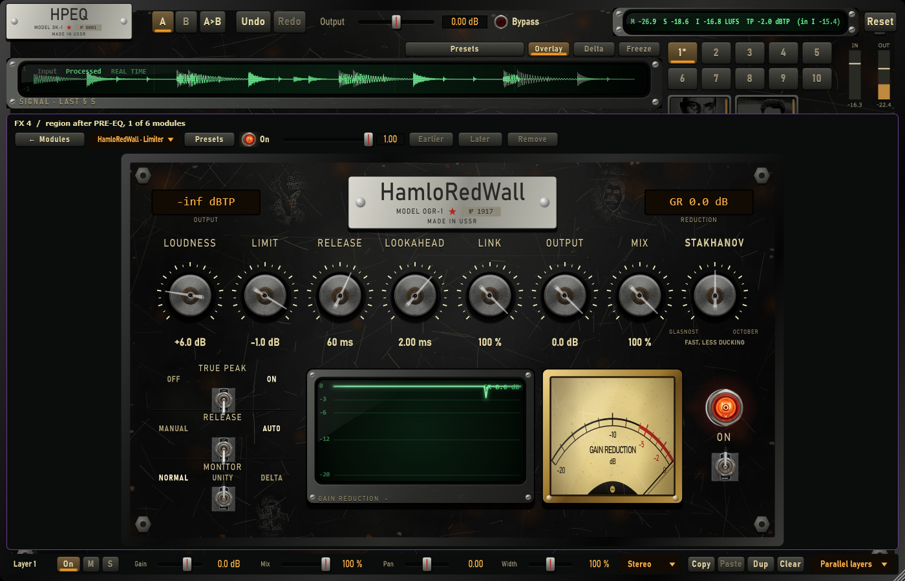

# Presets pass: presets for the whole HPEQ and for each module; LENIN / STALIN driven harder

## 1. Scope / Date / Base

| | |
|---|---|
| Scope | Owner (2026-10-26): add the presets; a preset button before Overlay; each module has its own presets; make BRING LENIN / STALIN BACK somewhat stronger (MIX takes it back down) |
| Date | 2026-10-26 |
| Base | `4c20c7f` on `feature/hpeq-m0-m1` |

## 2. Presets for the whole HPEQ

**The button before Overlay** (in the waveform row) opens the menu:

- **Init**: an empty project.
- **Factory**: pack > category (> group) > preset.
  - The factory library is in `Assets/Presets/Factory`. Its 185 saved states were made by another agent, with their generator scripts in `scripts/generate_factory_presets*.ps1`.
  - Two packs:
    - **Drums & Bass**: Kick, Snare, Hi Hat, Percussion, Drum Bus, Bass.
    - **Vocals, Mastering & More**: Lead Vocal, Backing Vocal, Mastering (Pop / Rap / Trap / Techno / House / EDM / Rock / Indie), Guitar, Synth, Keys, Mix Bus.
  - The library is embedded in the plug-in, so it does not depend on files next to the .vst3. CMake writes an index (pack / category / file) that is rewritten only when the library changes.
- **User**: the user's own presets (`%APPDATA%/HamloProd/HPEQ/Presets/User/*.hpeq`, the same saved state).
- **Save preset...** and **Open preset folder**.

**Loading a preset:**
- The preset is applied as **one undoable edit**.
- Output gain comes with the preset. This part is not undoable, because Output is a host parameter.
- **Bypass stays as it is.**
- A broken or newer state changes nothing.
- The button shows the name of the loaded preset, and the name is saved with the project.

## 3. Presets for each module

On every module page, the header gains a **Presets** button next to the type selector.

The menu offers:
- Default;
- the module's factory presets;
- the user's own presets (`.../Presets/Modules/<Type>/*.hpeqmod`, one module as saved in a project);
- Save preset... and Open preset folder.

Applying a preset:
- It is one undoable edit.
- It sets the module's defaults, then the values the preset names, then its mix.
- The module's ON state is kept.
- For HamloRevolution, the pattern is generated from the preset's seed and character.

**66 factory presets** (`Source/Core/ModulePresets.cpp`; 83 since presets pass 3 below):

| Module | Presets |
|---|---|
| HamloComp | Vocal Leveler, Drum Punch, Bus Glue, New York Parallel, Bass Control, Gentle Master, Squash (parallel) |
| HamloRedWall | Safe Ceiling, Streaming -1 dBTP, Loud Master, Soft Clip Push, Drum Peak Catcher, Broadcast -2 dB |
| HamloVerb | Vocal Plate, Small Room, Drum Chamber, Big Hall, Cathedral, Ambience Glue, 80s Snare Plate |
| HamloEcho | Slapback, Quarter Tape, Dotted Eighth, Ping-Pong 1/8, BBD Chorus Echo, Lo-Fi Dub, Vocal Throw (ducked) |
| HamloUdarnik | Kick Punch, Snare Crack, Tighten Room, Soften Attack, Drum Bus Snap, Sustain Bloom |
| HamloMag | Tape Warmth, Tube Glow, Iron Weight, Germanium Fuzz, Vinyl Dust, Cassette Lo-Fi, Parallel Grit |
| HamloRevolution | Subtle Movement, Musical Stutter, Half-Time Tape, Filter Motion, Width Pulse, Experimental, Destruction |
| HamloShirota | Wider Mix, Mono Bass 120 Hz, Master Width, Narrow, Stereoize Mono, Cosmos Pad |
| HamloZastava | Kick Gate, Snare Gate, Tom Gate, Vocal Noise Expander, Guitar Hum Cleaner, Gentle Bleed Cut |
| HamloFader | Unity, Pad -6 dB, Pad -12 dB, Boost +6 dB, Polarity Flip, Match to -18 dBFS, Match to -14 dBFS |

**The standalone module plug-ins** (HamloComp … HamloShirota .vst3) offer the same presets as host programs: 0 = Default, then the presets.

## 4. LENIN / STALIN: 6 dB more drive

The drive point moved from −6 dBFS to **−12 dBFS**: a −12 dBFS sine now gives the chain's static THD of 1 % (LENIN) and 4 % (STALIN).

So everything the tubes did at a level now happens 6 dB lower:
- harmonics at mix levels are about 6 dB louder;
- peaks are driven harder;
- STALIN's transformer knee moves with the drive point (6 dB above it, as before).

Small signals still pass at unity. MIX 50 % lowers the colour by 6 dB, so MIX ≈ 50 % comes close to the previous colour level.

| 1 kHz | before: −18 / −12 / −6 / 0 dBFS | now |
|---|---|---|
| LENIN THD | 0.019 / 0.038 / 0.31 / 3.45 % | 0.038 / 0.31 / 3.45 / 4.54 % |
| STALIN THD | 0.52 / 1.10 / 3.43 / 22.1 % | 1.10 / 3.43 / 22.1 / 40.5 % |

## 5. Tests (thresholds fixed before the runs)

| Test | Threshold | Result |
|---|---|---|
| Factory library embedded and loading | 185 presets, 2 packs, 13 categories; each loads and undoes | 185 / 185 loaded and undone |
| Preset load | Output gain from the preset, Bypass unchanged, name saved, a broken block changes nothing | Kick / Club Foundation: −1.00 dB, Bypass on |
| Module presets | ≥ 6 per module, unique names, only keys the module's page edits | 66 presets in 10 modules |
| Module presets sound | in the MIX chain on noise at −18 dBFS: finite output, not below −40 dBFS | 66 / 66 |
| User module presets | save and load round trip; a preset of another module type is refused | pass |
| Panel | the preset button left of Overlay shows the loaded preset; module pages have Presets | pass |
| Standalone programs | ≥ 7 programs (Default + presets); a program sets the panel; Default restores it | 8 / 8 modules |
| Tube bench (TUBE_PASS_REPORT) | all checks | pass, with the changes below |

### Disclosed

1. **The category count was miscounted.** The threshold was written as 12, but the library has 13 categories (6 + 7). It was corrected to 13; the library itself was not changed.
2. **HamloRedWall "Safe Ceiling" was identical to Default** (the standalone program test caught it). The preset now limits from −1 dB.
3. **The first drive change was not enough.** Raising the THD targets at −6 dBFS (1 → 3 %, 4 → 10 %) barely moved the colour at mix levels: LENIN H2 at −12 dBFS rose by only 0.6 dB, because the stages' knee is steep. It also broke two character checks. It was replaced by moving the drive point 6 dB down.
4. **Tube checks tied to the drive point moved with it.** "LENIN H2 over H3" moved from −12 to −18 dBFS. The STALIN transformer check (40 Hz THD > 2 × 1 kHz) moved from −6 to −12 dBFS: 9.84 % vs 3.43 %.
   - The thresholds themselves are unchanged.
   - At the old levels these checks now fail by design: they would be measuring 6 dB above the drive point.

Full suites (Release): `HPEQ_Tests` 2480 / 2480, `HPEQ_ModuleTests` 105 / 105.

## 6. Not verified / limits

- **Listening in FL Studio is for the owner:**
  - how the factory library sounds;
  - whether 6 dB more tube drive is "a bit more" or too much.
- The factory library's dynamics thresholds depend on the source level, as its README says.
- The library is the other agent's work: it is embedded and loads, but its content was not reviewed preset by preset.
- **Undo does not cover everything a preset load sets:** it restores the project but not the Output gain or the preset name.
- The EQ point has no preset menu of its own. Its DE-ESS button is a one-button preset.

---

# Presets pass 2: the whole library rebuilt and measured; HamloEcho ping-pong fix

Owner, 2026-10-26: a vocal preset needed +8 dB by hand ("слишком тихо"); some vocal presets were written before the
de-esser; the mastering presets must be redone from data; redo all presets, add more, and show what HPEQ can do
(layers, HamloRevolution …). Also: HamloEcho sent a mono vocal to the left ear only.

## 1. HamloEcho: ping-pong with CROSS 0 stayed in the left ear

PING-PONG feeds the left line only and left the bouncing to the CROSS knob; at CROSS 0 % (the owner's setting)
nothing crossed, so the echo stayed left. Now ping-pong always bounces L → R → L; CROSS acts while ping-pong is off.
The echo-train display follows. New tests: a mono source with ping-pong off gives L = R within 1 dB (Clean / Tape /
BBD / Lo-Fi: 0.01–0.15 dB); ping-pong at CROSS 0 bounces L, R, L with each echo ≥ 20 dB on its side (46–260 dB).

## 2. The library: 197 presets, designed in code and calibrated on real material

`Tests/Tools/LabPresets.cpp` (`HPEQ_Lab presets --material <dir> --out Assets/Presets/Factory`) replaces the two
PowerShell generators (removed). It builds each preset, runs it through the plug-in on real material (the loudest
24 s of each clip, 48 kHz) on all cores, calibrates it and writes the `.hpeq` files, the manifests (with every
preset's measurement) and `Assets/Presets/Factory/CALIBRATION.md`.

**Material** (the owner's, not in the repository): three lead vocals and three backing vocals from the owner's
projects; kick, snare / clap, hats, percussion, sub bass, bass guitar, drum loop, guitar chords, felt chords,
electric piano and a synth melody from the owner's stems; unmastered mixdowns `full_mix.wav` of three of the
owner's beats. The owner's own masters of five beats measured **−10.6 … −11.8 LUFS** integrated (true peak up to
+1.0 dBFS sample peak).

**Track presets are level-matched**: Output is set so the integrated loudness out = in on the category's material.
What that found: the vocal presets needed **+0.5 … +8.2 dB** (the old library shipped them at −1 dB: the owner's
"+8 dB by hand"). Where matching would push the true peak more than 6 dB over the input's, the peak sets the gain
instead (8 presets, marked in CALIBRATION.md: six kick presets on a hot, clipped kick stem stay 0.3–5.5 LU under the
input; two very bright vocal presets 0.9–1.0 LU under).

**Mastering is target-driven**: the HamloRedWall threshold is searched (bisection, mean of three mixdowns) until
the integrated loudness hits the genre target, true peak ≤ −1 dBTP. 6 genres × 7 masters: Clean, Warm (LENIN 30 %),
Punch, Multiband, Loud, Stalin (15 %), Streaming −14. Targets: Pop / Rock −9.5, Rap −9, Techno / House −8.5,
Trap −8 (Loud +0.5 dB, Punch +0.5 dB), Streaming −14. All 42 within ±0.5 LU, true peak −0.97 … −1.8 dBTP.

Found while calibrating (and handled in the search):
- the tubes run after the layers, so a master with LENIN / STALIN went over the ceiling (+1.0 … +1.6 dBTP): the
  search lowers the RedWall ceiling until the plug-in's output is at −1 dBTP (−2.1 dB for the Lenin masters);
- STALIN at 40 % on a loud master acts as a second, distorting limiter (loudness stuck at −11.7 LUFS): 15 % now;
- GLASNOST tops out near −9 LUFS on these mixes however hard it is driven; the search moves on to STAKHANOV, then
  OCTOBER, when a style cannot reach the target (the preset keeps the style that did).

**Every vocal preset carries the DE-ESS point** (DETECT VOICE).

**New: Hamlo Showcase** (20 presets) — Layers (Vocal Cinema: 4 parallel layers; Drum Factory: serial layers as a
production line; Drums Parallel Monster; Split-Band Bass Layers; Vocal Octave Choir), Revolution (Beat Switch-Up,
Vocal Chop Machine, Full Mix Destruction, Bass Gated Motion, Width Pulse, Crush Fills), Precision (points with their
own modules, regions: De-Ess + Air Exciter, Kick-Only Reverb, Vocal Band Saturation, Hi-Hat Only Echo, Snare Band
Reverb), Tubes (Lenin + Stalin Full Chain, Stalin Vocal Radio, Lenin Vocal Warmth, Stalin Drum Room). Layers,
Revolution, regions and tubes also appear across the other categories.

## 3. Tests

`HPEQ_Tests` "Preset pass": 197 presets, 3 packs, 17 categories, each loads as one undoable edit and undoes; the
generator itself fails (exit code) when a preset is outside tolerance. "Delay pass": the two ping-pong tests above.

## 4. Not verified / limits

- Listening in FL Studio (owner). Calibration is loudness, not taste.
- The material is hip-hop heavy; the Pop / Rock / Techno / House masters were calibrated on the same three
  mixdowns: on other material the limiter works harder or softer (loudness follows the threshold, so the target
  moves with the source). Some loud masters drive the limiter hard (up to 20 dB on the quietest mixdown).
- Dynamics thresholds depend on the source level; the kick presets were made on a hot, clipped kick stem.

---

# Presets pass 3: 17 more HamloRevolution presets, each checked on a drum loop

Owner, 2026-10-26: "more presets, only good ones, and more presets for Revolution". HamloRevolution's module
presets go from 7 to **24** (`Source/Core/ModulePresets.cpp`; 83 module presets in all). A "good" preset is one that
passes the checks below; none of the 17 candidates failed, so none was dropped.

## 1. The new presets

| Preset | Engines on | What the pattern holds |
|---|---|---|
| Tape Stop Drops | TIME (TAPE) | tape stops (and a freeze) at phrase ends |
| Half-Time Vocal (Clean) | TIME (CLEAN) | one HALF run, pitch kept by the phase vocoder |
| Reverse Tails | TIME | three REVERSE runs |
| Double-Time Rush | TIME (RHYTHM) | 2X runs |
| Freeze Pads | TIME + MOTION low pass | FREEZE loops, a slow filter under them (mix 80 %) |
| Trap Hat Ratchets | GLITCH | RATCHET steps, DEPTH 70 % (finer rolls) |
| Triplet Stutter | GLITCH, TRIPLET grid | STUTTER steps |
| Scratch DJ | GLITCH | SCRATCH steps |
| Gap Chopper | GLITCH | GAP steps |
| Boom Bap Swing Chops | TIME + GLITCH, swing 58 % | Musical chops on a swung grid |
| Humanized Glitch | TIME + GLITCH, HUMAN 40 % | Experimental, step offsets |
| Free-Time Drift | TIME + GLITCH, FREE 180 ms | chops off the tempo grid (mix 80 %) |
| High-Pass Riser | MOTION high pass | a level ramp over the bar: a filter build |
| Lo-Fi Crush Pulse | MOTION crush | crush on the grid, smoothed |
| Volume Chop 1/16 | MOTION volume | a hard 1/16 volume gate |
| Minimal Fills (Mix 40 %) | all three | Minimal pattern at 40 % |
| Mirror Destruction (M-G-T) | all three, order M-G-T | Destruction with high-pass motion first (mix 60 %) |

The seeds were picked from the generator's output (seeds 1-120 × 4 characters) so that the action a name
promises is in the pattern; a preset's pattern is generated from its seed when it is applied, as before.

## 2. Checks (thresholds fixed before the runs, `Tests/Unit/RevolutionPresetTests.cpp`)

| Check | Threshold | Before (7 presets) | After (24 presets) |
|---|---|---|---|
| Every engine left on (mix > 0) has events | ≥ 1 non-PASS step | 7 / 7 | 24 / 24 |
| A preset named after an action has it in its pattern | ≥ 1 step | — | 9 / 9 |
| No two presets make the same module | all pairs differ | pass | pass |
| 120 BPM drum loop, bars 5-8: finite | finite | 7 / 7 | 24 / 24 |
| … level out − in | −6 … +1.5 dB | −4.50 … +0.02 dB | −5.54 … +1.49 dB |
| … sample peak out − in | ≤ +3 dB | ≤ +0.73 dB | ≤ +0.73 dB |
| … difference out − in, re input RMS | ≥ −24 dB | −23.2 … +1.4 dB | −23.2 … +1.4 dB |
| Existing: page keys only, unique names, ≥ 6 per module; noise at −18 dBFS not below −40 dBFS | as before | pass | pass |

Per preset (level / peak / difference, dB): Tape Stop Drops −0.09 / 0.00 / −14.4; Half-Time Vocal (Clean) −0.01 /
−0.04 / −19.0; Reverse Tails +1.49 / 0.00 / −3.7; Double-Time Rush +0.38 / 0.00 / −2.2; Freeze Pads +0.35 / +0.04 /
−7.3; Trap Hat Ratchets +0.22 / 0.00 / −8.5; Triplet Stutter +0.19 / −0.02 / −1.2; Scratch DJ +0.86 / 0.00 / −1.3;
Gap Chopper −1.20 / 0.00 / −5.8; Boom Bap Swing Chops +0.01 / +0.31 / −10.6; Humanized Glitch −1.04 / −0.10 / +1.2;
Free-Time Drift −1.62 / −0.10 / −1.7; High-Pass Riser −4.53 / −2.02 / +0.4; Lo-Fi Crush Pulse −0.01 / 0.00 / −11.1;
Volume Chop 1/16 −4.23 / −0.10 / −4.9; Minimal Fills −0.11 / −0.02 / −17.4; Mirror Destruction −5.54 / −3.04 / −3.2.

### Disclosed

1. **The first drum loop was nearly mono** (hats and tone the same in both channels): Width Pulse, a width preset,
   measured −33.0 dB difference and failed, because a mono loop has no side for WIDTH to move. The test signal was
   made stereo (hats alternate sides, the tone is 1.5 Hz apart between channels) before any new preset was
   added; the thresholds were not changed. With it all 7 existing presets pass (Width Pulse −23.2 dB).
2. Two results sit at a threshold: Reverse Tails' level +1.49 dB (limit +1.5) and Width Pulse's difference
   −23.2 dB (limit −24). Both pass; they are listed so a later change that moves them is not a surprise.

Full suites (Release): `HPEQ_Tests` 2976 / 2976, `HPEQ_ModuleTests` 105 / 105.

## 3. Not done / limits

- **The factory library (whole-plugin presets) was not extended.** Its calibration (`HPEQ_Lab presets`) runs on the
  owner's material (vocals, stems, mixdowns), which is not in the repository and was not found on this machine;
  presets that were not calibrated and checked on it are not added. The Showcase / Revolution category keeps its 6.
- Listening in FL Studio (owner). The checks are level, peak and "it changes the loop", not taste.
- A host transport is not simulated: the loop runs at the plug-in's own 120 BPM clock.

# Presets pass 3, part 2: 27 factory presets (17 with HamloRevolution), on a rebuilt material set

Date 2026-10-27, branch `feature/hpeq-m0-m1`, base `a5ca92e`. The owner (2026-10-27): the first material folder is
gone - "make it again", from the music on E:\.

## 1. Material set 2 (`Tests/Tools/make_material_set2.py`)

The same 20 clip names as set 1, 48 kHz stereo float, so every design keeps its material. Each clip is gained so
its loudest 24 s (the window `HPEQ_Lab` uses) has set 1's integrated loudness (from CALIBRATION.md), unless the
sample peak would pass -0.3 dBFS (then the peak sets the gain). Nothing of it goes into git.

| Clips | Source | Loudness (set 1 -> set 2) |
|---|---|---|
| vocal_lead1-3 | the owner's dry vocal takes (Adobe Audition sessions "Голос твой", 6, 10) | -16.2 -> -16.2 LUFS |
| vocal_back1-3 | quieter takes from other tracks of sessions 6 and 10 | -19.9 -> -19.9 |
| mixdown_Ardnold / _boom_bap_3 / _sad_trap | the owner's "это всё перманентно" mixdown; two downloaded beats (boom bap, sad trap) | -14.1 -> -14.1 |
| drumbus1, bass1, bass2, guitar, keys, keys2, synth | stems from `Sample pack/track stems` (boom-bap kit, sub, deep bass, guitar chords, piano, felt piano, atmospheric synth) | -20.9 / -9.4 / -9.4 / -28.5 / -21.7 / -21.7 / -24.0 -> the same (bass1 -9.6) |
| kick, snare, hihat, perc | 90 BPM, 24-bar sequences of Boom Bap Box one-shots (fixed hits and patterns) | kick **-7.7 -> -11.5** (peak-limited); the rest the same |

## 2. Before: the 197 existing presets on set 2 (same generator, nothing changed)

All 197 calibrate within tolerance on set 2 too. Output gain set 2 - set 1, track presets: median 0.0 dB, within
1 dB 112 / 155, within 2 dB 133 / 155; the largest moves are the saturating ones on kick, hats and bass (Tape Hats
+8.6 -> +2.8, Hats Lo-Fi Vinyl +9.4 -> +3.7, Rock Kick Punch +7.1 -> +2.1, Bass Tape Warmth +2.7 -> +6.9 dB): a
saturator's loudness depends on the source. So the existing presets were **not** recalibrated: their gains came
from the owner's own material, and set 2 is not better, only different.

`HPEQ_Lab presets --keep <library>` (new) does that: a preset already in the library keeps its file and its
manifest values; only presets new to it are calibrated. Checked: all 197 old files byte-identical to their
pass-2 files, manifest values equal (they only get new numbers, as in pass 2). Also fixed: the generator deleted
`Hamlo-Showcase/` but wrote `HamloShowcase/`, so an old Showcase file would have stayed.

## 3. The new presets

| Pack / category | Presets |
|---|---|
| Hamlo Showcase / Revolution (6 -> 15) | Vocal Tape Stop Ends, Vocal Reverse Tails, Boom Bap Swing Chops, Scratch Break, Double-Time Drum Rush, Humanized Glitch Drums, Mix Gap Chopper, Mix High-Pass Riser, Mirror Destruction (M-G-T) |
| Revolution in the track categories | Hat Ratchet Rolls (HiHat), Perc Triplet Stutter (Percussion), 808 Tape Stop Drops (Bass), Vocal Half-Time Hook (LeadVocal), Backing Reverse Swells (BackingVocal), Guitar Freeze Filter (Guitar), Keys Crush Pulse (Keys), Pad Volume Chops (Synth) |
| Standard recipes the library lacked | Kick Parallel Smash, Snare Parallel Smack, Sub Focus Mono, Vocal Parallel Compression, Acoustic Strum Even, Upright Piano Intimate, Synth Lead Double, Mix Bus Low-End Focus |
| Mastering / Lo-Fi (new group, -12 LUFS) | Lo-Fi Tape Master, Lo-Fi Vinyl Master |

Every Revolution preset uses the (character, seed, settings) of a HamloRevolution module preset that
RevolutionPresetTests already checks on the drum loop, so its pattern is one that passed.

## 4. Checks (thresholds as before)

| Check | Threshold | Result |
|---|---|---|
| Calibration, track presets (25) | loudness out = in ±0.5 LU, or true peak <= input + 6 dB | 25 / 25 (3 peak-limited: Snare Parallel Smack, Sub Focus Mono -0.4 LU, Mix High-Pass Riser) |
| Calibration, Lo-Fi masters (2) | -12.0 ±0.5 LUFS, true peak <= -0.7 dBTP | -12.0 / -12.0 LUFS, -1.0 / -1.0 dBTP |
| Presets out of tolerance (whole library) | 0 | 0 of 224 (`HPEQ_Lab` exit 0) |
| Factory presets with Revolution: every engine left on has events | >= 1 step | pass (`RevolutionPresetTests`, new test) |
| ... a preset named after an action has it in its pattern | >= 1 step | 11 / 11 |
| Factory library loads, each as one undoable edit | all | 224 / 224, 3 packs, 17 categories |

No preset was dropped: none failed. Output gain of the new ones: -0.6 ... +5.8 dB (Mirror Destruction: the
destruction loses loudness on a full mix; its true peak +3.4 dBTP is within input + 6 dB).

Full suites (Release): `HPEQ_Tests` 3098 / 3098 (2976 before; 33 factory presets carry Revolution), `HPEQ_ModuleTests` 105 / 105.

## 5. Not done / limits

- The kick clip of set 2 is 3.8 LU quieter than set 1's (one-shots peak before they get as dense as set 1's
  kick); the new Kick Parallel Smash was calibrated on it, so its compressor sees a quieter kick than the old kick
  presets did.
- Listening in FL Studio (owner). The checks are loudness, peak and "the action is there", not taste.
- The library now has presets calibrated on two material sets; a full recalibration on one set would change
  the gains of the 197 old presets (section 2) and was not done.
