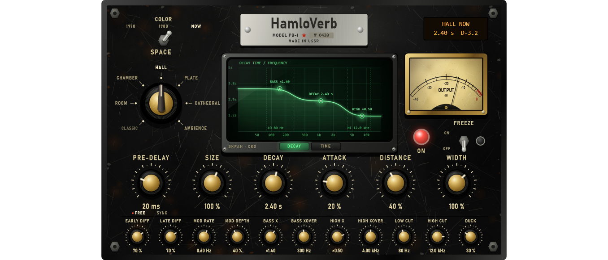

# Module pass 2 — Reverb: HamloVerb

## 1. Scope / Date / Base / Platform

| | |
|---|---|
| Scope | Owner: a reverb that imitates spaces ("допустим 5 кабин", like FL Studio's Convolver), no worse than Valhalla VintageVerb / FabFilter Pro-R, **with the same functions as those competitors**; knobs and design in the HamloComp style; AAA visuals |
| Design note | [REVERB_DESIGN.md](../REVERB_DESIGN.md) (function parity table, engine, page, thresholds) |
| Date | 2026-10-22 |
| Base | `5a9669e` (compressor pass) on `feature/hpeq-m0-m1` |
| Platform | Windows 11 x64, i5-10300H, MSVC 19.50.35730, JUCE 8.0.12 |

## 2. What changed

**Engine** (`Source/DSP/HamloVerb.*`, written for HPEQ, D3). The Reverb module now has a **Space**:
Classic (the M4 FDN, unchanged) or one of six HamloVerb spaces — **Room, Chamber, Hall, Plate, Cathedral,
Ambience**. Each space is its own room for the early field (image-source shoebox model, orders 1–3, two
microphones, the 24 strongest reflections each), its own tank delays, diffusion, balance and modulation.

- Pre-delay 0–500 ms or **tempo sync** (1/64 … 1/2, host tempo).
- **Attack** (build-up taps), **Early / Late diffusion**, **Mod rate / depth** (per-line sine LFOs,
  cubic interpolation), **Distance** (early/late balance, early brightness).
- 16-line FDN with Hadamard feedback; **three-band decay**: Decay (mid), **Bass ×** at **Bass Xover**,
  **High ×** at **High Xover** — second-order RBJ shelves in every loop (monotonic, so the loop gain
  never exceeds 1).
- **Color 1970 / 1980 / NOW**: tank bandwidth, modulation depth and speed; 1970 adds soft saturation in the loop.
- **Low Cut / High Cut** (12 dB/oct), **Width**, **Ducking** under the dry input, **Freeze** (lossless loop).
- A change of space fades the old engine out in 10 ms, clears the new one and fades it in.
- Wet-only send, spill-over, pool, PDC 0, block-size independence and no audio-thread allocation, as M4.
  Host tail = pre-delay (synced at the host tempo) + build-up + Decay × max(1, Bass ×); 30 s or more while frozen.

**Compatibility.** A project saved before this pass has no `space` key and stays **Classic, bit-exact**
(test below). A reverb added from the UI starts as **Hall, NOW, 20 ms, 2.4 s** (`defaultModule`).
Parameter ranges grew only for the new spaces: pre-delay to 500 ms, decay to 30 s (Classic keeps clamping
to its M4 ranges). `FxSlotParams::values` grew from 10 to 24 floats.

**Function parity** — see the table in [REVERB_DESIGN.md §1](../REVERB_DESIGN.md). Everything listed for
VintageVerb and Pro-R is present except, on purpose, Pro-R's free 6-band post EQ (HPEQ itself is the EQ,
and the reverb sits on an EQ band) and VintageVerb's 20 named modes (6 spaces × 3 colours here).

**Page = HamloVerb** (`Source/UI/HamloVerbPanel.*`), Black Steel like HamloComp; the shared drawing
(worn steel, bolts, nameplate, brass knobs, levers, lamps, needle meter) moved to `Source/UI/BlackSteel.*`
(HamloComp itself is unchanged). Nameplate **HamloVerb · MODEL РВ-1 · № 0420**, amber LCD (space, colour,
decay, ducking), seven-position **SPACE** selector with a bakelite chicken-head, **COLOR** three-way lever,
**FREEZE** lever with a blue lamp, red **ON** lamp, **OUTPUT** needle meter, six large knobs (Pre-delay with
FREE / SYNC, Size, Decay, Attack, Distance, Width) and eleven small ones (Early / Late diff, Mod rate /
depth, Bass ×, Bass xover, High ×, High xover, Low / High cut, Duck). In Classic the knobs that do nothing
for the M4 engine are dimmed.

The centre is a **green phosphor CRT** in a gunmetal bezel (graticule, bloom, scanlines, curved-glass
glare, edge falloff, persistence image), with two buttons:
- **DECAY** — decay time against frequency (the real three-band loop response), filled with a glow that
  breathes with the wet level; three handles: Bass (drag = Bass × and Bass xover), Decay (drag = decay),
  High (drag = High × and High xover); the cut regions of Low / High cut are shaded.
- **TIME** — the impulse picture: pre-delay marker, the space's early reflections (left and right
  microphones), the late envelopes per band (LOW / MID / HIGH) with the build-up, and the live wet level.

Knobs work as on HamloComp: vertical drag (Shift = fine), wheel, double-click = default, click on a value
to type it (percent and "k" accepted). The selector: click a name, drag or wheel.



## 3. Commands and exit codes

```bash
cmake --build --preset release                     # 0, no warnings
build/Release/HPEQ_Tests.exe                       # 0 — 1138 passed, 0 failed
build/Debug/HPEQ_Tests.exe                         # 0 — 1138 passed, 0 failed (CRT hook: malloc + new, 0 audio-thread allocations)
build/Release/HPEQ_Lab.exe ui --out …/reverb_pass/screenshots      # 0
build/Release/HPEQ_Lab.exe bench --out …/reverb_pass/bench.json --reps 3 --blocks 2000   # 0
```

## 4. Numbers (thresholds fixed before the runs)

| Test | Threshold | Result |
|---|---|---|
| Classic (no `space` key) = the M4 reverb, stereo and mono, impulse + noise | bit-exact | **bit-exact**; an old project's slot reads space 0 |
| Mid-band RT60 (1 kHz, EDC −5…−25 dB), every space, decay 1 / 2.5 s | ±15 % | Room 0.985 / 2.497, Chamber 0.971 / 2.486, Hall 1.000 / 2.458, Plate 0.972 / 2.434, Cathedral 0.906 / 2.528, Ambience 0.958 / 2.448 s (worst −9.4 %) |
| Bass × 2 → RT60(125 Hz) = 4 s; High × 0.4 → RT60(8 kHz) = 0.8 s (decay 2 s) | ±25 % | Hall 3.72 / 0.82, Plate 3.48 / 0.80, Room 3.77 / 0.77 s |
| Normalised echo density at 120 ms (Hall, Plate, full diffusion) | ≥ 0.9 and above Classic | 1.014, 1.018; Classic 0.056 |
| Modulation: tail correlation, impulse at 0 s vs 1.37 s (Hall 3 s) | depth 0 ≥ 0.999, depth 1 ≤ 0.5 | 1.0000 / **0.005** (default depth 0.4: 0.021) |
| Tail L/R correlation (Hall, mono impulse) | width 100 % < 0.3; width 0 > 0.99 | −0.021; 1.0000 |
| Freeze holds energy 2 → 11 s | ±1 dB | NOW −17.45 → −17.45; 1970 −19.81 → −19.80 dBFS |
| Pre-delay sync 1/8 at 120 BPM | onset 250…280 ms; tail formula | 264.06 ms (250 + the Hall's first path); tail 4.475 s exact |
| Attack 0 → 1, energy centroid (Hall 1.5 s) | ≥ +50 ms | 110.1 → 236.4 ms |
| Distance 0 vs 1, early (first 50 ms) / late energy | ≥ 6 dB | −2.52 vs −9.55 dB (7.0 dB) |
| Ducking 100 % under −6 dBFS noise; 1 s after the input stops | ≥ 12 dB; within 1.5 dB | 30.0 dB; 0.02 dB |
| Colour: spectral centroid of the tail | 1970 ≤ 0.85 × NOW; 1980 between | 6278 / 6976 / 8406 Hz (1970 = 0.75 × NOW) |
| Level against Classic, same decay, −18 dBFS pink | ±6 dB | all six spaces within ±0.05 dB |
| Space change Hall → Room mid-stream | no sample above 1.5 × the steady peak | 0.360 vs steady 0.613 |
| Block sizes 1 / 64 / 127 / 512, everything on (Cathedral, 1970, mod 1, attack, sync, duck, cuts) | bit-identical; 0 allocations | bit-identical; 0 |
| 20 000 random mutations of every setting in the engine | finite, < 1000; 0 allocations | pass; 0 |
| HamloVerb page wiring (real editor), old reverb shows Classic | pass | pass |

**CPU** (Release, block 512 at 48 kHz, budget 10 667 µs, `bench.json`, warm, median of 3 runs; the
numbers include the node's band split, `tree_1node_gain` = 27 µs):

| Config | p50 µs | p99 µs | p99 % of the block |
|---|---|---|---|
| Classic, 1 node | 59.4 | 105.2 | 0.99 % |
| Classic, 8 nodes | 450.5 | 816.6 | 7.7 % |
| **HamloVerb Hall (UI default), 1 node** | **250.4** | **454.5** | **4.3 %** |
| HamloVerb Hall, 8 nodes | 2 151.3 | 3 659.6 | 34.3 % |
| HamloVerb Plate (no early field) | 216.6 | 388.5 | 3.6 % |
| HamloVerb Hall, attack 0 | 228.8 | 428.2 | 4.0 % |
| HamloVerb Hall, modulation 0 | 212.8 | 410.5 | 3.8 % |

A HamloVerb costs about 4× a Classic reverb (16 modulated lines, 48 early taps, build-up taps, diffusers,
three-band loop filters). The first version measured 516 µs p50; moving the line gains, shelves, lengths,
LFO and tap positions to the 32-sample control clock (still block-size independent) and one shared write
index for the 16 equal lines brought it to 250 µs. A float version of the line arithmetic was tried and
gave nothing measurable (the cost is in the reads, not the arithmetic), so the loop stays in double.

**Memory:** the reverb pool keeps 16 reverbs per project; each now also holds the HamloVerb buffers
(about 1.1 MB at 48 kHz), so the pool grows from ~4 MB to ~22 MB at 48 kHz (~87 MB at 192 kHz), allocated
in `prepare()` as before.

**UI frame** (analysis update + full repaint 1400 × 900, Lab): p50 8.5 ms, p95 10.2 ms (30 Hz budget 33 ms).

Screenshots: [DECAY](reverb_pass/screenshots/hpeq_hamloverb_decay.png),
[TIME](reverb_pass/screenshots/hpeq_hamloverb_time.png),
[Cathedral 1970, freeze, sync 1/8](reverb_pass/screenshots/hpeq_hamloverb_cathedral_1970.png),
[an old project: Classic](reverb_pass/screenshots/hpeq_hamloverb_classic.png).

## 5. Disclosed changes made after first runs

1. **Bass / High bands — design changed** after the first run: first-order shelves in the loop gave
   RT60(8 kHz) = 1.07 s for a target of 0.8 s (+34 %, threshold ±25 %; bass −16 %). They were replaced by
   second-order RBJ shelves (slope 1): 0.82 s / 3.72 s. The criterion was not changed.
2. **Freeze — design changed**: the frozen field lost 2.0 dB in 8 s (NOW) / 2.3 dB (1970). The loss came
   from the cubic interpolation of the modulated reads (a mild low-pass on every pass). Freeze now fades
   the modulation out (exact integer reads) and switches off the 1970 saturation: 0.00 / 0.01 dB.
3. **Ducking — design changed**: 1 s after the input stopped the wet was still 4.9 dB low (threshold
   1.5 dB) because a 250 ms detector release had to fall 44 dB. Now a fast detector (2 ms / 50 ms) and the
   reduction itself releasing in 150 ms: 0.02 dB; the reduction under the input is 30 dB.
4. **Output level per space** trimmed after the first run (Cathedral was −7.5 dB, Room +3.4 dB against
   Classic at the same decay): every space now within 0.05 dB of Classic on −18 dBFS pink noise, 2 s.
5. **Modulation criterion changed**: "fixed coloration of the late spectrum ≥ 0.5 dB lower at depth 1"
   measured 1.58 vs 1.43 dB — both at the metric's own floor (the Welch variance of a decaying noise
   tail), so it cannot tell a ringing tank from a smooth one. It is still logged; the criterion is now the
   property modulation provides: the tail of an impulse at 0 s and of one at 1.37 s correlate ≥ 0.999 at
   depth 0 (time-invariant) and ≤ 0.5 at depth 1. Result 1.0000 / 0.005 (0.021 at the default depth 0.4).
6. **CPU pass** after the first measurement (516 µs p50 per reverb): control-rate updates and the
   shared write index (§4). The modulation moved to the control clock too — the delay of each line now
   moves linearly between LFO values 32 samples apart instead of a new sine value every sample; every
   criterion above was re-run on the final code.
7. **TIME view**: the first picture squeezed the early reflections into one block and drew a "live"
   level trace that looked like a fourth envelope; the time axis is now square-root and the live level
   shows as the brightness of the curves plus a LIVE readout.
8. `CompressorPassTests` expected `defaultModule(Reverb)` to be empty; it now has the Hall defaults, so
   that line checks `defaultModule(Gain)` instead.

## 6. Not verified

Listening and mouse use in FL Studio (owner): the sound of each space and colour, the CRT handles and
the selector by hand. Side-by-side listening against VintageVerb / Pro-R was not done here (no licences on
this machine); the comparison is by function set and by the measurements above.
