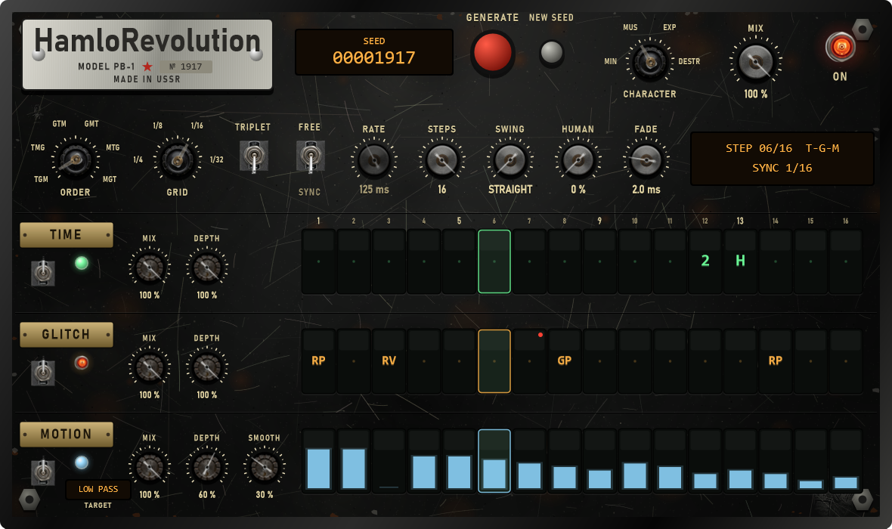

# Module pass 10 — Monsta FX becomes HamloRevolution (TIME · GLITCH · MOTION)

## 1. Scope / Date / Base

| | |
|---|---|
| Scope | Owner's task `HamloRevoulution_ACADEMIC_DESIGN_AGENT_TASK_RU.md` (name corrected by the owner to **HamloRevolution**), V1 = phases P0–P4: timeline and bounded histories, TIME (Half, Reverse, Freeze, Tape Stop, 2X), GLITCH with an editable pattern and Generate / Lock, MOTION, six orders, legacy Monsta kept, Black Steel page. One module like the others, in the Monsta FX slot |
| Date | 2026-10-25 |
| Base | `8aa7d60` on `feature/hpeq-m0-m1` |
| Not in this pass | P5 pitch-preserving stretch (WSOLA / phase vocoder), P6 optimisation (FeatureHub, WSOLA-CF), P7 EATW-B / C-ATD / MSAV-C, P8 studio alternatives, onset analysis. TIME's Half is the tape kind (pitch goes down) |

## 2. What changed

**One module, three engines.** The Monsta FX slot (`FxType::MonstaFx`, the same pool of 8) gets a `mode`.
Mode 1 is HamloRevolution (`DSP/HamloRevolution.*`); projects saved before have no `mode` and keep the M6
Monsta bit for bit. The UI creates new modules as HamloRevolution; a legacy slot's page shows **UPGRADE**.
In the plugin it is named **HamloRevolution · Time / Glitch / Motion**.

- **TIME** (per step): PASS, HALF (the run's first part at half speed; DEPTH 0..1 = speed 1..0.5), REVERSE
  (the window before the run, backwards), FREEZE (a loop of what came just before the run, crossfaded seams;
  DEPTH = loop 1/16..1/2 of a step), STOP (tape stop: speed and level fall to zero over the run), 2X (the
  window before the run and the run itself at double speed, through a 15-tap half-band filter).
- **GLITCH** (per step): PASS, REPEAT, STUTTER, RATCHET, REVERSE, GAP, JUMP (two runs back), SCRATCH (signed
  speed 1 ± π/2). DEPTH = the stutter / ratchet division (1/2 .. 1/16 of a step), the scratch width.
- **MOTION** (a level 0..15 per step): VOLUME, LOW PASS, HIGH PASS (TPT state-variable filter), WIDTH, CRUSH;
  DEPTH scales the levels, SMOOTH glides into the next step.
- Equal neighbouring steps make one **run** (inside one pattern cycle), so `HHHH` is one half-time bar.
- **Orders**: all six (T-G-M … M-G-T); a change fades to dry (10 ms), restarts the histories, fades back.
- **Per engine** ON, MIX, DEPTH; module MIX = the slot mix (as on every page).
- **Grid**: SYNC (1/4 … 1/32, TRIPLET, SWING 50–75 %, HUMAN = seeded step offsets, STEPS 1–16) or FREE
  (RATE = step length 20–2000 ms, starts with the transport). FADE = splice length 0.5–8 ms (ms, not samples).
- **Generate → Edit → Lock**: GENERATE fills the unlocked steps from SEED and CHARACTER (Minimal / Musical /
  Experimental / Destruction = density, which actions, where they fall; not DSP engines); NEW SEED; a click
  on a step edits it, shift-click locks it (red dot); right click on a plate: which actions Generate may use,
  clear / lock / unlock all. The pattern itself is saved (`timeA/B`, `timeLocks`, `timeAllow`, … `revSeed`),
  not only the seed. Generation runs on the message thread; the audio thread only reads the packed pattern.

**Time contract** (the task's section 5 and 14): a virtual sample clock with an anchor; the musical position
is the integral of the tempo (a tempo change re-anchors continuously; a seek or loop jump > 0.02 quarter is a
new epoch). The M6 Monsta computed `ppq · 60 / bpm · fs` over the whole history; that is gone in mode 1.
Every head reads only samples already written; a head that would need a sample older than what was
written since the epoch, or beyond the tape, plays the stage's input instead. Runs that do not fit the tape
are split into single steps (or pass). **Zero algorithmic latency**: nothing is added to the plug-in delay
compensation, so the existing latency caps did not have to change.

**Memory / reset**: TIME tape 4.5 s stereo, GLITCH uses the existing 3.1 s Monsta history (shared, no
extra), per instance 2.9 MB at 48 kHz, 11.6 MB at 192 kHz (pool of 8: 23 / 93 MB). Reset is now O(1) for
both modes (the M6 reset cleared 3.1 s of history on the audio thread when the pool handed out a slot).

**Page** (Black Steel, 1180 × 700): nameplate, SEED counter, red GENERATE, NEW SEED, CHARACTER selector,
MIX, ON lamp; ORDER and GRID selectors, TRIPLET and SYNC / FREE levers, RATE / STEPS / SWING / HUMAN / FADE,
status LCD (step, order, sync, WARMING UP); three engine rows with ON lever, lamp, MIX / DEPTH (MOTION:
SMOOTH, TARGET) and 16 step cells with the play head.

## 3. Numbers (thresholds fixed before the runs)

| Test (task §18) | Threshold | Result |
|---|---|---|
| Legacy: slot without `mode` → M6 Monsta; O(1) reset = fresh prepare | bit-exact | bit-exact |
| A01 empty pattern, 6 orders × blocks 1/64/512; stopped, free, swing, humanize | bit-exact | bit-exact |
| A02 engines off / mix 0 with a full pattern | bit-exact | bit-exact |
| A03 block sizes 1/16/64/127/512/2048 + random partition (Destruction, all engines) | bit-exact | bit-exact |
| A05 GAP on step 5 at 120 BPM | starts at sample 24000 | 24000 (fade 96 samples = 2 ms) |
| A05 swing 75 %: step 2 | starts at 9000 | 9000 |
| A05 44.1 kHz, 93 BPM (step 7112.9 samples) | ±1 sample | 28452 vs 28451.6 |
| A07 REVERSE of the window before the run (ramp) | exact order | exact |
| A08 HALF on a ramp; never ahead of the writer | < 1e-6 | 7e-9; causal |
| A09 TAPE STOP: last 100 samples of the run (DC 0.5 in) | < 0.01 | 0.0021; then dry again |
| A09 FREEZE loops the material before the run | periodic, source exact | yes |
| Seek: REPEAT everywhere, silence after the jump | 0 | 0 (old history never read) |
| Orders: T→G ≠ G→T; change mid-play | finite, no step > 1.5 × input's | 0.218 (input 0.266) |
| MOTION volume 15 / low pass at 0 / width 15 | 0 / bit-exact / mono | 0 / bit-exact / L = R |
| A10 / A14 44.1 / 96 / 192 kHz, mono, ×1000 input, injected NaN + reset | finite; empty pattern exact | pass |
| A12 allocations on the audio thread (orders changing, seeks) | 0 | 0 |
| A16 Generate, 10000 seeds × 4 characters: locks, forbidden actions, limits, determinism, a lock shifts nothing else | 0 violations | 0 |
| Characters: GLITCH events per pattern | Minimal < Musical < Experimental < Destruction | 1.91 / 4.61 / 6.54 / 11.53 |
| A15 pattern, locks, allow masks, 8-digit seed through the saved state; latency | exact; 0 | exact; 0 |
| In a project: region renders; module mix 0 vs module off | finite; < −120 dB | −400 dB (identical) |
| Page: GENERATE / NEW SEED / steps / locks / UPGRADE; MIX knob = module mix | pass | pass |

`HPEQ_Tests` 1594 / 1594, `HPEQ_ModuleTests` 73 / 73 (Release).

## 4. Disclosed changes made after first runs

1. **Tape stop level** was `(1 − x)^0.7` while writing the test; the 100-sample threshold showed it leaves
   1 % at the end; changed to a linear fade before the first run (the threshold was not changed).
2. **Seek test**: the jump was first placed inside a host block; hosts report positions per block, so it
   was moved to a block start (94 × 512) before the first run.
3. **Page levers** (screenshot check): `steel::lamp` leaves a gradient fill under which the next lever image
   draws nothing; the page sets an opaque colour before each lever. `BlackSteel.cpp` itself is unchanged
   (other pages may be affected — not checked in this pass).

All tests passed on their first run.

## 5. Not verified / limits

- Listening and mouse use in FL Studio (owner).
- HALF / 2X / SCRATCH are tape heads: the pitch moves with the speed (pitch-preserving Half-Time is P5).
  SCRATCH has no anti-alias filter (creative); 2X is exactly ×2 through the half-band filter.
- FREEZE and long runs need tape: a run longer than the tape allows is split into steps (at 120 BPM a TIME
  run up to ~4 s fits; REVERSE up to ~2.2 s).
- The standalone module VST3s (another agent) compile the new DSP file (one line added to
  `HPEQ_ModuleShared` so the shared `ProcessorsM6.cpp` links) but have no HamloRevolution variant.
- No onset analysis, no EATW-B / C-ATD / MSAV-C (P7): Generate is the seeded constrained generator above.
