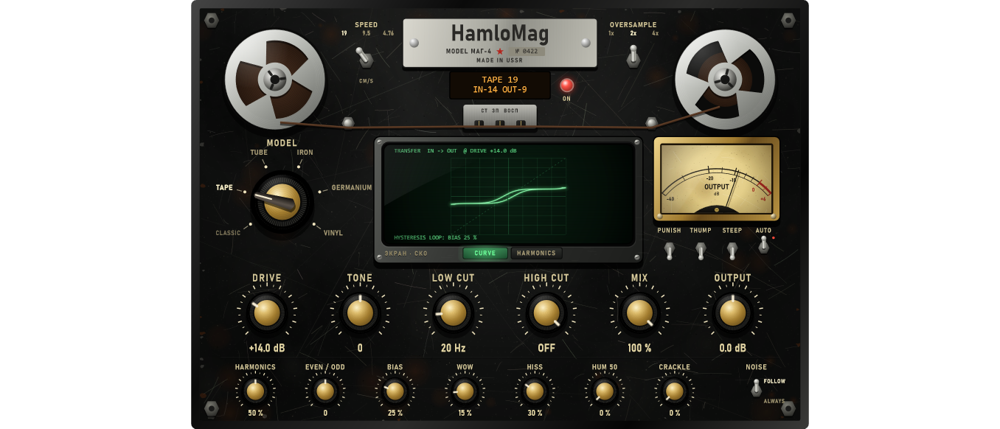

# Module pass 4 — Saturator: HamloMag

## 1. Scope / Date / Base / Platform

| | |
|---|---|
| Scope | Owner: "Soundtoys Decapitator, но придумай что-то наше: советские шумы аналогов + научная формула, которой нет у других; имитация лент, пластинки и насыщение гармоник; дизайн такой же — бобины" |
| Design note | [SATURATOR_DESIGN.md](../SATURATOR_DESIGN.md) (parity, the HamloLaw, engine, page, thresholds) |
| Date | 2026-10-23 |
| Base | `c5e99bc` (delay pass) on `feature/hpeq-m0-m1` |
| Platform | Windows 11 x64, i5-10300H, MSVC 19.50.35730, JUCE 8.0.12 |

## 2. What changed

**Engine** (`Source/DSP/HamloMag.*`, written for HPEQ, D3). The Saturator module now has a **Model**:
Classic (the M6 saturator, unchanged) or **TAPE, TUBE, IRON** (transformer), **GERMANIUM, VINYL**, all
inside the existing 1× / 2× / 4× oversampling.

- **The HamloLaw** (our harmonic layer, design note §2): with the peak envelope E (25 ms hold),
  u = x/E and ℓ = tanh(E/E_m), the layer adds h = E_m · Σ H·k_n·ℓⁿ·T_n(u) for n = 2…7 (T_n Chebyshev).
  A tone of amplitude A gets exactly harmonic n at E_m·H·k_n·tanh(A/E_m)ⁿ: every harmonic is chosen on
  its own (the model's signature k_n, the **Harmonics** amount H and the **Even / Odd** balance), it
  rises (n−1) dB per dB above the tone below the knee — the power-series law of real devices — and
  settles at the signature when driven. Measured: the formula holds within 0.45 dB; H2 and H3 rise 9.94
  and 19.95 dB per 10 dB. We have not seen this construction in the plugins we know; we cannot prove
  that no one has done it.
- **Model cores**: TAPE — rate-independent hysteresis (play operator, Prandtl–Ishlinskii) whose loop
  opens with the level (quiet passages stay linear, as AC bias makes them on a real machine), **Bias**
  sets the loop width, pre / de-emphasis around the core (highs saturate first), head bump and high loss
  by **SPEED** 19 / 9.5 / 4.76 cm/s, wow 0.6 Hz + flutter 7 Hz; TUBE — asymmetric triode (grid
  conduction), even-rich; IRON — the core flux follows the lows, which meet the knee three times sooner;
  GERMANIUM — asymmetric hard knee, odd-rich; VINYL — RIAA-like emphasis (inner-groove distortion of the
  highs), eccentric wow at 33⅓ / 45 / 78 rpm, 78 rpm band-limited like shellac (4th-order 100 Hz – 5 kHz).
- **Decapitator set**: Drive, **PUNISH** (+20 dB), **Tone** (tilt), **Low cut** + **THUMP**, **High cut**,
  **STEEP** (12 → 24 dB/oct), Mix (= the module's mix), **Output**, **AUTO** (small signals at unity).
- **Soviet analog noises**: **Hiss** (shaped per model: bright tape hiss, pink tube / vinyl hiss,
  white germanium hiss; louder at 4.76 cm/s), **Hum 50** (50 Hz mains with its harmonics and the
  100 Hz rectifier buzz of a ~220 V / 50 Hz supply), **Crackle** (random clicks and pops, twice as many
  at 78 rpm), **NOISE: ALWAYS / FOLLOW** (FOLLOW gates the noise with the input). Seeded generator:
  renders do not depend on the block size.
- Wow is a modulated delay around 4 ms; TAPE and VINYL report it — plus the low-frequency group delay
  of their bandwidth low-passes — as latency, so the node's dry path lines up (measured = reported).
- No allocation in `process()`; per-slot memory grows by the 9 ms wow buffers.

**Compatibility.** A project saved before this pass has no `model` key and stays **Classic** (the M6
path is untouched; the test moves every new setting and gets a bit-exact result). A saturator added
from the UI starts as **TAPE 19 cm/s, drive 6 dB, 2×, Harmonics 50 %, Bias 50 %, Wow 15 %, Hiss 15 %
(FOLLOW)**.

**Page = HamloMag** (`Source/UI/HamloMagPanel.*`), the Black Steel series. Two aluminium **reels** at
the top with three windows and the brown tape pack inside, turning while there is signal (the take-up
reel faster, both slower at 9.5 and 4.76); the tape runs over guide rollers and a head block
(СТ · ЗП · ВОСП: erase, record, play) under the nameplate **HamloMag · MODEL МАГ-4 · № 0422**; amber
LCD (model, speed, IN / OUT); red ON lamp. **SPEED** (cm/s or rpm, by model) and **OVERSAMPLE** levers
between the reels and the nameplate. **MODEL** selector with the bakelite chicken-head. CRT:
**CURVE** — the transfer at the current drive (the tape hysteresis loop visible), **HARMONICS** — bars
H1 … H9 for the live input level, computed by the engine itself (equal to the processor's output within
0.06 dB). OUTPUT needle meter; PUNISH / THUMP / STEEP / AUTO toggles; large knobs Drive, Tone, Low cut,
High cut, Mix, Output; small Harmonics, Even / Odd, Bias, Wow, Hiss, Hum 50, Crackle; NOISE
FOLLOW / ALWAYS. In Classic the controls the M6 saturator does not have are dimmed; Bias is only lit
for TAPE, Wow for TAPE / VINYL.



## 3. Commands and exit codes

```bash
cmake --build --preset release                     # 0, no warnings
build/Release/HPEQ_Tests.exe                       # 0 — 1231 passed, 0 failed
build/Debug/HPEQ_Tests.exe                         # 0 — 1231 passed, 0 failed (CRT hook: malloc + new, 0 audio-thread allocations)
build/Release/HPEQ_Lab.exe ui --out …              # 0
build/Release/HPEQ_Lab.exe bench --out …/saturator_pass/bench.json --reps 3 --blocks 2000   # 0
```

## 4. Numbers (thresholds fixed before the runs)

| Test | Threshold | Result |
|---|---|---|
| Classic (no `model` key), every new setting moved | bit-exact | **bit-exact**; an old project's slot reads model 0 |
| HamloLaw: harmonics 2…7 of a steady tone vs the formula, every model, A = 0.3 / 0.8 | ±0.5 dB | worst 0.448 dB |
| Power law below the knee (TUBE, −40 → −30 dBFS) | H2/H1 +10 dB, H3/H1 +20 dB, ±10 % | +9.94, +19.95 dB |
| TUBE even > odd; GERMANIUM odd > even (−12 dBFS, drive 6) | pass | TUBE H2 −24.4 / H3 −67.8; GERMANIUM H2 −33.2 / H3 −27.5 dB |
| TAPE head bump at 60 Hz (19 cm/s); 12 kHz 4.76 vs 19 cm/s | +2.5 ± 0.7 dB; ≥ 10 dB | +2.37; 14.98 dB |
| IRON H3/H1 at 50 Hz vs 1 kHz | ≥ 10 dB more | −21.1 vs −35.6 dB (+14.5) |
| VINYL 78 rpm: 50 Hz and 8 kHz below 1 kHz | ≥ 12 dB | −24.8 / −19.4 dB |
| Latency measured = reported (TAPE, VINYL, TUBE at 2×) | equal | 242 / 242 / 49 = reported |
| Wow 1: 1 kHz tone energy outside ±4 Hz | TAPE ≥ −40 dB; TUBE < −60 dB | −8.2; none |
| Hum, no input | 50 Hz strongest, harmonics, −50…−35 dBFS | 50 / 100 / 150 Hz −48.4 / −55.6 / −56.4 dB; −48.5 dBFS |
| Crackle 0.5 | 7.5 clicks / s ±35 % | 7.45 / s |
| Noise FOLLOW without input; ALWAYS | < −100; > −80 dBFS | silent; −41.4 dBFS |
| Auto gain, −40 dBFS at drive 12 dB, every model | ±0.5 dB | ≤ 0.005 dB |
| DC, TUBE drive 24 dB | \|mean\| < 10⁻³ | 0.000000 |
| Aliasing, GERMANIUM drive 24 on 7 kHz: off-harmonic energy 4× vs 1× | ≥ 10 dB lower | −12.6 → −50.1 dB |
| Display `harmonicProfile()` vs the processor (TUBE −12 dBFS) | ±1 dB | H2 −24.79 / −24.79, H3 −68.08 / −68.14 |
| Block sizes 1 / 64 / 127 / 512, everything on (TAPE 9.5, wow, hiss, hum, crackle, punish, steep, thump, tone) | bit-identical; 0 allocations | bit-identical; 0 |
| 20 000 random mutations in the engine | finite, < 1000; 0 allocations | pass; 0 |
| HamloMag page wiring incl. Mix → module mix; old saturator shows Classic | pass | pass |

**CPU** (Release, block 512 at 48 kHz, budget 10 667 µs, `bench.json`, warm, median of 3; includes the
node's band split, 27.8 µs):

| Config | p50 µs | p99 µs | p99 % of the block |
|---|---|---|---|
| Classic saturator, 2× | 135.9 | 183.4 | 1.7 % |
| **HamloMag TAPE, 2× (UI default)** | **246.0** | **320.2** | **3.0 %** |
| HamloMag TAPE, 4× | 383.7 | 566.8 | 5.3 % |
| HamloMag TUBE, 2× | 198.8 | 264.9 | 2.5 % |
| HamloMag TAPE 2×, 8 nodes | 1 960.0 | 2 570.2 | 24.1 % |

**UI frame** (analysis + full repaint 1400 × 900, Lab): p50 7.9 ms, p95 8.7 ms (budget 33 ms).

Screenshots: [CURVE](saturator_pass/screenshots/hpeq_hamlomag_curve.png),
[HARMONICS](saturator_pass/screenshots/hpeq_hamlomag_harmonics.png),
[TUBE, punish, hum](saturator_pass/screenshots/hpeq_hamlomag_tube_hum.png),
[VINYL 78 rpm, crackle](saturator_pass/screenshots/hpeq_hamlomag_vinyl78.png),
[an old project: Classic](saturator_pass/screenshots/hpeq_hamlomag_classic.png).

## 5. Disclosed changes made after first runs

1. **The HamloLaw changed** after the fuzz test: the first form, h = E · Σ H·k_n·ℓⁿ⁻¹·T_n(u), grew with
   the envelope and was unbounded at extreme drive (+68 dB with PUNISH). Now h = E_m · Σ H·k_n·ℓⁿ·T_n(u):
   the same power law below the knee, bounded at the signature above it. The formula test and the
   design note were updated to the new form (its threshold, ±0.5 dB, unchanged).
2. **Envelope**: a plain peak follower (instant attack, release) sagged between the peaks of a tone,
   so u was not a clean cosine; a 25 ms hold keeps E flat on any tone above 40 Hz (changed before the
   formula test ran).
3. **TAPE hysteresis width now opens with the level**: at a fixed width a −40 dBFS tone lost 6 dB
   (auto-gain threshold ±0.5 dB): the loop swallowed signals smaller than itself. Now 0.004 dB.
4. **Drive glide**: the auto gain used the drive at the end of a block, so renders differed with the
   block size while the drive glided (first block); the inverse glide now runs sample by sample.
5. **VINYL 78 rpm** band made 4th order (2nd order gave −9.7 dB at 8 kHz, threshold 12 dB).
6. **Latency** includes the low-frequency group delay of the tape / vinyl bandwidth low-passes (the
   pure delay alone was 1 sample short of the measured alignment).
7. **GERMANIUM** asymmetry reduced after change 1 made the harmonic layer smaller (H2 ≈ H3 against the
   "odd-rich" design; now H3 5.7 dB above H2).
8. **CPU**: wow sines once per sample (not per channel) and the HamloLaw's tanh only when the envelope
   moves: TAPE 2× 283 → 246 µs p50.

## 6. Not verified

Listening in FL Studio (owner): the five models, the noises in a mix, the reels and the CRT views by
hand. No side-by-side with Decapitator (not on this machine); parity is by the function list.
