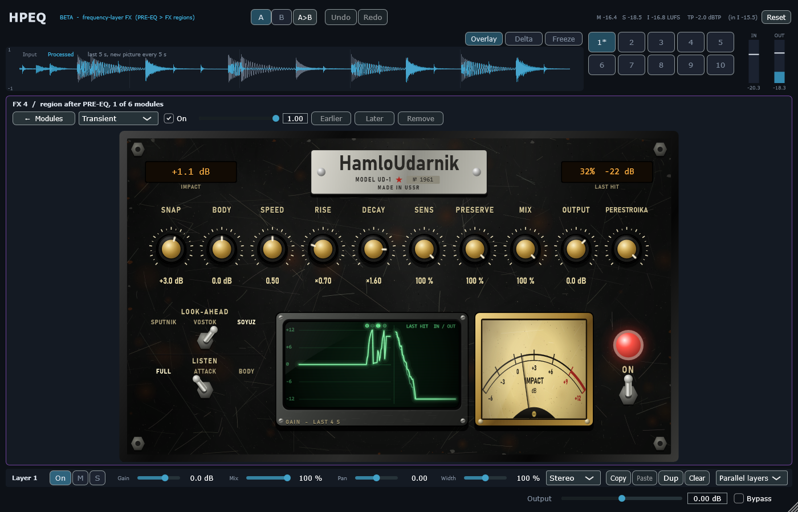

# Module pass 6 — HamloUdarnik transient shaper

## 1. Scope / Date / Base / Platform

| | |
|---|---|
| Scope | Owner: transient pass built on the research note "HP Transient Morph Engine", in the Soviet Hamlo Black Steel style; scope and names accepted after the briefing |
| Design | [`TRANSIENT_DESIGN.md`](../TRANSIENT_DESIGN.md) |
| Date | 2026-10-23 |
| Base | `1caa711` (module pass 5) on `feature/hpeq-m0-m1` |
| Platform | Windows 11 x64, i5-10300H, MSVC 19.50.35730, JUCE 8.0.12 |

## 2. What changed

**HamloUdarnik** (laws in `Source/DSP/HamloUdarnik.h`; with every new key absent the M6 transient shaper
runs, bit-exact — older projects sound the same):
- **PRAVDA** ("truth", clean): the M6 law (SNAP / BODY / SPEED) plus look-ahead, sensitivity, PRESERVE.
- **UDARNIK** (Peak-Neutral Punch, research §4): the attack is shaped toward the hit's own peak
  (`y = s γ tanh((g/γ) artanh(x/s))`: small samples get exactly the SNAP gain, the peak never passes s) and
  the body gives back what the attack gained, in K-weighted energy, so the loudness stays.
- **PERESTROIKA** (Transient Morph, research §3): RISE ×0.5…×2 time-scales the attack envelope (look-ahead);
  DECAY ×0.5…×2 divides the decay (dB under the hit's peak) by K, so an exponential decay τ becomes Kτ.
- Detector: onsets from the 1 ms / 10 ms envelopes; confidence 0…1 = how far the hit rises over the level
  just before it (stationary noise does not rise); strength against a 2 s accent reference; SENSITIVITY
  sets the front threshold and the strength gate. Not called a probability (the research says why).
- **PRESERVE** (Groove Guardian, research §7): each hit is measured against itself, not against the memory
  of the previous accent.
- **LOOK-AHEAD** SPUTNIK 0 / VOSTOK 2 / SOYUZ 5 ms (latency reported to the host), **LISTEN** FULL / ATTACK /
  BODY (ATTACK + BODY = FULL), **MIX** (the slot's mix), **OUTPUT** −24…+12 dB.
- A transient added from the UI starts in PRAVDA, VOSTOK, PRESERVE 100 %, everything else neutral.

**Page (Black Steel):** nameplate "HamloUdarnik · MODEL UD-1 · № 1961", amber LCDs IMPACT and LAST HIT
(confidence %, strength dB), ten brass knobs SNAP, BODY, SPEED, RISE, DECAY, SENS, PRESERVE, MIX, OUTPUT
and the mode knob titled with the mode (no red labels), levers LOOK-AHEAD and LISTEN, green CRT (gain of the
last 4 s with hit marks, brightness = confidence; the last hit's input and output envelopes), IMPACT needle
meter, ON lamp and toggle.




## 3. Commands and exit codes

```bash
cmake --build --preset release                     # 0, no warnings
build/Release/HPEQ_Tests.exe                       # 0 — 1351 passed, 0 failed
build/Debug/HPEQ_Tests.exe                         # 0 — 1351 passed, 0 failed (CRT hook: malloc + new, 0 audio-thread allocations)
HPEQ_Lab bench --reps 2 --blocks 1000              # reports/transient_pass/bench.json
HPEQ_Lab t11 + HPEQ_HostSmoke --t11 (random projects now with HamloUdarnik options)   # 0
HPEQ_Lab ui                                        # screenshots
HPEQ_MEM_PART=transient / HPEQ_MEM_FS=48000 HPEQ_Lab m7   # memory
```

## 4. Numbers (criteria from the design note, fixed before the runs)

| # | Test | Result |
|---|---|---|
| T1 | Keys absent = M6 (latency 0); neutral settings in 3 modes × 3 look-aheads = input delayed by L | pass, bit-exact (9/9) |
| T2 | Latency reported = measured (0 / 96 / 240 samples); blocks 1 / 64 / 512 identical; 0 allocations | pass |
| T3 | PRAVDA SNAP +12: gain on the first sample of a hit ≥ 10.8 dB with look-ahead | SPUTNIK 1.20 dB (reported), **VOSTOK 11.99, SOYUZ 12.00 dB** |
| T4a | Pink noise −20 dBFS, no hits, SNAP +12 / BODY −12: worst 50 ms change ≤ 1 dB | UDARNIK **0.55**, PERESTROIKA **0.55**, PRAVDA σ 0.5 **0.55 dB** |
| T4b | Hits 20 dB over noise, PERESTROIKA SNAP +12: attack-window gain ≥ 11 dB | **11.10 dB** |
| T4c | Bleed 30 dB under the accents, σ 0.5: bleed ≤ 1 dB, accents ≥ 11 dB | PRAVDA 0.00 / 11.97, PERESTROIKA 0.00 / 12.00 dB |
| T5 | UDARNIK SNAP +6 SOYUZ, drums: contrast ≥ +3 dB, sample peak ≤ input, true peak ≤ input + 0.1 dB, loudness ±0.5 LU | contrast **+3.70 dB**; sample peak −3.49 → **−4.09 dBFS**; true peak −1.55 → **−1.58 dBTP**; loudness −17.05 → **−17.48 LUFS (−0.43 LU)** |
| — | for comparison PRAVDA SNAP +6 (a plain shaper) | contrast +4.44 dB, but sample peak **+2.51 dBFS** (+6 dB) and **+3.8 LU** |
| T6 | PERESTROIKA SOYUZ: DECAY ×0.5 / ×2 → τ ×K ± 10 %; RISE ×0.5 / ×2 → rise ×r ± 15 % | 4 kHz: τ 60 → **30.0 / 115.2 ms (×0.500 / ×1.920)**; 200 Hz: **×0.500 / ×1.922**; rise 1.77 → **0.77 / 3.77 ms (×0.435 / ×2.129)** |
| T7 | PRESERVE 1: ghost/accent ratio change ≤ 0.5 dB | PRAVDA **−0.00 dB** (PRESERVE 0: −5.82), UDARNIK **+0.01 dB** (PRESERVE 0: +2.78) |
| T8 | ATTACK + BODY = FULL | worst 3.0e−8 |
| T9 | Onset not moved (SNAP +6) | 0.000 ms, all modes |
| T10 | OUTPUT −6 / +6 dB = output × 10^(O/20) | pass (≤ 1e−6 relative) |
| T11 | Page in the real editor (older transient shows M6 defaults; knobs, MIX, levers edit the project; latency reaches the engine); T11 through the VST3 binary | pass; **237/237** states and latencies, **57/57** bit-exact renders and re-opens |

CPU (block 512 at 48 kHz, p50 / p99 µs, p99 % of the block; includes the crossover tree for a band):
M6 transient 50.7 / 131.4 (1.2 %), PRAVDA VOSTOK 93.6 / 166.9 (1.6 %), UDARNIK SOYUZ 96.7 / 202.7 (1.9 %),
PERESTROIKA SOYUZ 94.0 / 214.8 (2.0 %), UDARNIK on the MIX chain 85.4 / 190.6 (1.8 %), PERESTROIKA on 8 nodes
724.8 / 1135.7 (10.6 %).

Memory: 12.6 KB per prepared transient slot at 48 kHz (`HPEQ_MEM_PART=transient`; limiter 50.8 KB); a
whole engine has 540 slots, so +6.8 MB of the 108.3 MB measured for a prepared engine at 48 kHz (359.96 MB at
192 kHz; the earlier passes since M8 were not re-measured here).

## 5. Disclosed changes after the first run

The first run failed T1 (L > 0), T4a, T4b, T5 and T6 (RISE). The criteria were not changed; the laws and
one measurement were:

1. **T1 measurement**: `compareAligned(..).bitExact` is defined only for delay 0; the test now requires
   `maxAbsError == 0` with the delay (the sound was already the delayed input).
2. **Confidence** first came from the 10 ms vs 100 ms envelopes: pink noise reached confidence 1 (noise
   changed by 12 dB, T4a) and hits over noise only ~0.5 (T4b 9.9 dB). Now: how far the 10 ms envelope rises
   within 5 ms over its value at the onset, `clamp((R − 6) / 6)` (threshold 9 dB was tried first: T4b 6.5 dB).
   The 100 ms envelope was removed.
3. **Body** in the event modes was "everything after the attack window": BODY −12 cut steady noise
   forever after one false hit. Now the body is weighted by the M6 sustain weight (`b = (1 − a) w_s`).
4. **UDARNIK** first used a smooth gain cap (`g ≤ H/E`): no distortion, but the contrast grew only +0.53 dB
   (a kick decays little within 30 ms, so the cap left no room). Then a peak-neutral shaper
   `s tanh(g artanh(x/s))` (contrast +2.93, loudness +0.74 LU, true peak +0.57 dB); then the energy balance
   was moved to the hit's whole body (300 ms, faded by 400 ms) with K-weighted energies (contrast +4.80,
   loudness −0.41 LU, true peak still +0.57 dB); last, a true-peak guard `γ = g^(−0.1)` (the shaped peak sits
   0.1 × boost dB under the reference): contrast +3.70, true peak −0.03 dB, sample peak −0.6 dB. The 0.1
   factor was chosen after seeing the +0.57 dB overshoot.
5. **RISE** first used a 0.1 / 1 ms peak follower (×0.26 / ×2.56), then a 1 ms centred mean (×0.41 / ×2.26);
   now a 0.5 ms centred mean and, for r < 1, a target that holds the peak until the source gets there. The
   test first measured from the onset itself, which cut off the 10 % point (both signals' envelopes already
   started above 10 %); it now starts 2 ms before the onset. Result ×0.435 / ×2.129 — r = 0.5 is 13 % fast
   (inside ±15 %). RISE is meant for the click (bands above ~2 kHz); the note said ~200 Hz before.

## 6. Not verified

Listening and mouse use in FL Studio (owner). The confidence is a heuristic tested on synthetic noise,
hits and bleed, not on a corpus of real drum loops (research §10: a corpus and blind listening are the next
step).
