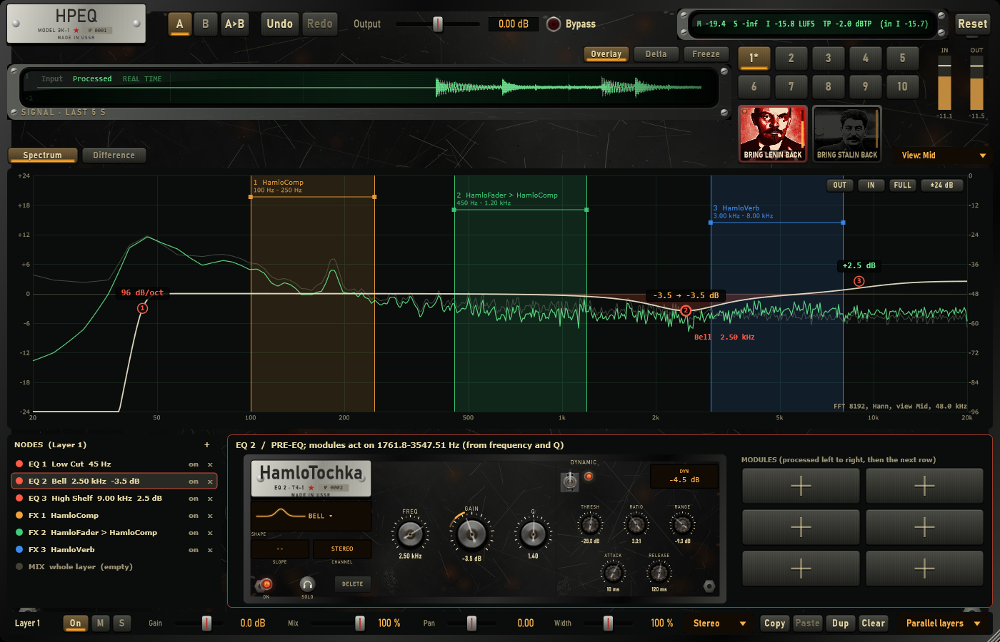

# Tube pass — BRING LENIN BACK / BRING STALIN BACK: Soviet tube preamps as the colour of the whole HPEQ

## 1. Scope / Date / Base

| | |
|---|---|
| Scope | Owner's research `SOVIET_TUBE_PREAMP_RESEARCH_RU.md` and the owner's decision (2026-10-26): not a separate VST3 but two portrait buttons in HPEQ — BRING LENIN BACK (LOMO UP-25) and BRING STALIN BACK (LOMO UP-27); a button switches its tube character on for the whole mix; each has a MIX; nothing else on the panel |
| Date | 2026-10-26 |
| Base | `cc297b6` on `feature/hpeq-m0-m1` |
| Level reached | **Circuit-informed** (the research's two levels: circuit-accurate / hardware-calibrated): tube models fitted to datasheets, UP-25 operating points from the factory tables; no SPICE run (no SPICE here), no real UP-25 / UP-27 measured |

## 2. Sources checked (before programming, as the research asks)

- **UP-25**: Cherkasov, *Spravochnik kinomekhanika*, 1979, pp. 201–204 (djvu.online text layer). Read: tubes
  L1 6Zh32P, L2 / L3 6N3P; **table 24** (R1–R28, C1–C14), **table 25** (electrode voltages); feedback: stage 1
  R20 / R26, stage 2 R5 / R6 / R7, stage 3 R19 shunted by R28. **Figure 111 (the schematic drawing) is not
  in the text layer**: which part sits where is inferred from the voltages (below), not read off the drawing.
- **6N3P** (rudatasheet.ru): mu 36 ± 8, S 4.8–6 mA/V, Ia 8.75 ± 2.75 mA, Rk 240 Ω. The page lists Ua 250 V;
  with that the numbers do not fit any triode law (a Koren fit needs an exponent of 2.2). The 6N3P's
  analogue 2C51 / 5670 is specified at **150 V / 240 Ω / 8.2 mA / 5.5 mA/V**; with 150 V everything fits
  (exponent 1.47). Used: 150 V (an assumption, stated).
- **6Zh32P** (audioportal.club): 250 / 140 V, −2 V, 3 ± 1 mA, S 1.8 ± 0.5 mA/V, screen ≤ 1 mA (EF86 0.6 mA).
- **UP-27**: only the GroupDIY measurement of one unit (200 V supply, ~75 dB gain, overload near +10 dBu) and
  owners' notes; no factory schematic or values were found. Its model is a **hypothesis of a typical layout**.

**Fits** (`tube_pass/fit_tubes.py`): 6N3P Koren mu 36, Ex 1.4704, Kg1 360.1, Kp 588.7, Kvb 300 → 8.50 mA,
5.8 mA/V, ra 6.2 kΩ at 150 V / 240 Ω (exact). 6Zh32P Koren pentode mu 38, Ex 1.4, Kg1 1261.6, Kp 125.0,
Kvb 10, Kg2 3643 → 3.0 mA, 1.8 mA/V, screen 0.6 mA.

**UP-25 layout from table 25 + the fit** (the cross-check that the reading is right):

| Tube | Table 25 | What the model gives | Parts that match (table 24) |
|---|---|---|---|
| L1 6Zh32P | plate ~60 V, screen ~70 V, bias −1.5 V | 0.53 mA → plate load ~360 kΩ, cathode ~2.6 kΩ, screen resistor ~3.3 MΩ | R3 470 k (≈), R26 3.3 M, C1 50 µF / 15 V (cathode) |
| L2 left 6N3P | plate ~80 V, bias −1.6 V | 1.51 mA → plate load 113 kΩ, cathode 1.06 kΩ | R10 / R11 120 k, R15 1 k |
| L2 right 6N3P | plate ~100 V, bias −1.25 V | 5.3 mA → cathode 237 Ω, plate load ~28 kΩ | R16 / R25 220 Ω; the plate load is not in the list (inferred) |
| L3 6N3P ×2 | plates ~210 / ~105 V, bias −1.3 / −1.4 V | two triodes in series, ~105 V each, ~5.5 mA → 1.2 V over 220 Ω | R16 / R25 220 Ω — "series connection" as the book says |

Capacitor roles: C1 50 µF / 15 V and C9 10 µF (cathode bypasses), C3 / C6 / C8 / C12 0.033 µF (coupling), the
4 µF parts (no voltage listed) taken as supply decoupling. Stage-2 feedback ratio R6 / R7 = 220 k / 3.9 M.

## 3. What was built

**DSP** (`DSP/TubePreamp.*`): Koren 6N3P and 6Zh32P; a common-cathode **stage** whose static behaviour
along its AC load line (with its local and plate-to-grid feedback) is solved once into a table, and whose
dynamics run per sample: the coupling capacitor into the grid leak, **grid current** once the grid goes
positive (it charges the coupling capacitor — the bias moves after an overload: blocking distortion), the
**cathode bypass** capacitor (the bias follows the signal), the resting point taken from the table itself
(no drift, no thump at switch-on). STALIN adds an **input transformer**: primary resistance, magnetising
inductance (10 Hz corner) with a saturating core (the flux is the integral of the voltage, so lows
saturate first), a damped leakage resonance near 45 kHz.

- **LENIN** = 6Zh32P → 6N3P (feedback R6 / R7) → 6N3P → 6N3P pair (feedback R19 / R28).
- **STALIN** = transformer → 6Zh32P → 6Zh32P → 6Zh32P → 6N3P.
- **Calibration** (the research's Input / Output Gain, §13): small signals pass at unity; the drive is the
  point where a −6 dBFS sine has the chain's static THD of LENIN 1 %, STALIN 4 % (a choice: a gentle and a
  hard character for a mix bus). Both on: LENIN into STALIN.
- **The whole output**: after the layers, before Bypass and Output; 4× oversampled with linear-phase FIR
  half-band filters (the reported latency is exact: 38 samples at 48 kHz, only while a button is on); 20 ms
  fades on a button or MIX change; both off = the plug-in exactly as before. Saved in the project (`lenin`,
  `stalin`, `leninMix`, `stalinMix`, only when used), undo, A / B.

**Panel**: two portrait buttons under the layer buttons (the owner's pictures, made into a dark
newspaper-grain monochrome for off and a Soviet red duotone for on). Click: on / off. Drag up / down or the
wheel: MIX (a thin amber gauge on the button's edge, "MIX 70 %" while it changes); double click: MIX 100 %.

## 4. Numbers — the research's test bench (thresholds fixed before the runs)

| Test | Threshold | LENIN | STALIN |
|---|---|---|---|
| Off | bit-exact | bit-exact | |
| −50 dBFS 1 kHz: gain, THD | 0 ± 0.5 dB, < 0.3 % | −0.008 dB, 0.0005 % | −0.006 dB, 0.014 % |
| Response at −40 dBFS, 40 Hz – 15 kHz | ±1 dB / ±1.5 dB | 40 Hz −0.77, 100 Hz −0.13, 15 kHz −0.01 | 40 Hz −1.00, 100 Hz −0.16, 15 kHz +0.18 |
| THD vs level −30 / −18 / −12 / −6 / 0 dBFS | rises; −6 dBFS LENIN 0.3–10 %, STALIN higher | 0.005 / 0.019 / 0.038 / **0.31** / 3.45 % | 0.14 / 0.52 / 1.10 / **3.43** / 22.1 % |
| H2 / H3 at −12 dBFS | LENIN H2 over H3 | −68.4 / −100.1 dB | −39.2 / −56.0 dB |
| tanh control (−12 dBFS) | tanh no even harmonics; LENIN H2 > −80 dB | tanh H2 −240 dB (none) | |
| Transformer: THD 40 Hz vs 1 kHz at −6 dBFS | 40 Hz > 2 × 1 kHz | | 9.90 % vs 3.43 % |
| SMPTE IMD (60 Hz + 7 kHz, 4:1, −6 dBFS) | STALIN above LENIN | 0.14 % | 5.49 % |
| Overload recovery: −40 dBFS tone after a +6 dBFS burst | changed > 0.05 dB, back within 0.5 dB after 0.4 s | +2.15 dB right after, 0.00 dB after 0.4 s | |
| MIX 50 %: H2 | 6 ± 1 dB lower | −65.6 → −71.6 dB (6.0) | |
| Blocks 1 / 64 / 512; allocations; ×100 input | identical; 0; finite | pass | pass |
| Plug-in: latency reported while on; an impulse lands on it | ±1 sample | 38 samples, peak at 38 | |
| State, buttons edit the project | pass | pass | pass |
| CPU, 48 kHz, 64-sample blocks, both on | p99 ≤ 25 % | p99 14.0 % (p50 7.5 %) | |

## 5. Disclosed changes made after first runs

1. **NaN everywhere**: a stage's table at rest was one table step off zero; ~70 dB of gain turned that into
   a clipped chain and a zero gain in the calibration. The table's resting value is now taken off.
2. **A thump at switch-on** (seen as a DC transient in the latency test): the resting cathode voltage is now
   solved on the table itself.
3. **LENIN cut 2.7 dB at 40 Hz**: the 4 µF parts had been taken as cathode bypasses; their missing voltage
   rating points to supply decoupling. Corrected (L2 left C9 10 µF, L2 right unbypassed).
4. **Calibration**: compressing the fundamental by 2 / 4.5 dB at 0 dBFS gave LENIN 4.4 % THD at −6 dBFS;
   changed to a THD target at −6 dBFS, and the calibration chain now includes grid current.
5. **STALIN**: −2.3 dB at 40 Hz from three small pentode cathode capacitors (hypothetical values anyway) →
   100 µF; the transformer corner 15 → 10 Hz and its saturation knee 45 → 90 Hz at full scale (the pentodes
   had hidden it).
6. **Latency**: IIR polyphase oversampling put an impulse 2 samples after the reported latency; linear-phase
   FIR is used instead (38 samples, exact).

No threshold was changed. Full suites: `HPEQ_Tests` 1678 / 1678, `HPEQ_ModuleTests` 73 / 73 (Release).

## 6. Not verified / limits

- **Not hardware-accurate**: no real UP-25 / UP-27, no SPICE comparison (the research's step 2 needs ngspice
  and verified tube models; none here). Figure 111 was not readable as text; parts' places are inferred.
- **UP-27 is a hypothesis** (no factory values). Its STALIN character is a typical transformer + pentode
  preamp of that family, not that unit.
- The stage model is a table plus dynamics (circuit-informed), not a WDF network: feedback across several
  stages and the frequency dependence of the feedback networks are simplified.
- The drive points (1 % / 4 % THD at −6 dBFS) are a product choice; the research's "Original / Extended
  headroom" switch was not added (the owner asked for buttons and MIX only).
- A button change moves the plug-in's latency (0 ↔ 38 samples at 48 kHz); hosts re-align, a short click
  at that moment is possible.
- Listening in FL Studio (owner).

## 7. Presets pass: 6 dB more drive (owner, 2026-10-26)

The owner heard the colour as barely audible. The drive point moved from −6 to **−12 dBFS**: a −12 dBFS sine
now gives the static THD of LENIN 1 % / STALIN 4 %; STALIN's core knee stays 6 dB above the drive point.
Everything above happens 6 dB lower (e.g. LENIN THD at −18 dBFS 0.019 → 0.038 %, STALIN 0.52 → 1.10 %);
MIX 50 % is close to the old colour. The two checks tied to the drive point moved with it (LENIN H2 over
H3: −12 → −18 dBFS; transformer 40 Hz vs 1 kHz: −6 → −12 dBFS, 9.84 % vs 3.43 %); thresholds unchanged.
Details: `PRESET_PASS_REPORT.md` §4–5.
