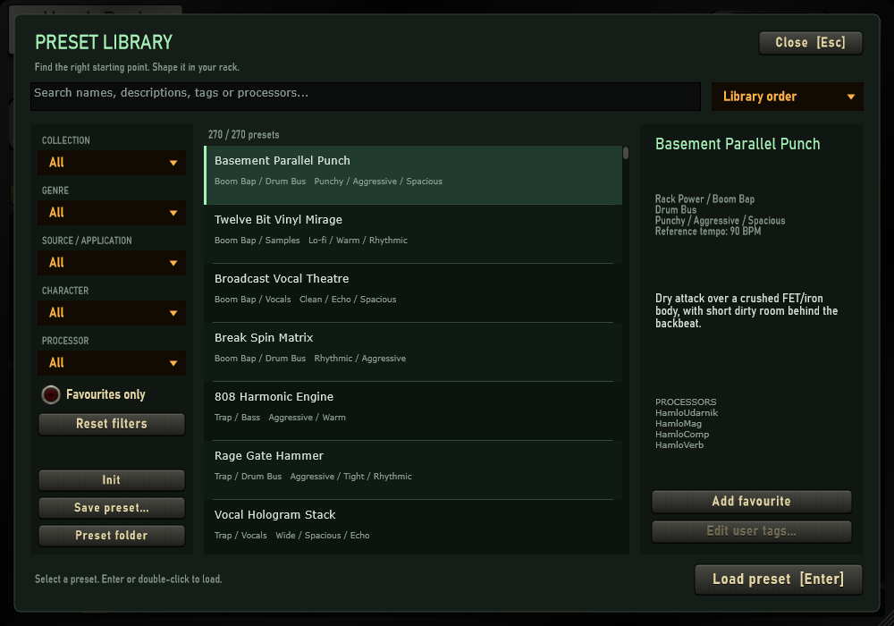

# Preset library — HamloRack 0.2.1

Click the preset name to open the library inside the rack. The former cascading
menu is replaced by a searchable list with a detail panel. The 20 Rack Power and
250 task recipes keep their existing DSP settings and output calibration.

- Search matches words across names, descriptions, character labels, genre,
  source and processor names. Words combine with AND; case is ignored. Common
  Russian source and character aliases are included.
- Collection (Rack Power / Task presets / User), genre, source/application,
  character, processor and favourites filters combine. Lead/backing/other vocal
  recipes share the Vocals source; mix-bus and mastering recipes share Mix / Master.
- Character labels for every factory recipe are editorial browsing metadata in
  `Assets/Presets/HamloRack/browser-tags.json`. They describe the authored intent;
  they are not new audio measurements or automatic listening verdicts.
- Choose library order or alphabetical order. A result counter and explicit
  empty state show what the active filters contain. Reset filters restores the
  full list and default order.
- Selecting a row shows its description, character, source, reference tempo and
  processors. Selection and filter changes do not load audio settings. Enter,
  double-click or Load preset applies the selection through the existing undoable
  load path. The browser stays open for comparing starting points. A dot marks
  the loaded preset; failures display an error instead of claiming success.
- Up/down in the search field navigates results; Enter loads and Escape closes.
  Ctrl+F inside the browser focuses search. The header arrows follow the filtered
  list (including alphabetical sorting), even after closing the browser, until
  Reset filters. With no active filters, the existing bank navigation remains.
- Favourites persist for factory and user presets. Edit user tags assigns genre,
  source and comma-separated character labels to saved user files. These settings
  live in `User/browser.json`, alongside `.hpeq` files, and use temporary-file
  replacement. The preset files and DAW project state are not rewritten by tags
  or favourites. A new editor restores favourites/tags; search filters are local
  to the current editor. Concurrent favourite changes preserve other saved keys.
- Save preset, Init and Open preset folder remain available in the sidebar.
  The layout supports the rack's existing 1000x700 minimum and larger windows.

Current build/test evidence is recorded in `CURRENT_VERIFICATION.json`.
The first browser test used the normalized design hash instead of the resource
byte hash. Its expectation now checks the actual committed recipe file SHA-256
(`c72f1d99...`); the recipe data, calibration and numerical audio tolerances were
not changed to resolve that test failure.
The complete native-integration receipt for 0.2.0 is preserved separately as
`INTEGRATION_0.2.0_VERIFICATION.json`; its full-suite totals and audio render
replays are historical evidence, not reruns claimed for this UI patch.

Build on another PC after pulling `main`: run `build_vst.bat`.
